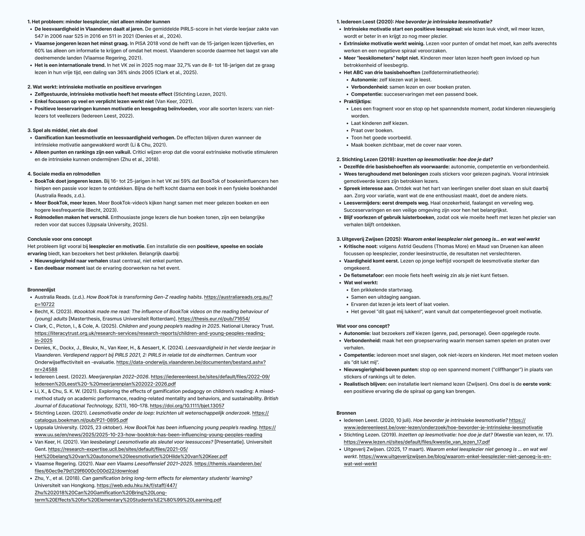

## What we did

We looked for research on reading motivation, existing solutions and trends.

## Key insights

- Reading skill in Flanders keeps dropping (PIRLS: 547 in 2006 → 511 in 2021).
- The problem is mainly **reading pleasure and motivation**, not only skill.
- Motivation grows from 3 needs: **autonomy** (choosing yourself), **relatedness** (doing it together) and **competence** (feeling "I can do this").
- Rewards like points or stickers don't help much. Curiosity works better.

## Existing solutions and inspiration

Boektopia's own scavenger hunt and listening huts, Short Story Dispensers, teamLab, Text Rain, Meow Wolf.

## What this means for us

Free choice, quick success, a shared moment, and curiosity as the reward.

## Sources

- Australia Reads. (n.d.). *How BookTok is transforming Gen-Z reading habits*. https://australiareads.org.au/?p=10722
- Becht, K. (2023). *#booktok made me read: The influence of BookTok videos on the reading behaviour of (young) adults* [Master's thesis, Erasmus University Rotterdam]. https://thesis.eur.nl/pub/71654/
- Clark, C., Picton, I., & Cole, A. (2025). *Children and young people's reading in 2025*. National Literacy Trust. https://literacytrust.org.uk/research-services/research-reports/children-and-young-peoples-reading-in-2025
- Denies, K., Dockx, J., Bleukx, N., Van Keer, H., & Aesaert, K. (2024). *Leesvaardigheid in het vierde leerjaar in Vlaanderen. Verdiepend rapport bij PIRLS 2021, 2: PIRLS in relatie tot de eindtermen*. Centrum voor Onderwijseffectiviteit en -evaluatie. https://data-onderwijs.vlaanderen.be/documenten/bestand.ashx?nr=24588
- Iedereen Leest. (2020, July 10). *Hoe bevorder je intrinsieke leesmotivatie?* https://www.iedereenleest.be/over-lezen/onderzoek/hoe-bevorder-je-intrinsieke-leesmotivatie
- Iedereen Leest. (2022). *Meerjarenplan 2022–2026*. https://iedereenleest.be/sites/default/files/2022-09/Iedereen%20Leest%20-%20meerjarenplan%202022-2026.pdf
- Li, X., & Chu, S. K. W. (2021). Exploring the effects of gamification pedagogy on children's reading: A mixed-method study on academic performance, reading-related mentality and behaviors, and sustainability. *British Journal of Educational Technology, 52*(1), 160–178. https://doi.org/10.1111/bjet.13057
- Stichting Lezen. (2019). *Inzetten op leesmotivatie: hoe doe je dat?* (Kwestie van lezen, No. 17). https://www.lezen.nl/sites/default/files/kwestie_van_lezen_17.pdf
- Stichting Lezen. (2021). *Leesmotivatie onder de loep: Inzichten uit wetenschappelijk onderzoek*. https://catalogus.boekman.nl/pub/P21-0895.pdf
- Uitgeverij Zwijsen. (2025, March 17). *Waarom enkel leesplezier niet genoeg is … en wat wel werkt*. https://www.uitgeverijzwijsen.be/blog/waarom-enkel-leesplezier-niet-genoeg-is-en-wat-wel-werkt
- Uppsala University. (2025, October 23). *How BookTok has been influencing young people's reading*. https://www.uu.se/en/news/2025/2025-10-23-how-booktok-has-been-influencing-young-peoples-reading
- Van Keer, H. (2021). *Van leesbelang! Leesmotivatie als sleutel voor leessucces?* [Presentation]. Ghent University. https://research-expertise.ucll.be/sites/default/files/2021-05/Het%20belang%20van%20autonome%20leesmotivatie%20Hilde%20van%20Keer.pdf
- Vlaamse Regering. (2021). *Naar een Vlaams Leesoffensief 2021–2025*. https://themis.vlaanderen.be/files/60ec9e79d129f6000c000d22/download
- Zhu, Y., et al. (2018). *Can gamification bring long-term effects for elementary students' learning?* University of Hong Kong. https://web.edu.hku.hk/f/staff/447/Zhu%202018%20Can%20Gamification%20Bring%20Long-term%20Effects%20for%20Elementary%20Students%E2%80%99%20Learning.pdf
