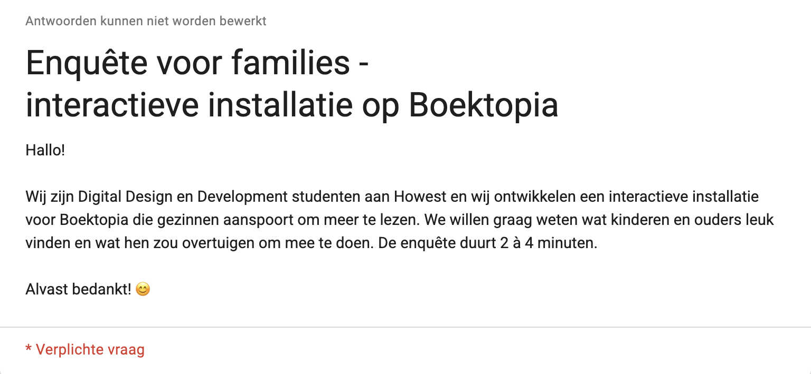

## What we did

We made a short survey (max. 4 minutes) for Boektopia visitors, with questions for the parents and the children.

## What we ask

Age, how often they read, what stops them from reading, favourite genres, what activity they'd like most, how long they want to wait, and "I would read more if…".

## Where

Online, and via friends and family.

**Link:** [forms.gle/PnyUvV8ajz6ASmfdA](https://forms.gle/PnyUvV8ajz6ASmfdA)

## Results

See [Survey results: what families want](../2026-10-29-survey-results/).
