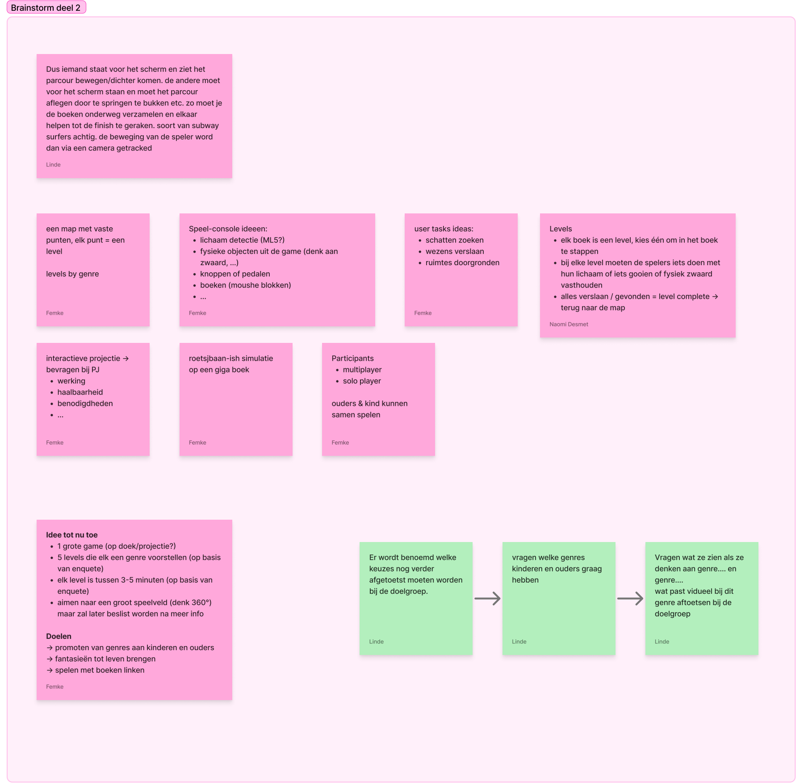
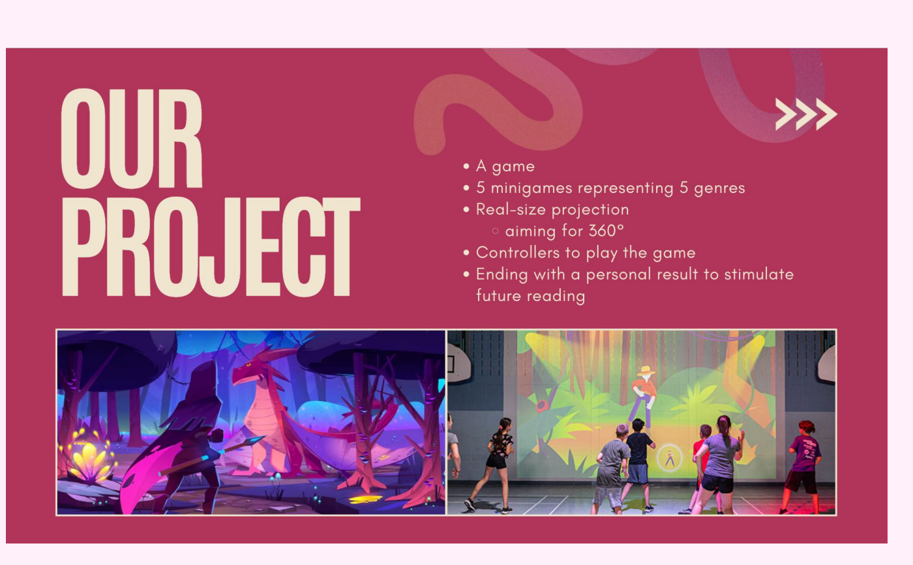
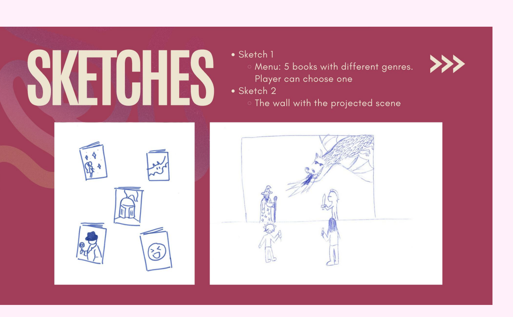

## What we did

We held a second brainstorm. We started from Book Runner, the duo game from our [first ideation](../2026-10-29-ideation/), and built on it.

Ideas that came up:

- **A map with fixed points**: every point is a level, and every level is a genre.
- **Levels as books**: you pick a book to step into the story. You complete a level by defeating everything or finding everything, and then you go back to the map.
- **Ways to play**: body detection (ML5), physical objects from the game such as a sword, buttons or pedals, books as building blocks.
- **Player tasks**: finding treasures, defeating creatures, exploring spaces.
- **Players**: multiplayer and solo, so parents and children can play together.

We dropped the **Magic Mirror**. Our [survey](../2026-10-29-survey-results/) showed that families want to be active and reach a goal together, and in front of the mirror there isn't much to do. We also don't think a screen that big is feasible.

## Our concept so far

- **One big game**, projected life size on the walls.
- **Five mini games**, each representing a genre. The genres are based on our [survey](../2026-10-29-survey-results/).
- **3 to 5 minutes** per mini game, also based on the survey.
- **Aiming for 360°**, so you stand right inside the story. We'll decide this once we know more about the space.
- **Controllers** to play the game.
- **A personal result** at the end, to encourage reading after the event.

Our first sketches: a menu with five books in different genres, and the wall with the projected scene.

## Why this direction?

**Our goals:**
- Introduce children and parents to different genres
- Bring fantasies to life
- Link playing to books

**A technical choice:** we looked into a 2D lidar to detect throwing, but it was too expensive and too complex. That's why we went for games with **controllers**. We'll ask our teacher PJ how an interactive projection works, how feasible it is and what we need.

## Next steps

Some choices still need to be tested with our target audience:

- Which genres do children and parents like?
- What do they picture when they think of a genre? What fits a genre visually?
