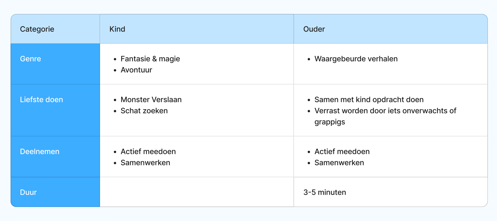
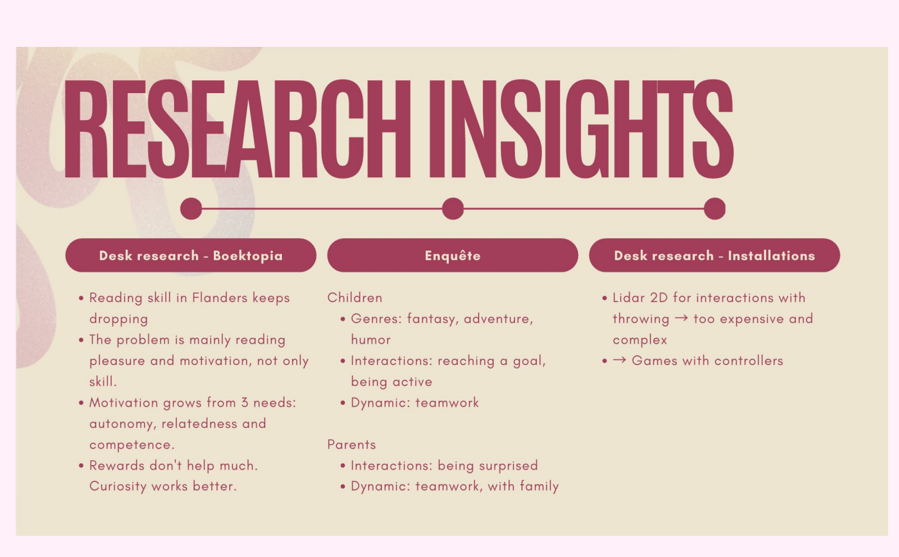

## What we did

We went through the answers to our [family survey](../2026-10-28-survey/) and summarised them per question for children and parents.

**11 families** filled in the survey (28–30 October). In 8 of them, at least one child is 6 to 8 years old.

## The numbers

Families could pick more than one answer, so the numbers show how many of the 11 families chose each option.

**Children**

| Question | Most chosen |
| --- | --- |
| Genres | Adventure (8), humour (7), fantasy & magic (6), informative books (6), fairy tales (4) |
| What would excite them | Finding a treasure (9), defeating a monster (8) |
| What makes them join | Being active (7), playing against each other (7), working together (6), everyone gets a role (4) |
| How often they read | (Almost) every day (5), a few times a week (2), now and then (2), (almost) never (2) |

**Parents**

| Question | Most chosen |
| --- | --- |
| Genres | True stories & non-fiction (8), romance (5), mystery & detective (4) |
| What would excite them | Doing a task together with their child (8), being surprised by something unexpected or funny (7) |
| What makes them join | Being active (7), working together (5) |
| Duration | 3–5 minutes (7), 1–3 minutes (3), more than 5 minutes (1) |

One parent wrote that their young children are a bit scared to do something like this alone in a public place, so they'd rather do it together as a family.

## What we learned

| | Children | Parents |
| --- | --- | --- |
| **Genre** | Fantasy & magic, adventure | True stories |
| **Favourite activity** | Defeating a monster, finding a treasure | Doing a task together with their child, being surprised by something unexpected or funny |
| **Taking part** | Being active, working together | Being active, working together |
| **Duration** | | 3–5 minutes |

- Children don't want to sit and watch: they want to **move and reach a goal**.
- Parents don't want to stand on the side: they want to **play along** with their kids.
- **3 to 5 minutes** is long enough for a full experience and short enough to avoid long queues, which fits the client's demand for high throughput.

## What this means for us

These results shaped our concept: an active game families play together, in genres children love, that lasts a few minutes. We combined them with our desk research in one overview:

Humour (7) and informative books (6) also scored high with children, and playing against each other (7) was as popular as being active (7).

<!-- TODO: what do you do with humour, informative books and competition? And parents prefer true stories while children prefer fantasy: how do you deal with that? -->
<!-- TODO: most children in our survey already read a lot; only 2 of 11 (almost) never read. What does that mean for your results, since non-readers are the group Boektopia most wants to reach? -->
