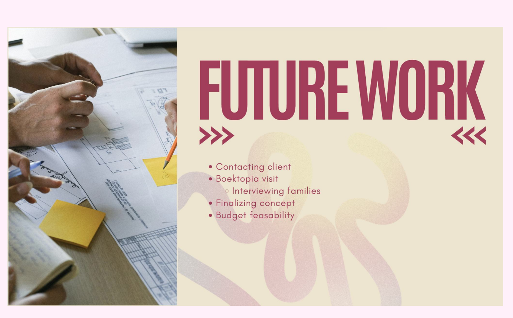

## What we did

We recorded a pitch video for Boektopia instead of presenting live. We built on our [pitch to our peers](../2026-10-30-pitch-to-peers/) and used their feedback.

**What's in the video:**
- Our How Might We question
- Target audience and personas
- Research methods and insights
- Our concept, sketches and possible genres
- The user flow
- The why, how and what (golden circle)
- A short look at the technical side
- Future work

Following our peers' advice, we added the How Might We question and the user flow, and kept the technical setup brief. We'll go into it in more depth after we've talked to the client and visited Boektopia.

## Status

We've sent the video to Boektopia and are waiting for their reaction. We'll write a separate post about their feedback.

<!-- TODO: add a link to the video if you want to share it -->
