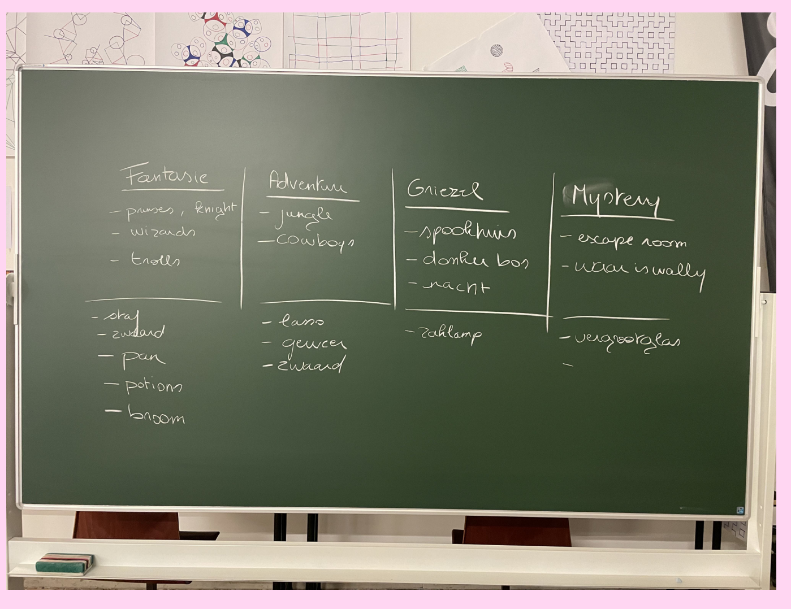
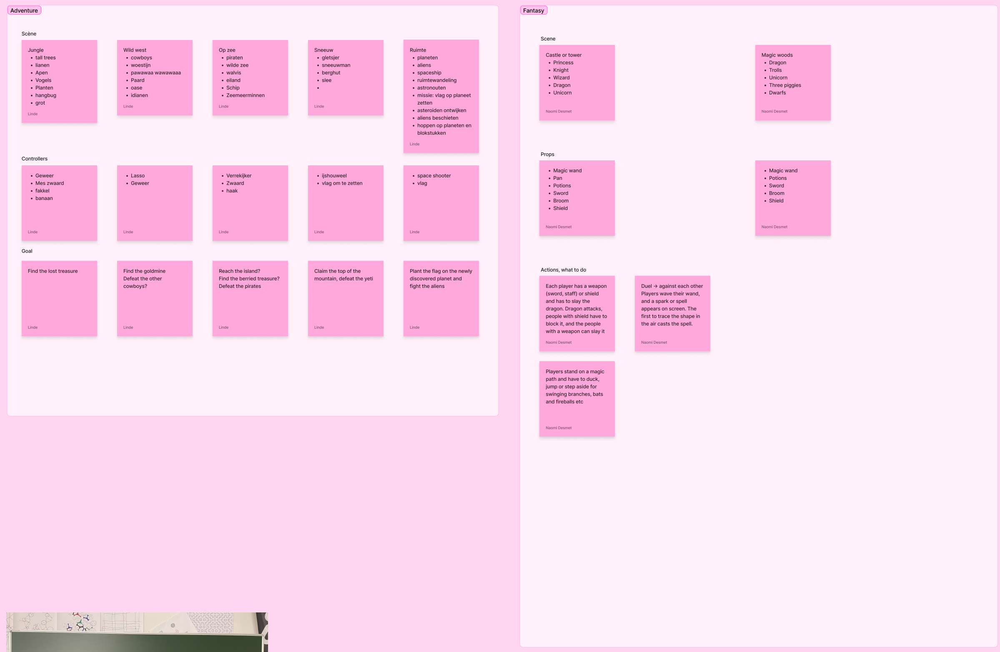
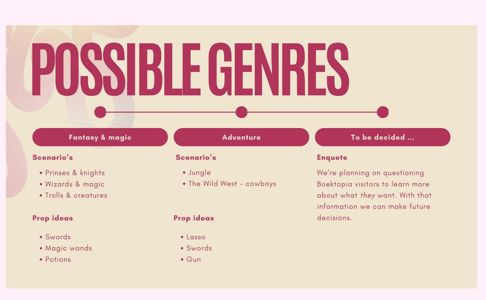

## What we did

For every genre we looked for possible **scenes**, **controllers or props**, and a **goal** for the players. We started with a quick brainstorm on the whiteboard: fantasy, adventure, scary and mystery.

Then we worked it out on our FigJam board:

## Adventure

| Scene | Controllers / props | Goal |
| --- | --- | --- |
| Jungle: tall trees, vines, monkeys, birds, a cave | Gun, knife or sword, torch, banana | Find the lost treasure |
| Wild West: cowboys, desert, horses, an oasis | Lasso, gun | Find the gold mine, defeat the other cowboys |
| At sea: pirates, wild sea, a whale, an island, mermaids | Telescope, sword, hook | Reach the island, find the buried treasure, defeat the pirates |
| Snow: glacier, snowman, mountain hut, sled | Ice axe, flag | Claim the top of the mountain, defeat the yeti |
| Space: planets, aliens, spaceship, astronauts | Space shooter, flag | Plant the flag on a new planet and fight the aliens |

## Fantasy

**Scenes:** a castle or tower (princess, knight, wizard, dragon, unicorn) or magic woods (dragon, trolls, unicorn, the three little pigs, dwarfs).

**Props:** magic wand, potions, sword, broom, shield, pan.

**What players do:**
- Each player has a weapon (sword, staff) or a shield. When the dragon attacks, the players with a shield block it and the players with a weapon slay it.
- Players stand on a magic path and have to duck, jump or step aside for swinging branches, bats and fireballs.
- A duel against each other: a spell appears on screen, and the first to trace its shape in the air with their wand casts it.

## Scary stories

Still to be worked out.

## What we presented

Fantasy & magic and adventure came out on top in our [survey](../2026-10-29-survey-results/). The other genres are still open, and we want to ask Boektopia visitors what they want.

<!-- TODO: which mini game do you like best so far, and why? -->
