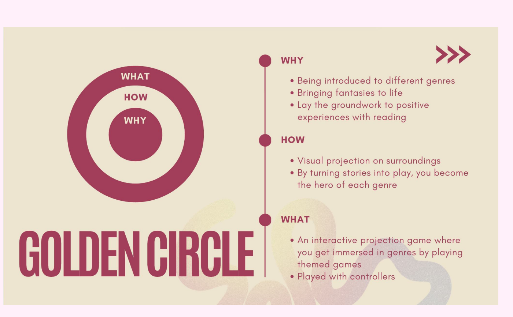
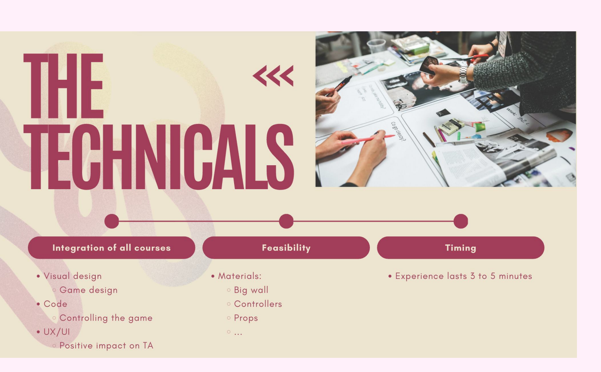

## What we did

We pitched our project to our classmates: our target audience, research insights, concept, sketches, the why/how/what of the project, the technical side and our next steps.

## Feedback we got

- **Add a user flow** to show how visitors move through the experience.
- **Leave out the technical setup** in the video for the client.
- **Attach the props** to the installation. Otherwise they may get stolen, or children won't want to let go of them.
- **Recommend books after the game**: "if you liked this, continue your story in these books".
- **Put our How Might We question literally in the slides.**

## What we did with it

For our pitch video for the client, we added a [user flow](../2026-10-30-user-flow/) and a How Might We slide. We kept the technical part short. The game now ends with book recommendations for the genre you played.

## What other groups are working on

- A quiz/riddle game to defeat a dragon in 3 minutes, with a results page to compete with others. We wondered whether text riddles work for children of 6, or for people with dyslexia.
- "Everyone's book": a story in three acts. You write the beginning together, experience the middle at Boektopia, and take a personal ending home as a souvenir.
- "A magical secret": a hidden academy with three trials for children aged 9 to 14, and a bookmark or stickers as a souvenir.
- "Wie zoekt die vindt": a projection with a physical bookcase, where children search for the right book based on riddles.

<!-- TODO: what did we take away from the other groups' ideas? -->
