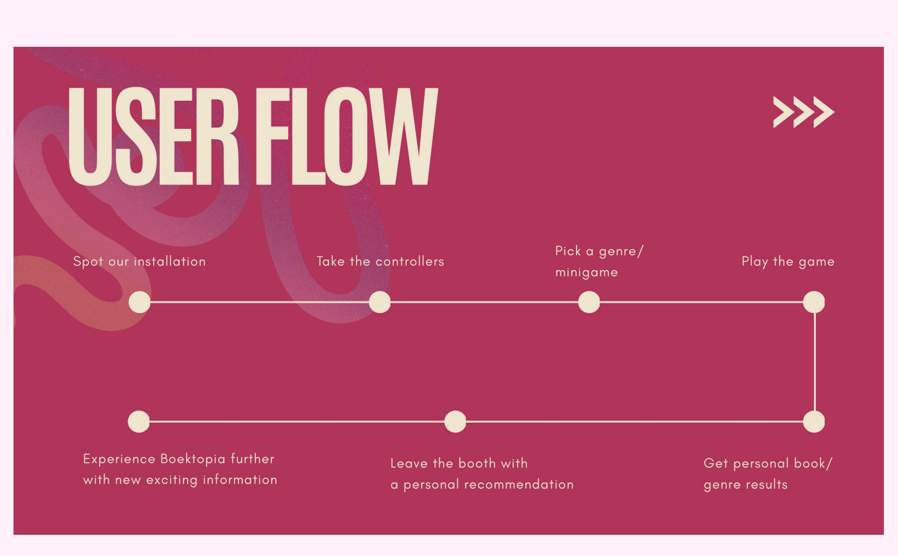

## What we did

After the [feedback from our peers](../2026-10-30-pitch-to-peers/), we mapped out how a family moves through our installation.

## The full flow

1. Arrive at Boektopia
2. Spot our installation
3. Watch other players, or have a look at the installation
4. Take the controllers and look at the screen
5. Pick a genre (mini game)
6. Play the mini game and beat it
7. Put the controllers back
8. Get results that bring you back to the real world: Flemish books recommended for the genre you just played
9. Scan the QR code to save the recommended books
10. The game goes back to its home screen. *Not happy with the result? Play another genre.*
11. Leave the booth with new ideas for what to read next
12. Maybe find some of the recommended books at Boektopia

## Why this flow?

The flow ends **outside** our installation, at the book stands. Our game should be a first spark, and the recommendations are the bridge to actual books.

<!-- TODO: anything you'd still change or want to test in this flow? -->
