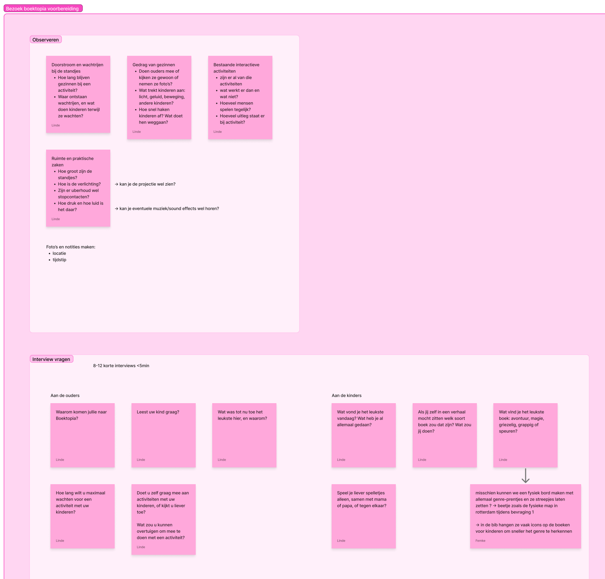
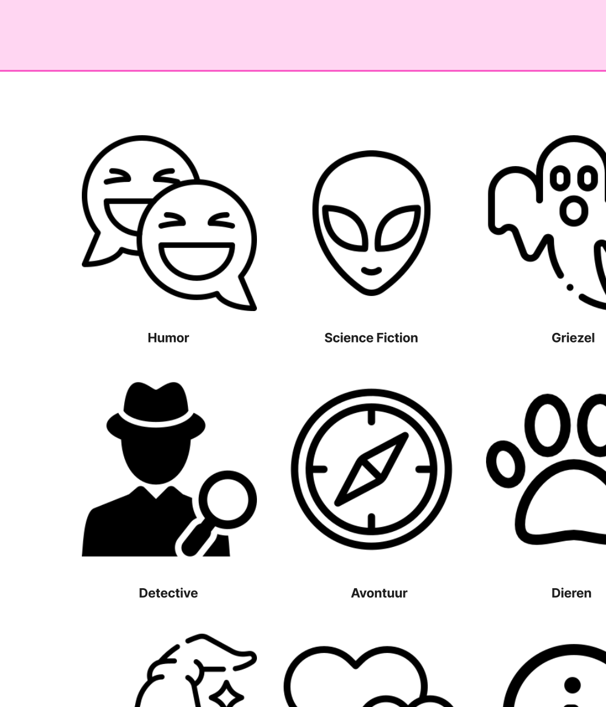

## What we did

On Monday 2 November we're visiting Boektopia in Kortrijk Xpo. To get the most out of it, we prepared what we want to observe and which questions we want to ask.

## What we'll observe

- **Flow and queues:** how long do families stay at an activity? Where do queues form, and what do children do while they wait?
- **Family behaviour:** do parents join in, just watch, or take pictures? What attracts children: light, sound, movement, other children? How quickly do they lose interest, and what makes them leave?
- **Existing interactive activities:** what works and what doesn't? How many people play at the same time? How much explanation is there?
- **Space and practical matters:** how big are the stands? What's the lighting like, and could you see a projection? Are there power sockets? How busy and loud is it, and could you hear music or sound effects?

We'll take photos and notes, and write down the location and time.

## Interview questions

We're aiming for **8 to 12 short interviews** of less than 5 minutes.

**For parents**
- Why did you come to Boektopia?
- Does your child like to read?
- What has been the most fun so far, and why?
- How long would you wait for an activity with your children?
- Do you like to join activities with your children, or do you prefer to watch? What would convince you to join?

**For children**
- What did you like most today? What have you done so far?
- Do you prefer playing games alone, with mum or dad, or against each other?
- If you could be in a story, what kind of book would it be? What would you do?
- What's the best kind of book: adventure, magic, scary, funny or detective?

## A genre board

Instead of only asking about genres, we could make a **physical board with genre pictures** where children put a tally mark. Libraries often put icons on children's books so they can recognise the genre quickly, so we collected some of those as inspiration.

