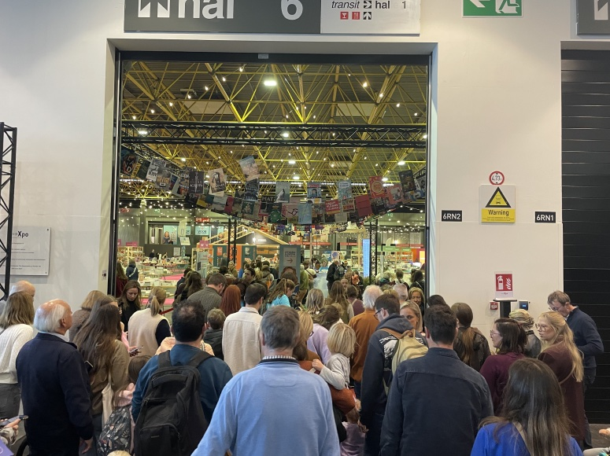
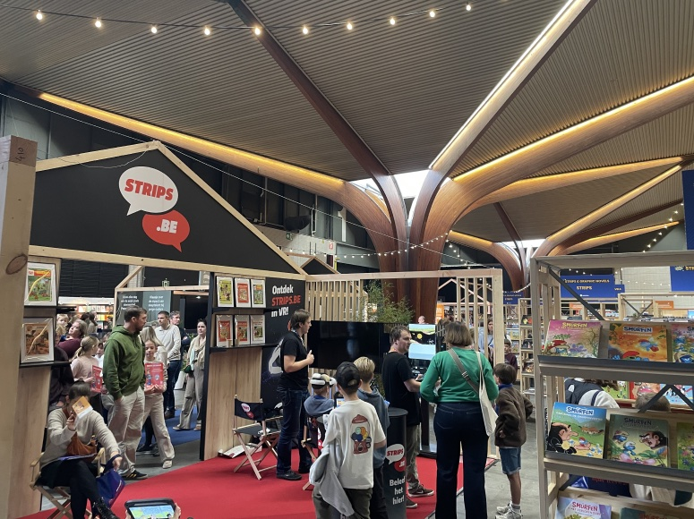
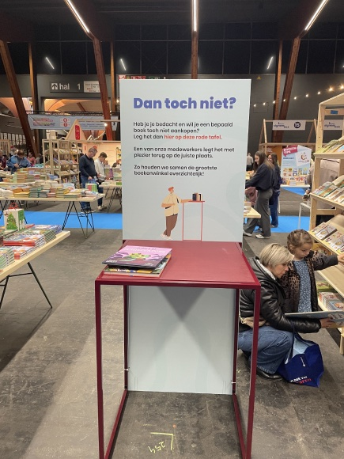
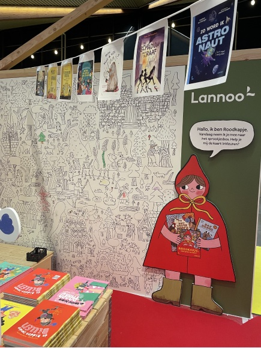
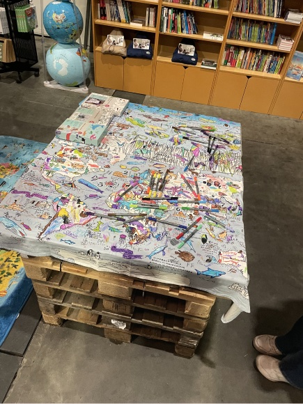
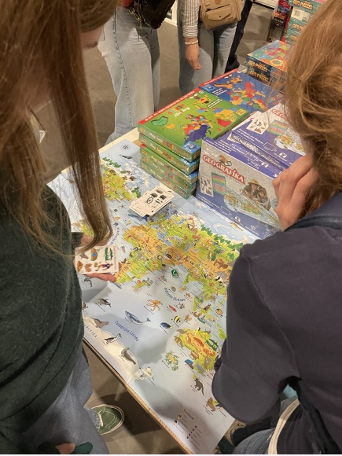

## What did we do?
On Monday 2 November we arrived at Boektopia when the doors opened at 9:30. We spent the first half hour exploring the fair, and then we started interviewing. We were looking for parents with children between 6 and 12 years old, and we managed to talk to 12 families. You can find the questions we prepared in [Preparing our Boektopia visit](../2026-11-01-preparing-boektopia-visit/).

## What did we learn?

**At opening, Monday 2 November at 9:30**

- A lot of people were already queueing.
- Many children came along, and we noticed a lot of very young ones, like toddlers.
- Hall 1, the first one you walk into, has the adult books. After a while we noticed that many people went straight to the children's books hall. Some families split up later.

**The layout of hall 2**

- The halls were divided by colour: in the signs, the carpets and so on.
- Some booths were very spacious and fully styled, like this VR comics booth. Up to 15 people could easily walk in at the same time.
- We didn't quite get the VR part. To us it looked like simply reading comics with a VR headset on.

**"Dan toch niet?" tables**

- A bit like in the library: you leave a book you no longer want on a general table, and staff put it back. Very handy at a big fair like this.
- The tables in the children's books hall were noticeably fuller than the ones for adults.

**Colouring wall**

- We often saw a parent and a child colouring together on this wall. They both took part in the activity.

**Colouring pallet**

- This pallet stands right by the entrance, in the adult books hall. Even so, it was already almost fully coloured in, although the fair had only been running for a few days.

**Entertainment in between**

- People are very curious and quickly drawn to things that are laid out to try. We picked up this card game ourselves straight away, purely out of curiosity.

### General observations

#### A family day out

- There were a lot of children in the morning.
- It really is a family activity, almost a whole-day trip, food included.
- We didn't hear a single child say they were bored. They were all enthusiastic and curious, browsing through the books or doing an activity. This was especially true for children over 6.
- Many older children walked around without staying close to their parents. They went to look at the books on their own, sometimes with a brother or sister.
- Children under 6 mostly stayed in hall 3, with the bouncy castles: a whole hall of children's fun with several bouncy castles and a letter maze.
- Once, we heard over the speakers that a child had got lost.

#### Space and organisation

- The adult and children's sections are clearly separated, mainly by the separate halls, but also by colour coding.
- There are a lot of tills and queue barriers.
- In the play hall there were plenty of seats for parents and a lot of food stalls. With play equipment around the edge and seats and stalls in the middle, it felt like a playground or picnic park.
- We wondered how they keep books from being stolen. Sold books get an eye-catching sticker, and security checks it when you walk out.

#### Activities

- Some activity booths gave children a small goodie, like a comic strip they made themselves. Afterwards you could see how proud every child was of what they had made.
- Overall it was very busy, with many possible walking routes and lots of booths in between. That made us think a very large installation might be off the table, unless a booth can be as big as the treasure hunts ("Speurtochten"). Realistically, that's too ambitious. Update: the client has since confirmed they want a smaller installation.

## Next steps

- **Bring the observations into our ideation:** we use what we saw at Boektopia as input while we keep working out our concept.
- **Design for a smaller space:** the space will be more limited than we first thought, so we'll look into what an installation of that size can and can't do.
- **Pin down the mini-games:** we want to decide on the [mini-games](../2026-10-30-mini-games/) and start building our ideas around them, if they still fit the concept.
