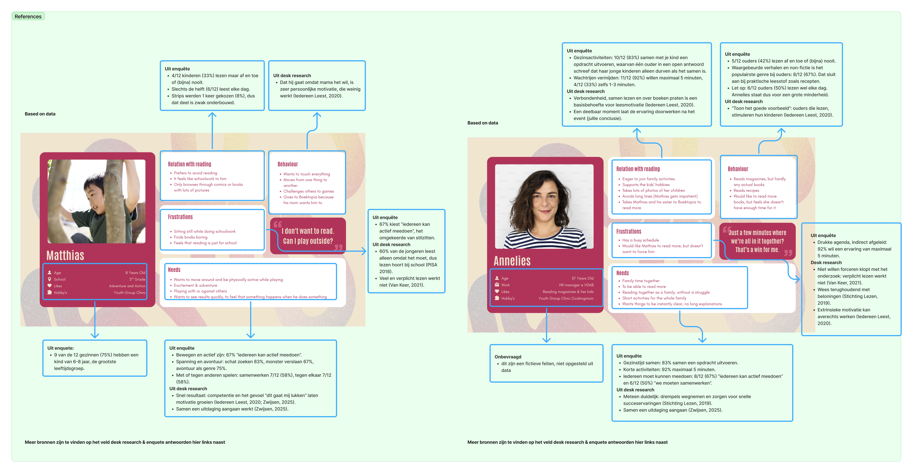

## What did we do?

We had a consult with the UX expert desk. We showed where we stood with our research, personas, How Might We questions and mini-games, and asked for feedback.

## Feedback

### Look beyond reading

- **Don't get stuck in a tunnel.** Many teams only research their own theme, but other fields can be just as inspiring: psychology, philosophy, the world in general.
- For example, **playful learning**: how do children play, and what patterns show up when they play?
- Use research outside of reading to find out which concepts work and which don't, and how to make ours stronger.

### Personas

- Everything in a persona has to come from research. You should be able to say right away: "this comes from there, that comes from there, this is general."
- So **add references** to show where each part comes from.

### How Might We question

- "What fits them" is still a bit vague.

### Mini-games

- **5 minutes is very long.** With a long queue, the waiting time adds up quickly.
- **Mini-games can be very simple.** The expert told us about an installation where you helped build a dam: wherever you stepped, earth appeared. It took 20 to 30 seconds, several people could play at once, and that was more than enough.
- **Better without points.**
- **Stick to one objective** per game.

### What they expect at the beta pitch

- The **techniques** we used.
- The **research** we did.
- **Inclusivity.** They really want to see that we thought about it, for example colour use, an option to adjust things, or suggestions.
- **Deep insight into our target audience:** their needs and values. Our audience is split (children and parents), so we should profile both.
- **Impact on the world around us:** more-than-human design. It won't fit everywhere, but do we think about sustainability and durability? Don't build the craziest installation that just gets thrown away afterwards.
- **The added value for the target audience** once they walk away from the installation.

## What did we do with it?

- We started [extra research beyond books](../2026-11-10-broader-research/): [playful learning](../2026-11-10-broader-research/#playful-learning), [inclusivity](../2026-11-10-broader-research/#inclusivity), [more-than-human design and sustainability](../2026-11-10-broader-research/#more-than-human-design-and-sustainability), [psychology](../2026-11-10-broader-research/#psychology), [the needs and values of our target audience](../2026-11-10-broader-research/#needs-and-values-of-our-target-audience) and [the impact after the event](../2026-11-10-broader-research/#impact-after-the-event).
- We shortened our mini-games to **1 to 2 minutes** each.
- We made our How Might We question more specific:

> How might we combine play and reading, so families with children aged 6 to 12 at Boektopia can step into different literary genres, discover which genre suits the children best, and leave with a positive experience that makes them want to read?

### References for our personas

We added references to our [personas](../2026-10-29-personas/), Matthias and Annelies. Each part of a persona now links to where it comes from: our survey, our desk research, or both. For example, Matthias wanting to move around while playing comes from the survey, where 67% chose "everyone can actively join in". Annelies's busy schedule comes from the survey too: 92% want an experience of 5 minutes at most.

We also marked what is **not** based on data. Annelies's personal details, like her job and hobbies, are fictional and only there to make her feel real.

## Next steps

- Keep each mini-game simple, with one objective and no points.
- Prepare the beta pitch around the points above.
