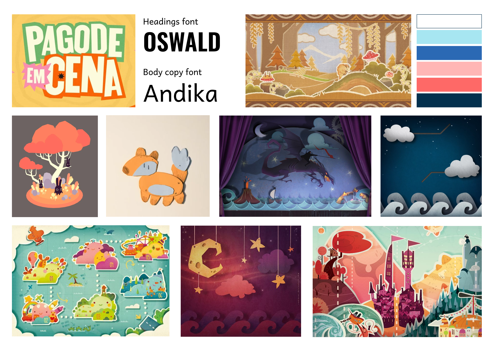
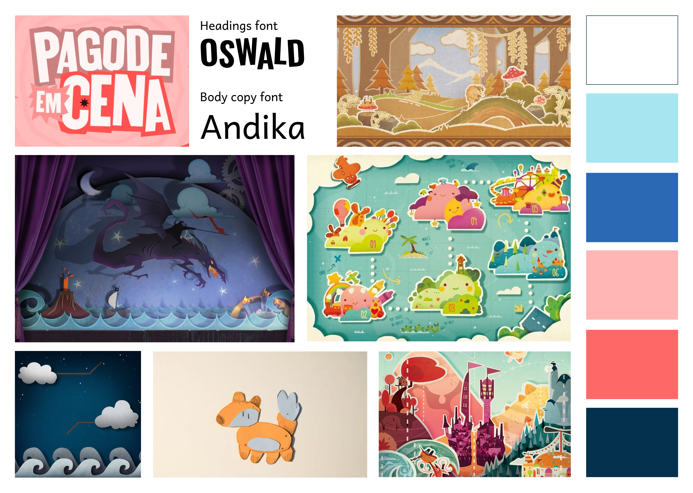

## What did we do?

We started by looking for visual inspiration on Pinterest. There, we found a paper-theatre-like style. This creates a stronger connection with books through the visual language.

We used Boektopia's colour palette, especially its blue and pink. We also plan to add extra colours for each genre, so every genre has its own identity and can be distinguished from the others.

For the typography, we chose a basic font and plan to make it look like it has been cut out. Each genre will also have its own variation of the font to strengthen its identity.

We discussed our first style board during a [visual design consultation](../2026-11-11-vd-consult-1/) (coming soon).

For the client meeting, we created a more refined style board, which you can read about in our post about [client meeting 1](../2026-11-12-client-meeting/) (coming soon).

Our visual style was approved, so we can now start developing the assets and composing our scenes.

## What did we learn?

We learned that a consistent visual language can make the connection between our installation and books clearer. Giving each genre its own colours and typography can help users recognise and distinguish the different genres while keeping the overall style cohesive.

## Why this direction?

The paper-theatre inspiration makes the project feel tangible and connects to the world of books. Boektopia's blue and pink provide a recognisable starting point, while the genre-specific colours and typography allow each genre to develop its own identity.

## Next steps

We will work out the visual assets and the composition of our scenes. We will also develop the genre-specific stylizations (extra colors and fonts).
