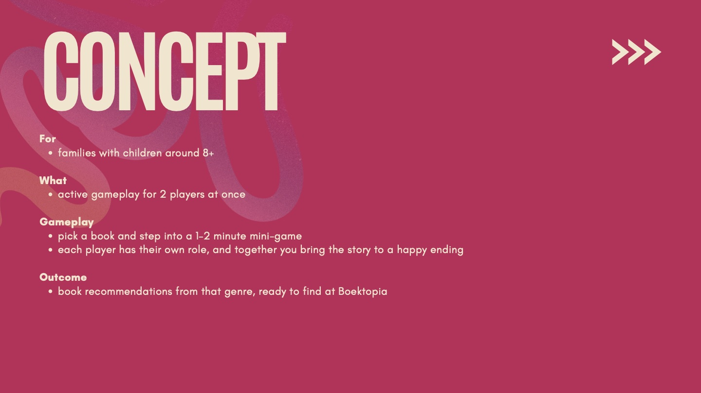
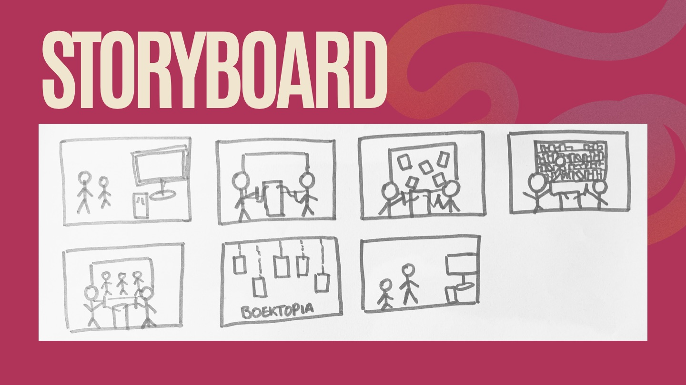
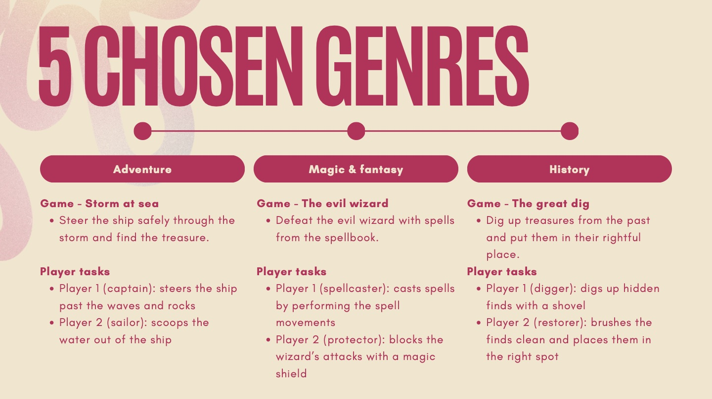
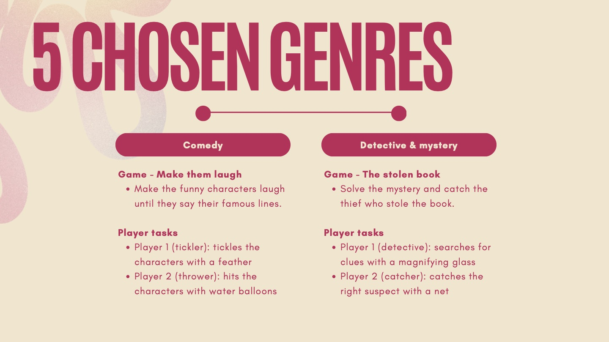
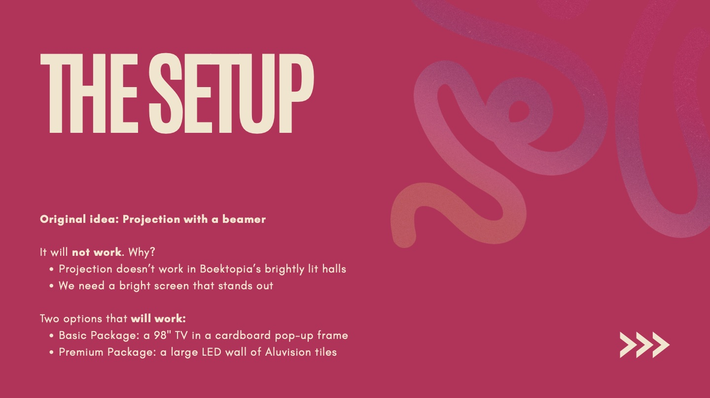
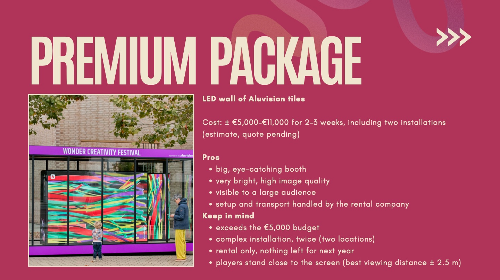
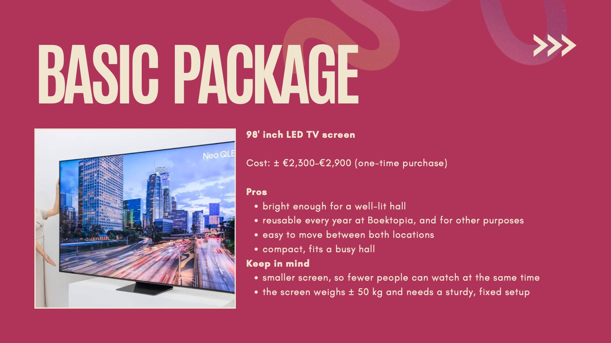
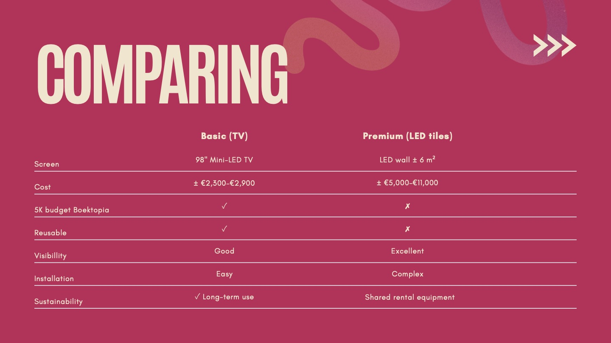
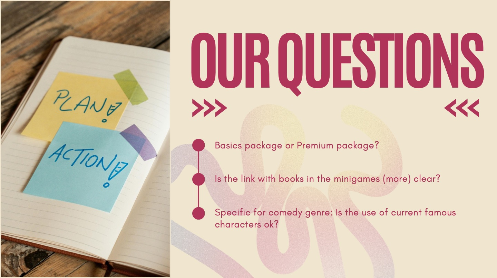

## Meeting prep

Before the meeting, we did a lot of new research and worked out our mini-games on paper. We put all the new information in a slide deck. For the installation, we gave the client a choice between two packages, each with its own budget, size and impact. We also prepared some questions we needed answered to move forward, like whether we can use famous characters and whether the link with books is clearer now.

### Concept

### Five genres, five mini-games

Each genre gets its own mini-game, where both players have their own role.

### The setup

Our original idea was to project the game with a beamer. That won't work: Boektopia's halls are brightly lit, so we need a bright screen that stands out. We worked out two options.

### Our questions

## The meeting

We planned an online meeting on Teams at 10 a.m. The call took about 15 minutes.

## Feedback from the client

### The screen

- **LED wall:** they wouldn't rent an LED wall themselves either so renting is a good solution.
- **TV:** visually, it doesn't have enough impact. They wouldn't go for it.
  

### The link with books

- Several groups came up with similar ideas. Seeing our presentation felt like "we've seen that before". She liked the angle of some other groups better.
- It still feels like playing a game that happens to be about books. "It's a good game, but why is it at Boektopia?"
- The games have to be filled with reading and books in their content.
- Genres also exist in films. So for each genre, use references that really come from books. Sherlock Holmes, for example, is a book reference for detective.
- She really liked the **book tips at the end**. Maybe we could add a task there, like a riddle that makes you go look for the book. Linking back to the books on display is nice, but there has to be a reason to go and look at them.

### Famous characters for comedy

- Using famous characters is okay.
- A character like Lambik is more timeless.
- So: take specific elements from well-known books, not just from one book.

## What does this mean for us?

- We need to find a different screen solution that has enough visual impact, but still fits the budget and the space.
- Books have to be at the heart of each mini-game, not just the genre. We'll look for references from well-known children's books for every genre.
- We'll work out the book tips at the end, and give families a reason to go and find the books.

## Next steps

Our next meeting with the client is on Tuesday morning, around 9 a.m. or just before noon.
