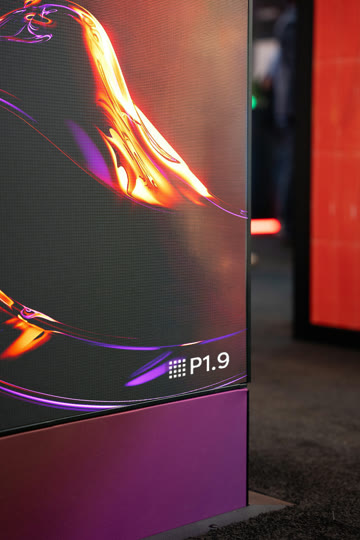
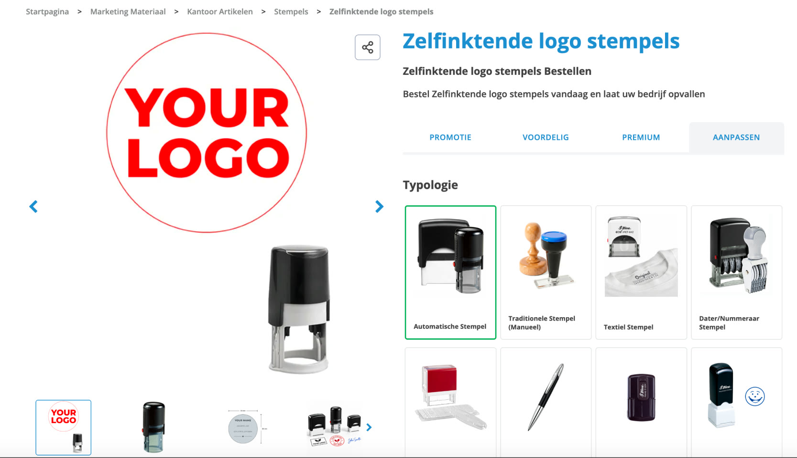

## Where we started

At the [development consult](/posts/2026-11-13-dev-consult/), the expert told us:

- A real Wii Remote is very hard to use, but a **Wii Nunchuk** is possible. It has an accelerometer inside that measures its position, and it works with a cable, so it's always attached to something.
- A **separate accelerometer** is also an option, but then we have to add the cable ourselves.
- We need **everything twice**, once for each player.
- **Order early**, compare the options and their prices, and start trying them out. Delivery times are long, so we shouldn't wait for the design.

So this research was only about the controllers: which option fits our games, what exactly we need to buy, and how we can test it as fast as possible.

## Wii Nunchuk vs. a separate motion sensor

| | Wii Nunchuk | Separate motion sensor (IMU) |
| --- | --- | --- |
| **What's inside** | Accelerometer (3 axes), joystick, 2 buttons | Accelerometer + gyroscope, e.g. MPU-6050 or BNO085 |
| **What it measures** | Tilting and shaking | Tilting, shaking **and turning** |
| **Casing** | ✓ Ready-made, ergonomic and sturdy | ✗ We have to design and make it |
| **Buttons** | ✓ Two built in | ✗ We have to add them |
| **Cable** | ✗ Short (± 1 m) with its own plug, needs an adapter | ✓ We choose the length |
| **Connecting** | ✓ Easy with an adapter and existing Arduino libraries | ✗ Soldering and wiring |
| **Style** | ✗ Looks like a Nintendo part, hard to fit into our paper style | ✓ Can be shaped to match our style board |
| **Price** | ± €5–10 for a copy, more for an original; adapter ± €2–5 | MPU-6050 ± €3–5, BNO085 ± €20–30 |
| **Development time** | ✓ Works quickly | ✗ More work, more chance of problems |
| **Theft** | ✗ Thin cable, so a steel cable is still needed | Same, needed in both cases |

## What does this mean for our mini-games?

| Movement | Game | Nunchuk | Sensor with gyroscope |
| --- | --- | --- | --- |
| Turning a steering wheel (tilting) | Adventure | ✓ | ✓ |
| Scooping water, digging | Adventure, history | ✓ | ✓ |
| Shaking, throwing, tickling | Comedy | ✓ | ✓ |
| Pointing at the screen (magnifying glass, net) | Mystery | ± By tilting it like a joystick | ✓ Better |
| Drawing shapes in the air (spells) | Fantasy | ± Hard, only by tilting | ✓ Much better |

The Nunchuk can do everything that has to do with **tilting and shaking**. For **pointing and drawing** it falls short, because it doesn't measure turning around the vertical axis. We can work around that by using tilt like a joystick, where the cursor moves in the direction you tilt. That works, but it feels less natural.

This is all **on paper**, based on what the parts should be able to do. We don't know yet if it really works like this in our games. That's exactly why we're going to test both options: to prove which one works best, instead of choosing based on assumptions.

## Parts we need

### Option A: Wii Nunchuk

| Part | Amount | ± Price each | Status |
| --- | --- | --- | --- |
| Wii Nunchuk, original, second-hand | 2 | €0 | We have 4: two of our own and two we can borrow |
| Adafruit Wii Nunchuck Breakout Adapter | 2 | €7–11 | Ordered |
| STEMMA QT/Qwiic cable to jumper wires | 2 | €1–3 | Ordered |
| ESP32 board | 2 | €0 | We have 3, bought earlier for school |
| *Optional:* Nunchuk extension cable, 1.8 m | 2 | – | Only if we choose this option |

**Pros:** works quickly, no casing needed, buttons built in.
**Cons:** only tilting and shaking, less good for pointing and drawing, and it looks like a Nintendo controller.

### Option B: separate motion sensor

| Part | Amount | ± Price each | Status |
| --- | --- | --- | --- |
| Adafruit BNO085 (with sensor fusion) | 2 | €30–40 | Too expensive just for testing, so we start with the cheaper option |
| *Cheaper:* MPU-6050 (GY-521 board) | 2 | €3–5 | Ordered |
| Small ESP32-S3 that fits in a staff | 2 | €8–15 | Only if we choose this option |
| STEMMA QT/Qwiic cable, short | 2 | €1–3 | – |
| Long, flexible USB-C cable (± 1.5–2 m) | 2 | €5–10 | Easy to find in a regular shop |
| Casing: 3D print in PETG, or wooden staffs | – | €10–30 | A teammate can 3D print it if we model it in Blender |

**Pros:** also measures turning, better for pointing and drawing, and we can give it our own shape.
**Cons:** more building and programming, and we have to make the casing ourselves.

### Needed for both options

| Part | Amount | ± Price each | Status |
| --- | --- | --- | --- |
| Arcade button 60–100 mm with LED | 3 | €5–15 | Not yet |
| Microcontroller for the buttons (ESP32 or Raspberry Pi Pico) | 1–2 | €5–10 | Not yet |
| Steel cable with sleeve and eye screws, or security reels | 2 | €10–40 | Not yet |
| USB hub with its own power supply | 1 | €15–30 | Not yet |
| Jumper wires + breadboard for testing | 1 set | €5–10 | We already have these from Creative Code |

## Why we're buying and testing both

Claude's advice was to order a full test kit of both options for about €100–150. We made it much smaller. We already had Nunchuks, ESP32 boards and jumper wires, so we only ordered the **three parts we were missing to test**. Everything else waits until we know which option we'll use. We ordered:

- 3 × MPU-6050 sensor (GY-521)
- I2C Qwiic/STEMMA QT cables
- Adafruit Wii Nunchuck Breakout Adapter

Together this cost **€36.14**, or about **€12 each** for the three of us.

We chose to test both options because:

- We want to find out which one works best for our games **based on real facts**, not on assumptions about what it can or can't do.
- If we only decide after thinking about it for a long time, the delivery times might be too long to order it all in time.
- It's cheap, so there's no big reason not to test.

## What exactly will we test?

- **Connection:** does the data arrive at the ESP32 steadily, without freezing?
- **Two controllers at once:** do two controllers work together without interference?
- **Cable length:** does the Nunchuk still work steadily with the 1.8 m extension cable?
- **Web Serial:** does the data reach the browser and Phaser?
- **Delay:** when you move the controller, does a dot on the screen follow right away, or is there a delay?
- **Movements:** shaking, tilting/steering, throwing/swinging, pointing, and drawing or following shapes.

We'll document every test with videos and photos, ratings and reviews, notes and our own experiences.

## Next steps

- Wait for the parts to arrive (between 19 and 24 November).
- Build a test setup for each option with the ESP32 and the breadboard.
- Run the tests above and write down the results.
- Choose one option and order the rest of the parts for it, for both players.

## Screen ratio: jury vs. final product

Our game may run on a different screen for the jury than in the final product for Boektopia. So we did some light research into what that means for the game.

The difference is only in **the screen** and **the computer**, not in the game or the controllers:

| | Jury (prototype) | Client (final version) |
| --- | --- | --- |
| **Screen** | Projection or a large TV | Rented Aluvision LED wall |
| **Computer** | Our own laptop | A separate mini-PC |
| **Game** | The same Phaser game | The same Phaser game |
| **Controllers and docking station** | The same | The same |

### What we have to keep in mind

- **An LED wall often has a different ratio than 16:9.** It is built from tiles of about 50 × 50 cm, so the ratio depends on how many tiles are rented. 6 × 4 tiles (± 3 × 2 m) is **3:2**, while 7 × 4 tiles (± 3.5 × 2 m) comes close to **16:9**. A projector or TV is almost always 16:9.
- **The resolution of an LED wall is lower than you'd think.** An Aluvision tile with a 2.5 mm pixel pitch has 192 × 192 pixels, so a wall of 6 × 4 tiles is only **1152 × 768 pixels**, less than Full HD. Small text and thin lines will be unreadable. Our paper style, with big shapes and thick white edges, actually fits this well.
- **The game always runs locally**, on our laptop for the jury and on the mini-PC for the client, so it doesn't matter whether there's wifi.

If we propose a wall of **3 × 2 m** (6 × 4 tiles), the ratio is 3:2. The resolution then depends on the pixel pitch:

| Pixel pitch | Pixels per tile | Resolution of the wall |
| --- | --- | --- |
| 2.5 mm | 192 × 192 | 1152 × 768 |
| 1.9 mm | ± 260 × 260 | ± 1560 × 1040 |
| 1.5 mm | ± 330 × 330 | ± 1980 × 1320 |

The values for 1.9 and 1.5 mm are estimates. We still have to ask the rental company for the exact numbers and which input resolution their system expects.

The client is quite sure they'll use an Aluvision LED wall, so we've contacted Aluvision. We'd like to visit their showroom to see the LED walls in real life and ask our technical questions, like the exact resolution per pixel pitch and which input their system expects.

### Our approach

So the game shouldn't depend on one fixed ratio:

- **One safe zone for everything important.** Players, buttons, text, timers and book recommendations always stay inside a central zone of about **1620 × 1080** that is visible on every screen.
- **A background bigger than needed.** We draw the background (sky, sea, bookcases, paper layers) on about **1920 × 1280**, so it covers both 16:9 and 3:2. On the 16:9 projector a bit of the top and bottom falls away, and on the 3:2 LED wall a bit of the left and right, but those parts are always outside the safe zone.
- **In Phaser** we start with the scale mode **FIT**, which always shows the whole image, with black bars where needed. Later we can switch to **EXPAND**, which fills the screen without black bars and fits this safe zone approach.
- Our designers draw the **safe zone as a frame** in every screen, and we make our paper layers at the back (sky, sea, curtains) wider and taller. We can test both ratios early by simulating a 1920 × 1080 and a 1920 × 1280 window in Chrome's developer tools.

For the jury demo we also want a dark enough room for the projector, test the colors on the real screen beforehand, run Chrome in full screen (kiosk mode), and bring a spare USB cable, extension cable and ESP32.

## Stamps

Besides the controllers, we're already thinking about the stamps. The technical side still has to be worked out, but this is our plan so far:

- **Round stamps** with our own design, ordered per piece.
- **5 stamps**, one for each genre, possibly each in a different color.
- They have to be **self-inking**, with their own ink storage. Loose stamps with a separate ink pad dry out faster and are easier to vandalise.
- When the ink runs low, the ink pad can simply be replaced or refilled with a few drops.
- Each stamp has to be **attached to a stamp stand**, so it can't be stolen.

We found two shops where we can design and order our own self-inking stamps: [VistaPrint](https://www.vistaprint.be/) and [Bizay](https://www.bizay.be/).

