## Why these slides?

Our second meeting with the client is a call on **17 November at 9 a.m.** Just like at our [first client meeting](../2026-11-12-client-meeting/), the slides are a common thread for the client: they show where we stand and what we're working on.

You can leaf through the slides here:

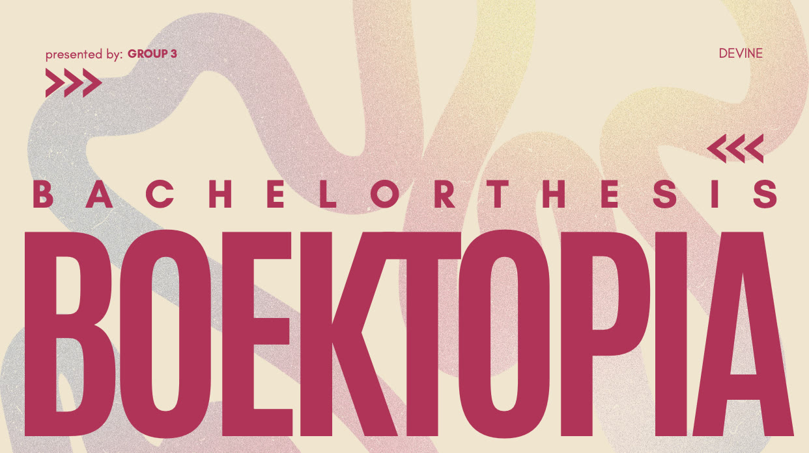

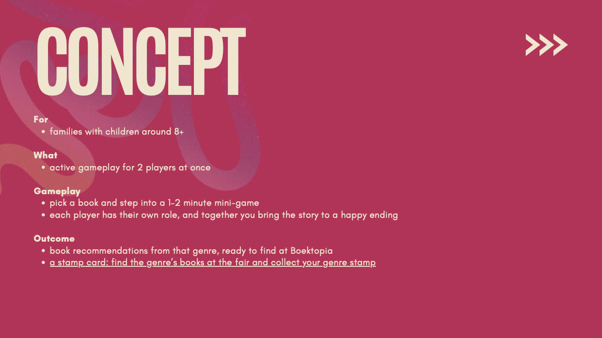

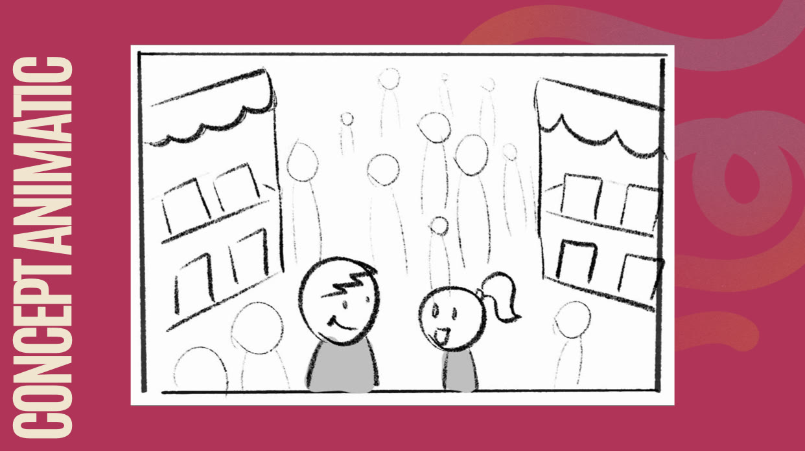

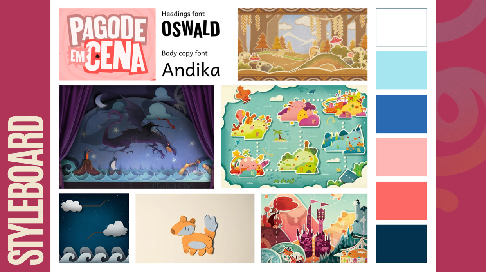

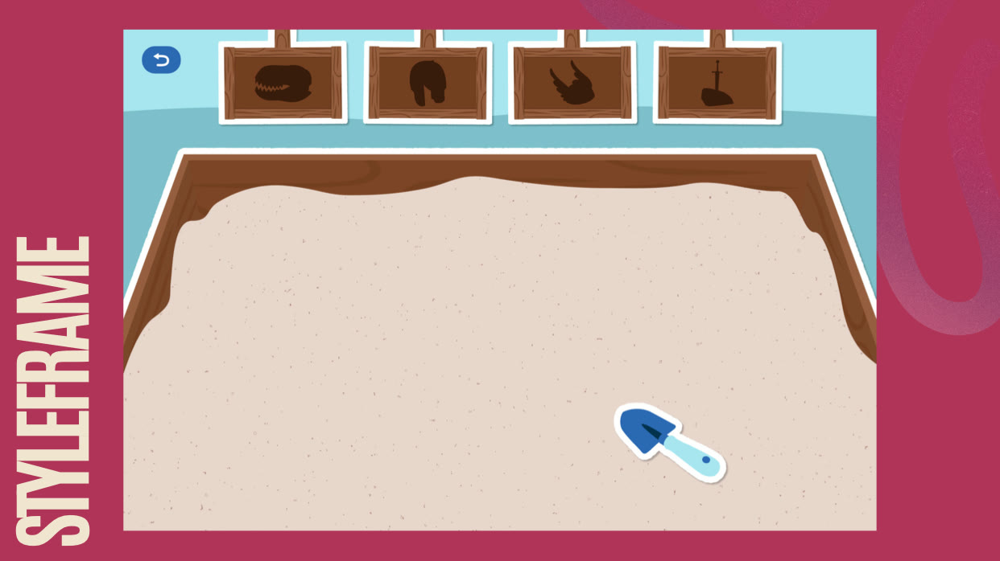

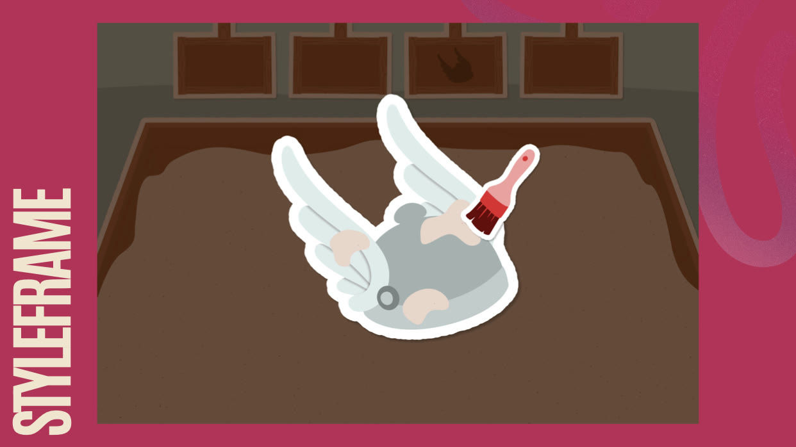

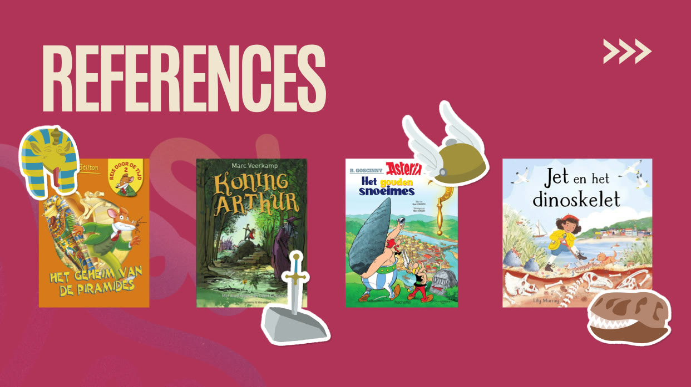

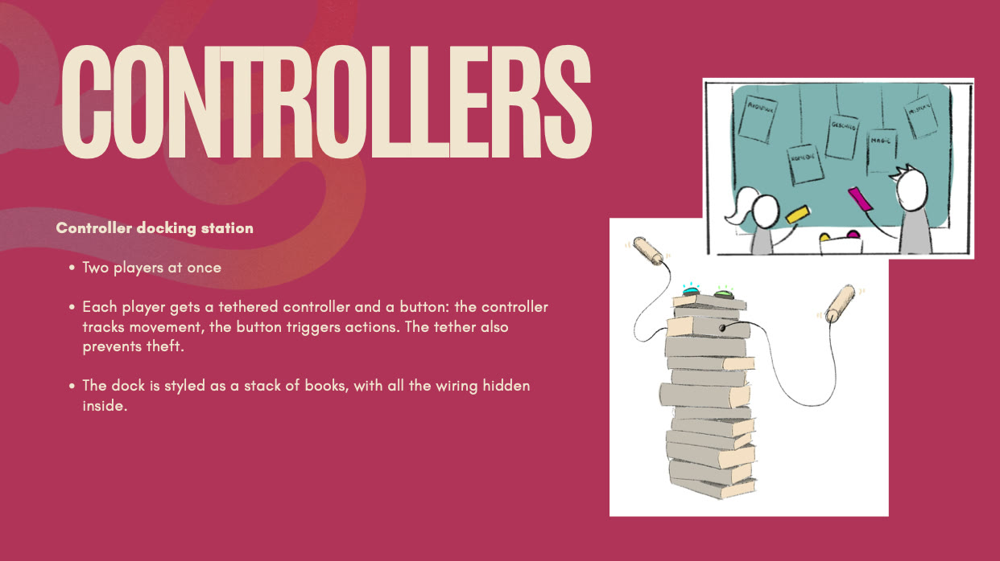

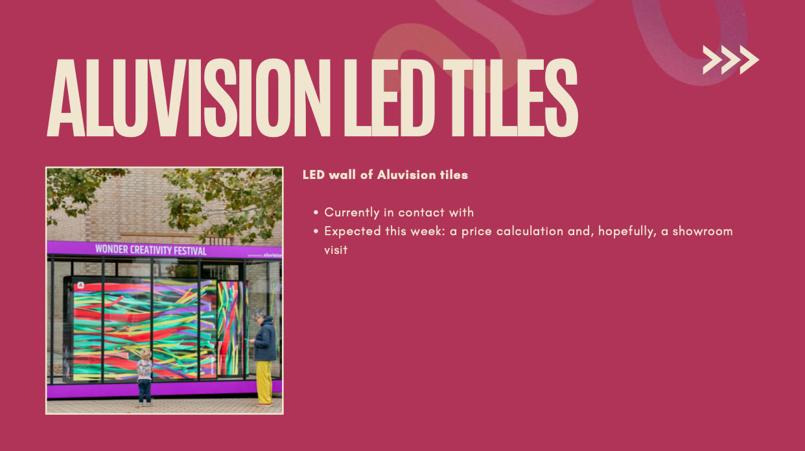

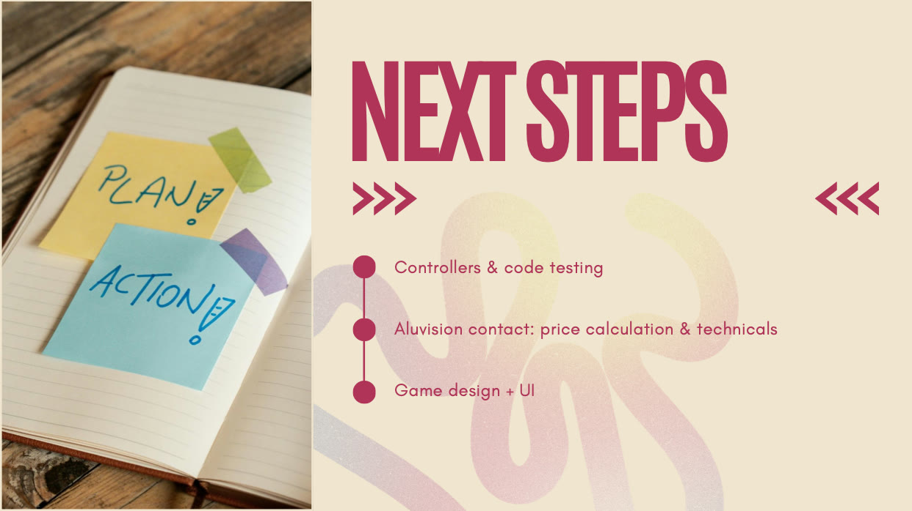

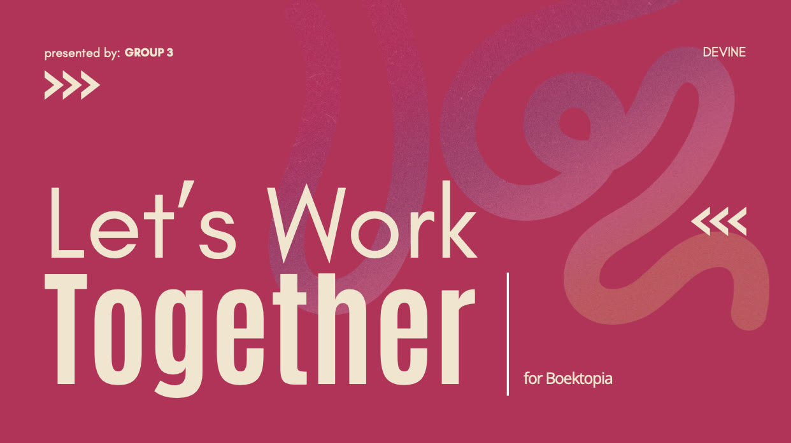

## What's in them?

### Concept: one small addition

Our concept hasn't changed. We only added one part: **the stamp card**. After the game, families look for books from the genre they played between the bookstands at the fair, and stamp their card with their favourite genre.

### Animatic

To show how the experience works, we made an animatic of the concept:

<video controls playsinline preload="metadata" src="../../files/animatic.mp4"></video>

### Style and styleframes

Our style hasn't changed either. What's new are **styleframes** of one minigame, the history game *The Great Dig*. They show how we would apply our style in a real game screen: the dig site, the shovel, and a treasure you brush clean.

### References to books

For the client, it was important that **the link with books is clear**. So we added the references: the books that our minigames refer to, with the objects from the game on top of their covers.

### Controllers

We showed that we're thinking about the controllers and how to style them: a docking station shaped like a stack of books, with a tethered controller and a button for each player. The cable also prevents theft, and all the wiring is hidden inside. More about this in our [technical research](../2026-11-15-technical-research/).

### Aluvision

The Aluvision story continues. We're in contact with them and expect a price calculation this week, and hopefully a visit to their showroom. We mention this so the client stays up to date.

### Next steps

This time we **don't have specific questions** for the client, so we end with our next steps:

- Controllers and code testing
- Aluvision contact: price calculation and technical questions
- Game design and UI
