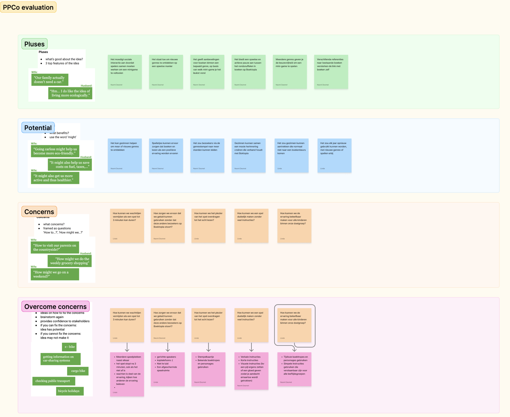
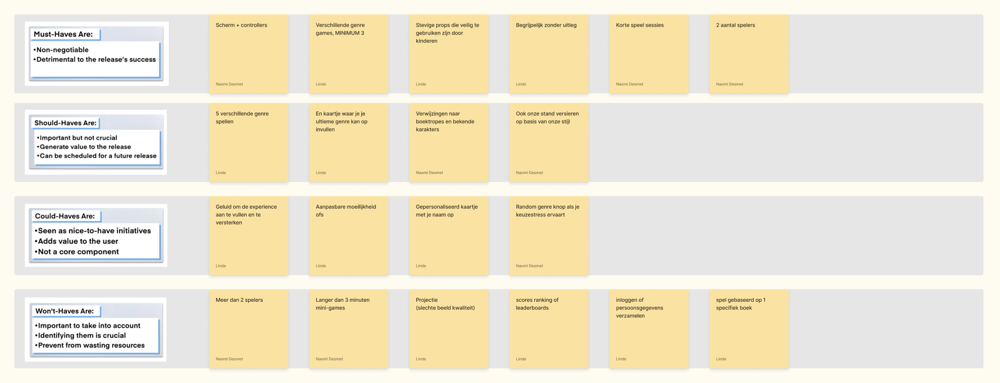
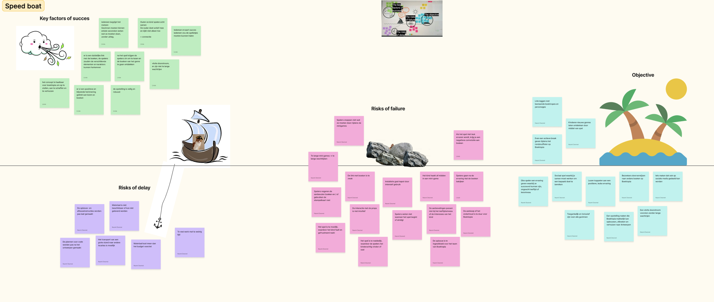
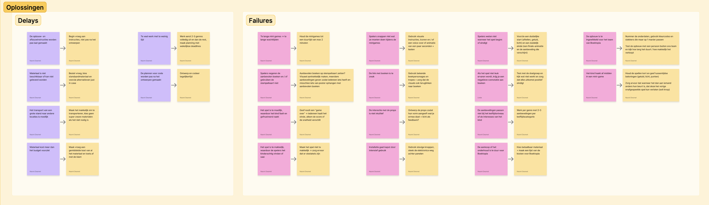

## What did we do?

After choosing our concept, we wanted to look at it critically before continuing with design and development. We used three methods: **PPCO**, **MoSCoW** and the **Speedboat**. Each method looked at our concept from a different angle: what's good about it, what definitely has to be in it, and what could slow us down or make us fail?

## 1. PPCO

PPCO stands for Pluses, Potentials, Concerns and Overcome concerns. We first looked at the strengths of our concept, then at its opportunities, and only then at our concerns. That way, we avoided dropping an idea too quickly by only looking at its problems.

- **Pluses:** our concept encourages working together, lets families discover new genres in a playful way, and gives book recommendations based on the game they liked most. The references to existing books strengthen the link with reading.
- **Potentials:** the installation can link reading to a positive experience, lead visitors to more stands through the genre stamp, and be reused every year with new genres.
- **Concerns:** our biggest concerns were queues, sound that bothers other visitors, the step from playing to actually reading, being clear without instructions, and accessibility for all children.

**Overcome concerns:**

| Concern | Solution |
| --- | --- |
| Queues | Several play spots, a fixed maximum duration, and waiting as part of the experience (watching other players) |
| Sound | Directional speakers, a screened-off play area and a limited volume. We didn't think headphones were a good option. |
| From playing to reading | The stamp card, and well-known book tropes and characters |
| Clarity | Short verbal and visual instructions, like arrows or a glow that draws attention |
| Accessibility | Timeless tropes and characters, and simple instructions for all ages |

## 2. MoSCoW

With MoSCoW, we decided which parts are really needed and which are extras. That keeps our scope realistic for the time we have.

| Must have | Should have | Could have | Won't have |
| --- | --- | --- | --- |
| Screen + controllers | 5 genre games | Sound to enhance the experience | More than 2 players |
| At least 3 genre games | The "My ultimate genre is…" card | Adjustable difficulty | Games longer than 3 minutes |
| Sturdy, safe props | References to book tropes and well-known characters | A personalised card with your name | Projection (poor image quality) |
| Understandable without explanation | A stand decorated in our style | A "random genre" option for when choosing is hard | Scores, rankings or leaderboards |
| Short play sessions | | | Logging in or collecting personal data |
| 2 players | | | A game based on one specific book |

**What we learned:** the core of our concept is a short, clear game for two players, with at least three genres. We deliberately leave out everything that makes the experience longer, more complicated or more competitive.

## 3. Speedboat

With the Speedboat, we looked at our project as a boat sailing to an island. What pushes us forward, what holds us back, and where could we be shipwrecked?

### 🏝️ The island: our objectives

- Link to existing book tropes and characters
- Let children discover new genres through play
- Offer an active break during a visit to Boektopia
- Let every player succeed, regardless of age or reading level
- A social game where you work together towards a goal
- Link reading to a positive experience
- Lead visitors to books at Boektopia
- Make something that can be shared on social media
- Be accessible and inclusive for all families
- A setup that's easy to build, take down and move
- A smooth flow without long queues

### 💨 The wind: key factors of success

- Everyone understands it straight away, without explanation
- Parent and child really play together
- Everyone succeeds and reaches the end
- There's a clear link with books that players recognise
- After playing, players want to read
- A smooth flow without long queues
- A positive, lasting memory of reading
- A safe and sturdy setup
- Feasible for Boektopia to set up, buy and move

Then we looked for a solution for every anchor and every rock.

### ⚓ The anchors: risks of delay

| Risk | Solution |
| --- | --- |
| Setup and takedown instructions are made too late | Start the instructions early, not only after designing |
| Too much work in too little time | First fully work out 2 or 3 genres, with a planning and weekly deadlines |
| Materials aren't available or aren't delivered | Order early, choose standard materials, have alternatives ready |
| The code is only planned after designing | Design and code at the same time |
| Transporting a large stand is difficult | Choose light materials that are easy to move |
| Materials cost more than the budget | Make a cost estimate early and check it with the client |

### 🪨 The rocks: risks of failure

| Risk | Solution |
| --- | --- |
| Players don't understand what to do | Visual instructions, icons, a voice-over or a short animation, and testing |
| Players don't know when the game starts or ends | A clear start (countdown, sound, light) and a clear end (final animation and recommendation) |
| The interaction with the props isn't intuitive | Props whose shape shows what you do with them, with light as feedback |
| The game is too hard, so the child gets frustrated | Never "game over": everyone reaches the end |
| The game is too easy, so it feels boring or childish | Enough obstacles and a build-up in difficulty |
| The child drops out in the middle of a game | Short games with feedback along the way, and the option to leave a game so the next players can start |
| Long games lead to long waiting times | Keep the games short |
| A game that isn't fun gives books a negative image | Test with the target audience, and let every outcome end positively |
| The link with books is too weak | Well-known book characters and tropes, and visuals that refer to books |
| Players don't look at the books after the experience | Recommended books on the stamp card, an attractive design, several recommendations, and a poster at the stand |
| The recommendations don't fit the child's age or interests | 2 or 3 recommendations per genre for each age group |
| The installation breaks from intensive use | Sturdy props, and electronics hidden behind panels |
| The setup is too complicated for the Boektopia team | Numbered parts, colour codes, plugs that only fit one way, and testing the setup with someone outside our team |
| Buying or maintaining it is too expensive for Boektopia | Affordable materials, and a clear cost list for the client |

## 🎯 Conclusion

The validation confirmed that our concept is strong in working together, discovering genres and linking to books. At the same time, it showed that its success mostly depends on clarity, flow and sturdiness. A game that isn't clear straight away, takes too long or breaks can undermine the whole goal: linking reading to a positive experience.

## Next steps

We take these lessons with us to the next phase:

- We test early and often with the target audience, especially whether the game is clear without explanation.
- We first fully work out 2 or 3 genres before making the rest.
- We design and code at the same time, and start early on the setup instructions and the cost estimate.
- We make sure every outcome ends positively, so no child goes home with a bad feeling about books.
