## The assignment

On **Friday 20 November** we give our second pitch. This time it isn't a classic presentation, but a **round table** with the other groups that work for Boektopia. We sit in a circle and take turns explaining our project. Our lecturer or coach leads the session and can give feedback too.

The other groups are our colleagues, but also our competitors. That makes it a moment to learn how to deal with feedback from fellow students and from outside, and how to be critical but fair.

At the round table we have to:

- Really get to know each other's projects.
- Show where we are: something of the design, the development or the start of a prototype.
- Explain the pros and cons if we wanted to sell our project to the client.
- Tell what feedback we got from the client, and how we used it or why we didn't.
- Share something unique: an insight, an innovative principle or a technology.
- Name our next steps.
- Bring issues we're unsure about to the group.

We submit our presentation as a zip file on 20 November, before 10 p.m.

## Our slides

These are the slides we'll show at the round table. You can leaf through them here:

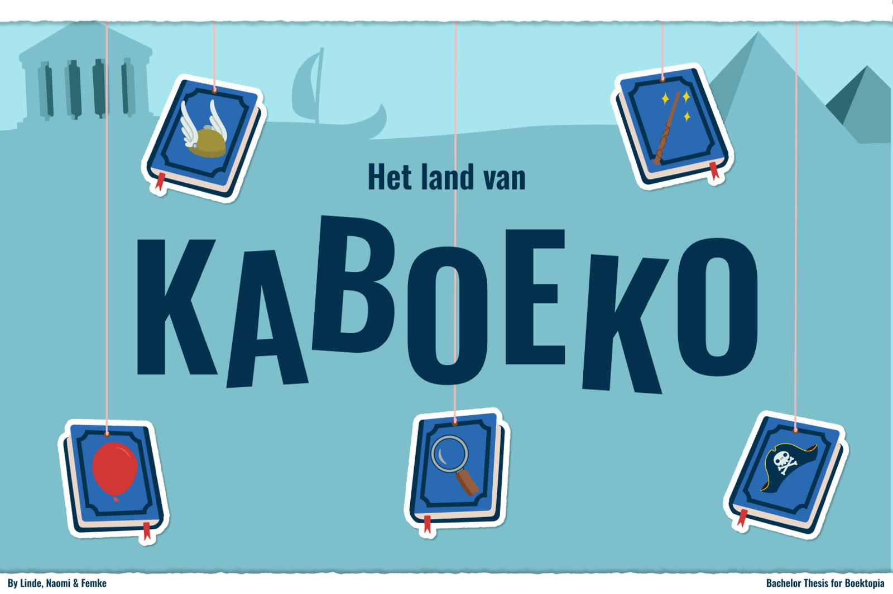

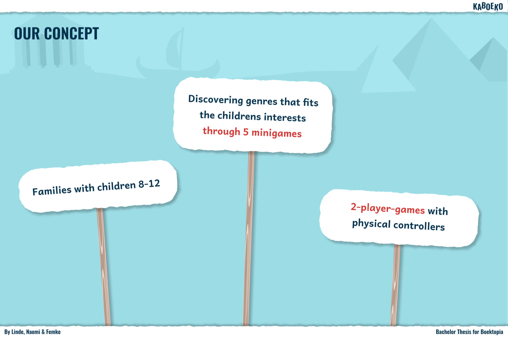

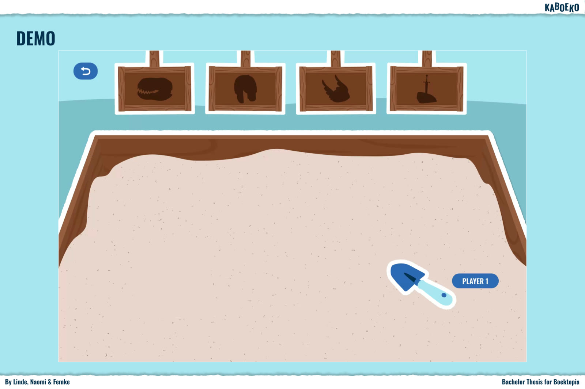

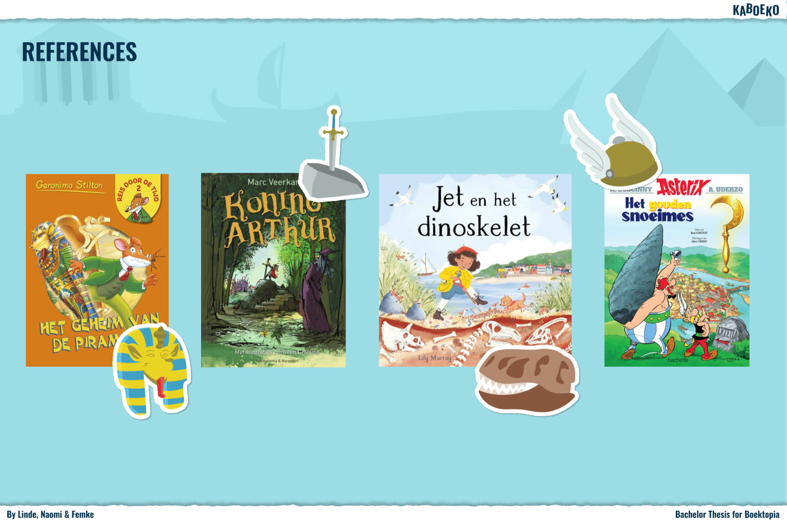

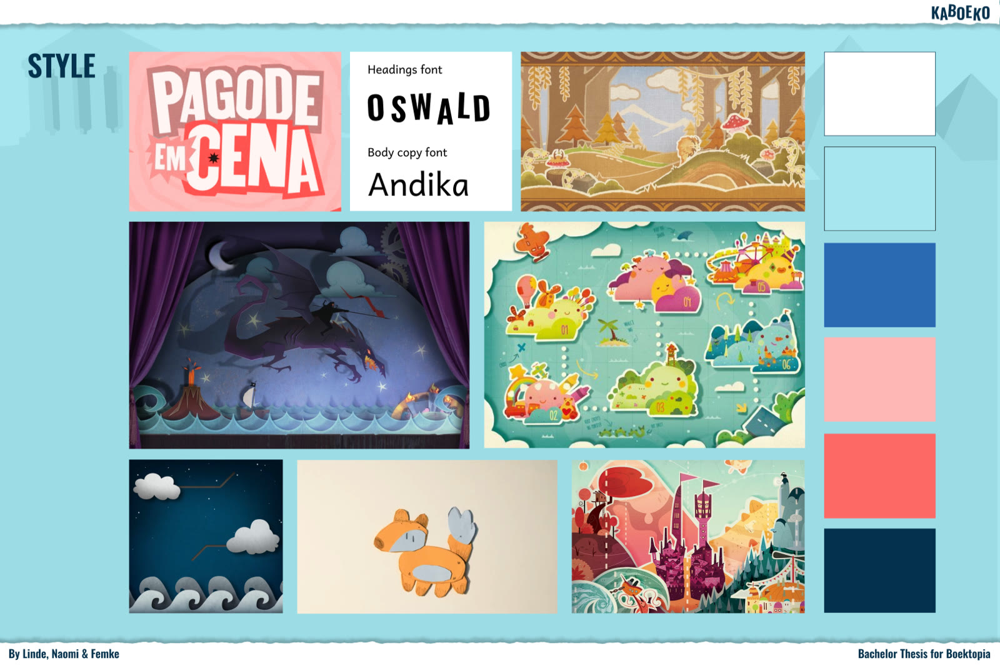

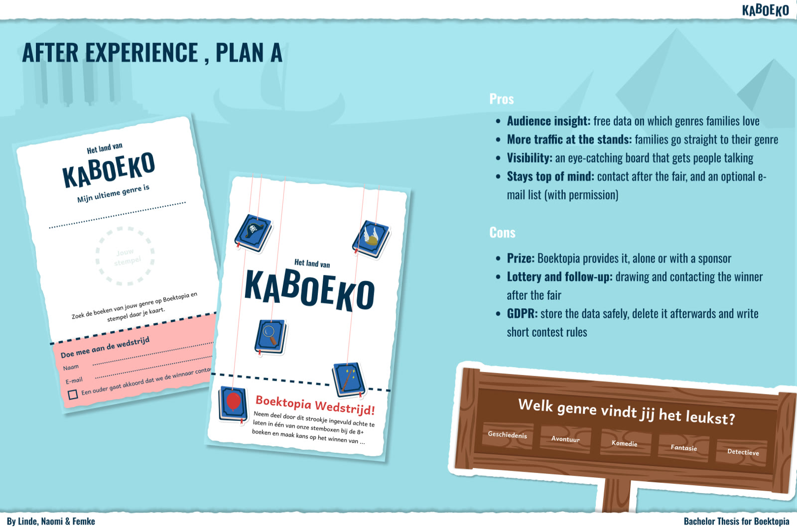

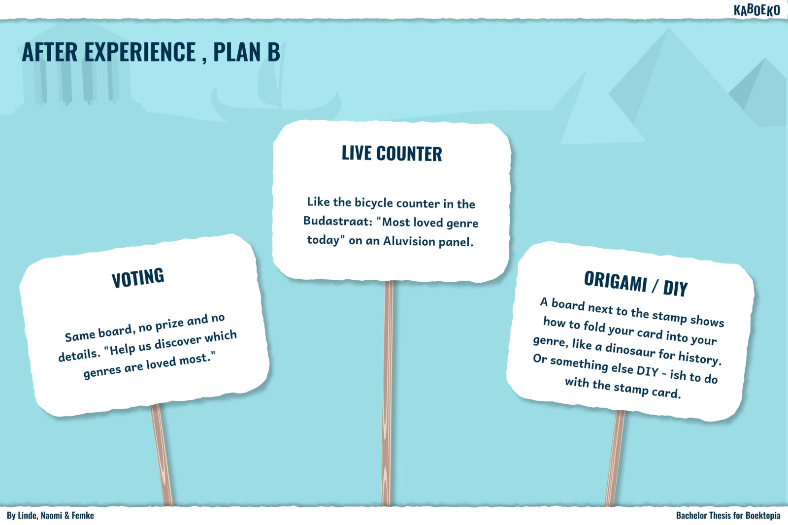

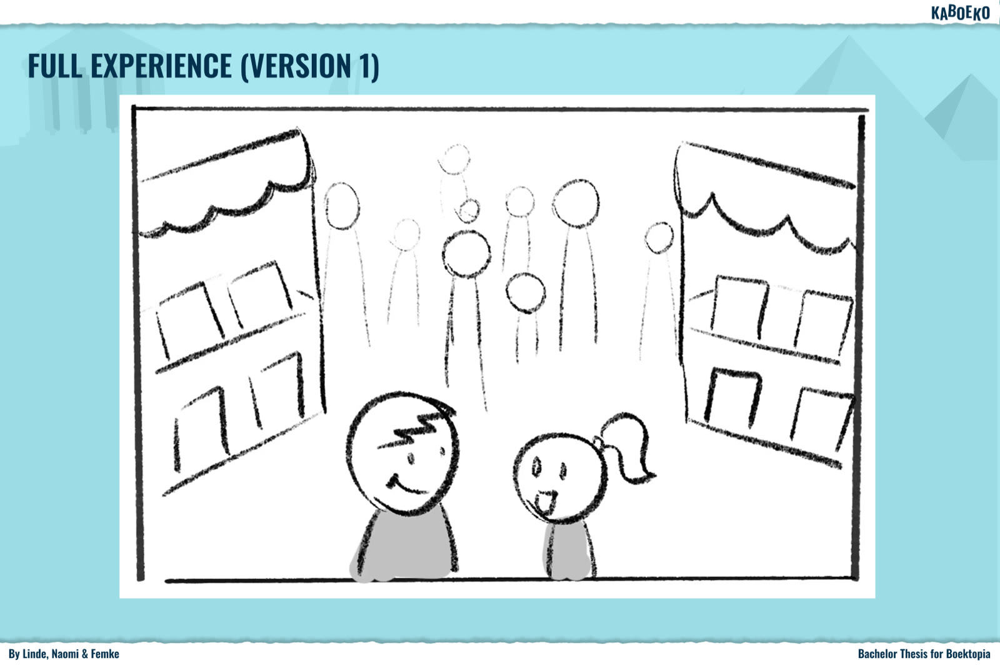

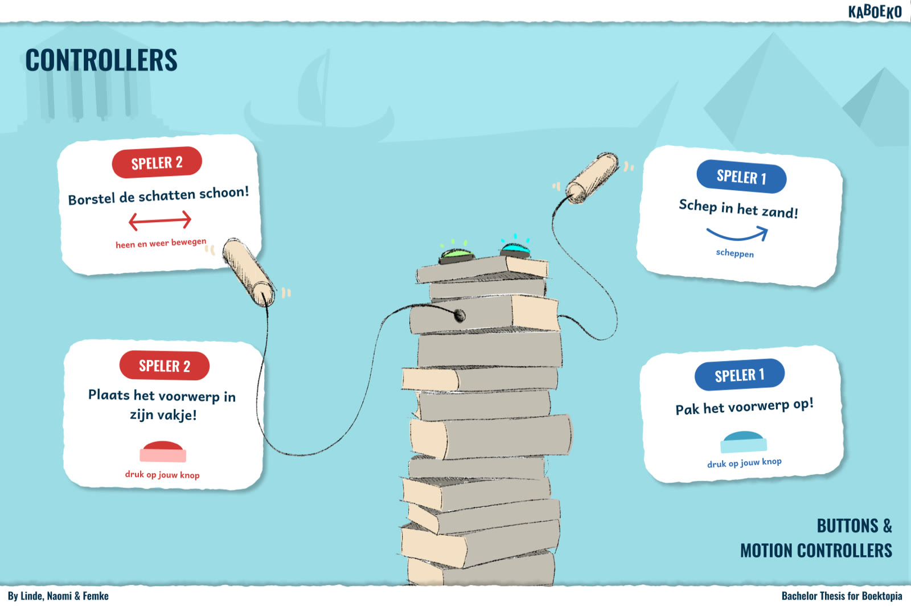

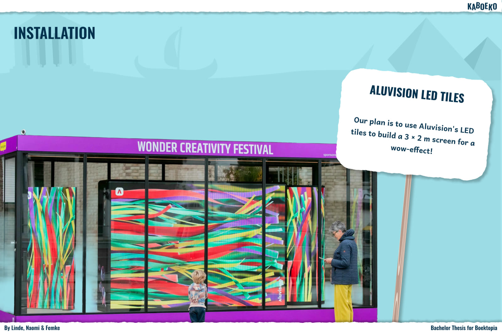

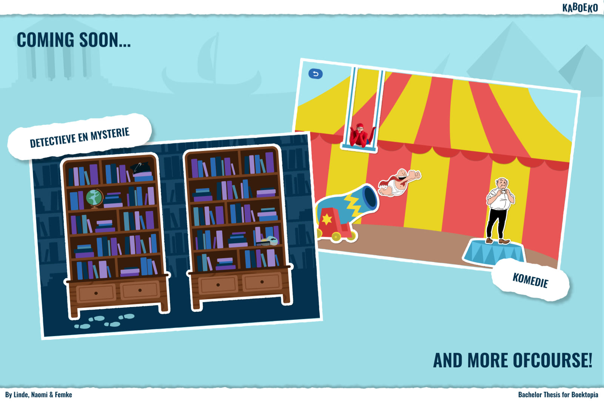

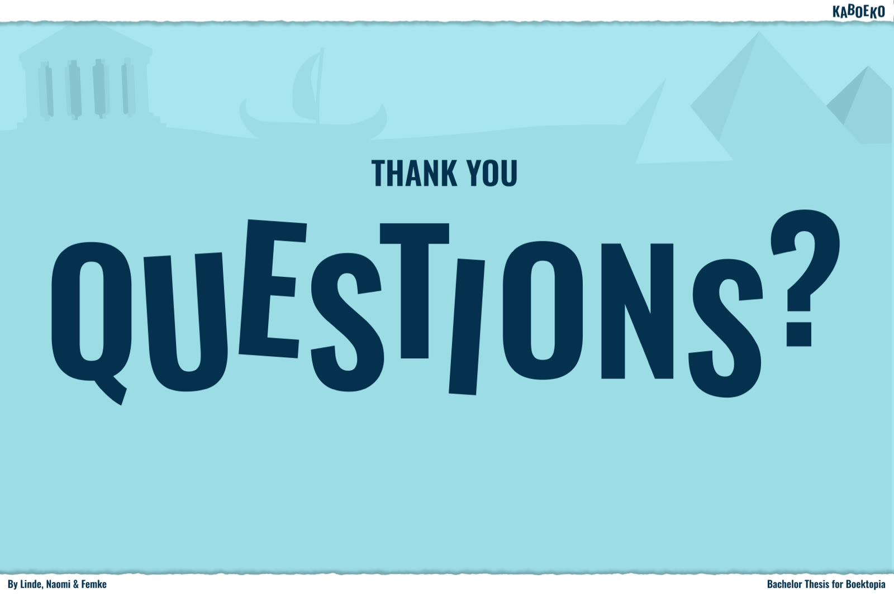

## What we'll present

### Concept

- Our [five minigames](../2026-11-16-final-mini-games/), each based on real books.
- The stamp card, and our new ideas for it (see below).

### Target audience

Families with children aged **8 to 12**.

### Technology

- A game for **two players**, each with their own controller (see our [technical research](../2026-11-15-technical-research/)).
- The **Aluvision LED wall** as the screen.

### A first working game

We also want to show that we already have **working code**. The history minigame can already be played on localhost, but only with the **mouse cursor**. No controllers are connected to it yet: we're still waiting for the parts we ordered, so we can't run our controller tests yet.

### Visuals

Our style board and the styleframes, which we already showed the client in our [meeting prep](../2026-11-16-client-meeting-prep/). New is a **motion video** of one minigame, the history game, where one player digs with a shovel and the other brushes the treasures clean:

<video controls playsinline preload="metadata" src="../../videos/demo-video_final.mp4" aria-label="Motion video of the history minigame"></video>

We'll also show our animatic again, to explain the whole experience:

<video controls playsinline preload="metadata" src="../../files/animatic.mp4" aria-label="Animatic of our concept"></video>

## The stamp card: a question for our peers

At our [second client meeting](../2026-11-17-client-meeting-2/), the client told us the stamp card doesn't give families a strong enough reason to collect a stamp yet. So we worked out a few new ideas, and at the round table we'll ask the other groups which one they would choose.

### Our main idea: a vote that's also a contest

We were inspired by the map of Wonder Kortrijk, where visitors put stickers on a map to answer questions like "Where do you feel at home?" and "Where would you bring change?".

1. The stamp card gets a **tear-off strip** where you write your contact details.
2. You go to the books of your genre and stamp your card there.
3. In the middle, between the books, stands a large board with **five boxes**, one per genre: "Which genre do you like best? Drop your vote and win …"
4. You tear off the strip and drop it in the box of your favourite genre, like a lottery ticket.
5. After Boektopia, the winner is contacted.

Prizes we could suggest to the client: a book voucher, a book, Boektopia merchandise or a ticket for the next edition. Even without a prize, the votes show how many children like each genre, which is always useful as statistics.

Things to keep in mind:

- A contest needs **rules**.
- Taking part has to stay **optional**.
- **Boektopia decides** what they want or can give as a prize.

### What this means for the client

| Pros | Cons |
| --- | --- |
| **Insight into their audience:** the boxes show which genres families choose, free market research for the next editions. | **Running the lottery and contacting the winner:** a task for after Boektopia. |
| **Contact with visitors:** people who join can leave an e-mail address, handy to invite them to the next edition, but only with their explicit permission. | **Providing a prize:** themselves or through a sponsor, that's up to them. |
| **More visitors at the bookstands:** families walk straight to the genres, which is good for the stand holders' sales. | **Responsible for the data:** the client has to store the contact details safely and delete them after the contest (GDPR), and write short contest rules. |
| **Visibility:** an eye-catching board with a vote draws attention and gets people talking at the fair. | **Extra material:** the board and five boxes, which also have to travel to the second location. |
| **A link after the fair:** contacting the winner keeps Boektopia in people's minds after the event. | **Follow-up during the fair:** emptying or checking the boxes from time to time, especially with many participants. |
| **A chance for partners:** a publisher or bookshop could sponsor the prize in return for visibility. | |

### Plan B

If the client thinks this is too big a task to take on, we have a few alternatives:

- **The same idea without a prize:** the board with the boxes only serves for statistics: "Help us discover which genres are loved most."
- **A live counter:** like the bicycle counter in the Budastraat in Kortrijk, but showing "the most loved genre of today" on an Aluvision panel, with real-time numbers every time a card drops in a box or someone presses a button. This does mean more work for us.
- **Origami:** you take your stamp card to the books to find your stamp, and next to it hangs a board that shows how to fold your card into a cool origami shape that matches your genre, like a dinosaur for history.

## Next steps

- Finish our slides for the round table, and prepare the playable history minigame on localhost.
- Connect the controllers to the game and start our controller tests as soon as the parts arrive.
- Ask the other groups which approach for the stamp card they would choose.
- Pitch on Friday 20 November and submit our presentation as a zip before 10 p.m.
