## The round table

Today we pitched our project at a **round table** with the other groups that work for Boektopia. How we prepared, and what we wanted to ask, is in our [pitch prep](../2026-11-17-project-pitch-prep/).

We updated our slides before the pitch. Compared to our first version, the concept slide now also mentions the stamp card and the personalised book recommendations, the technical slide explains why we use Phaser 4, and a few slides have a short note on how they answer the client's feedback. You can leaf through the final slides here:

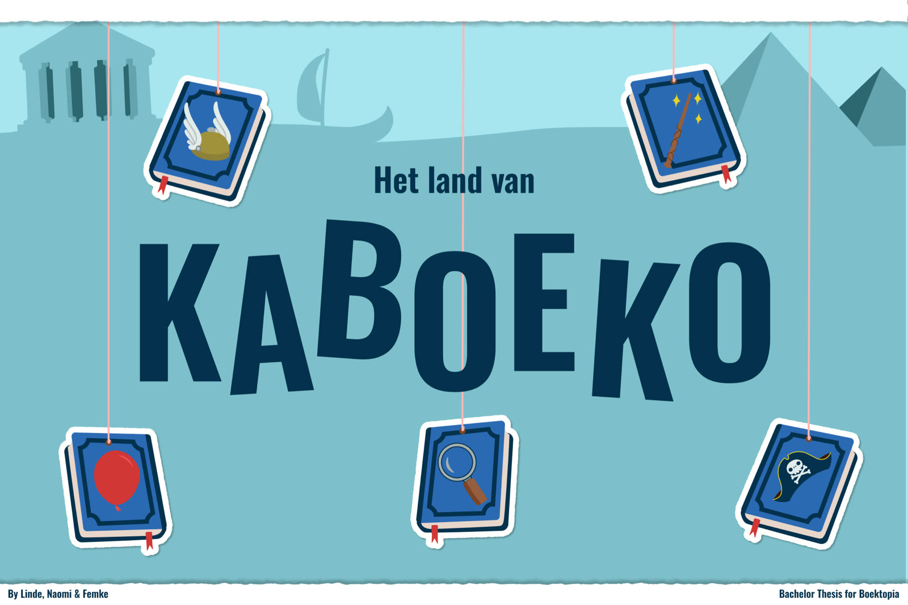

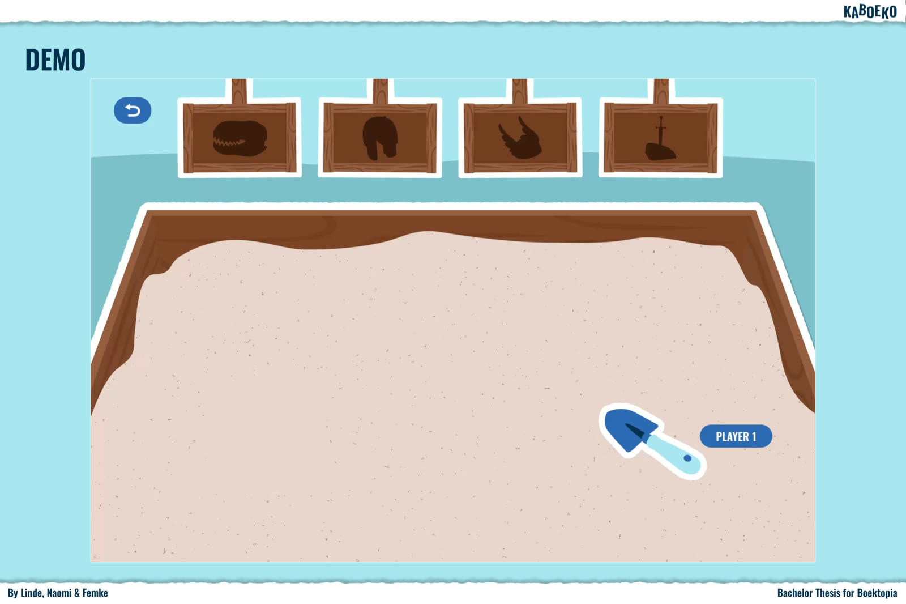

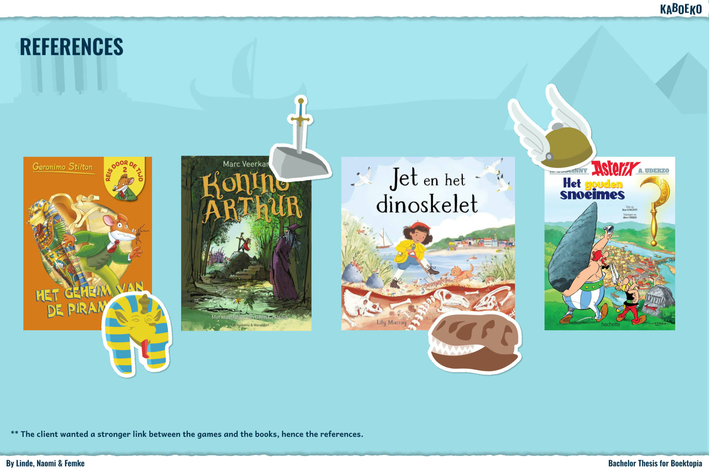

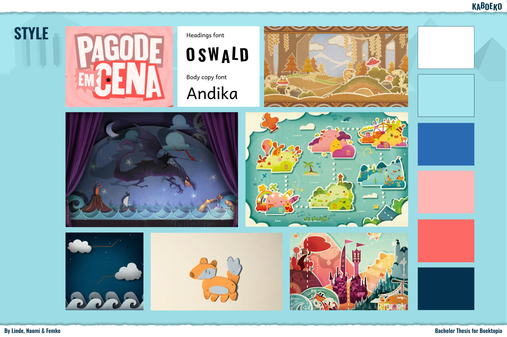

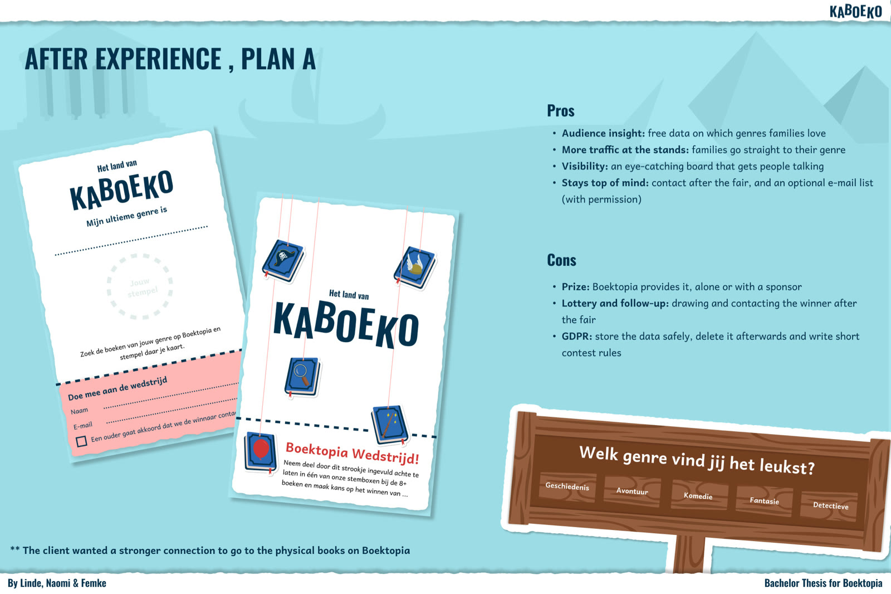

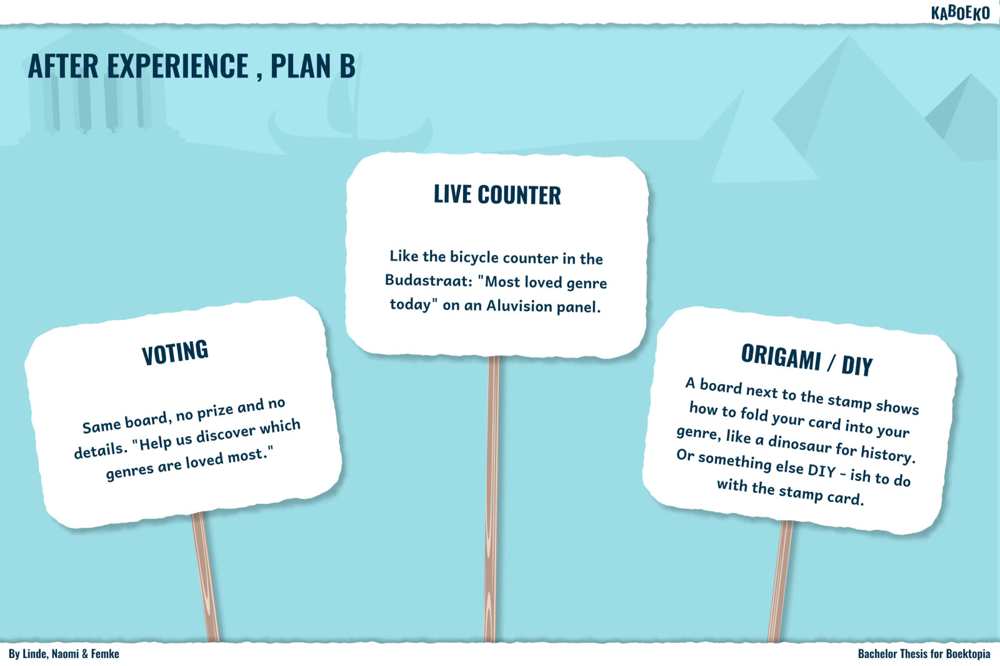

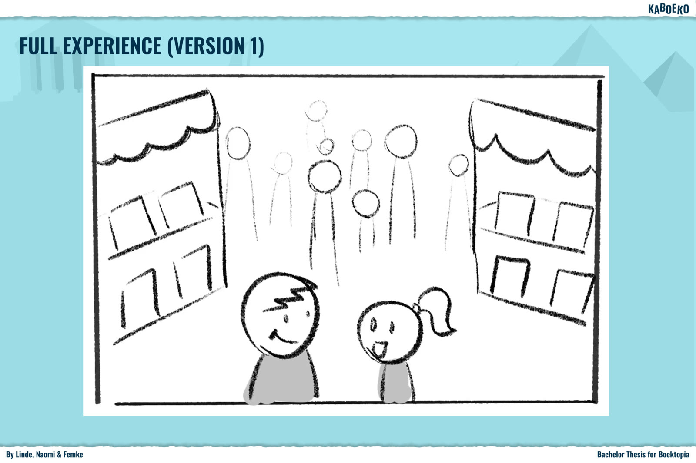

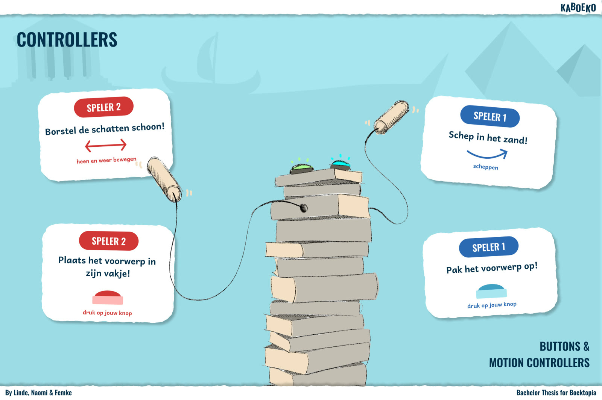

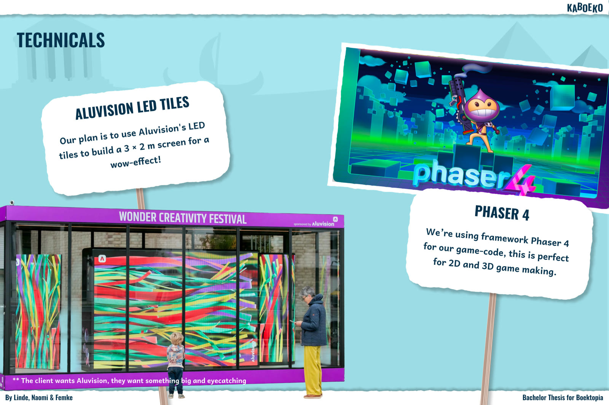

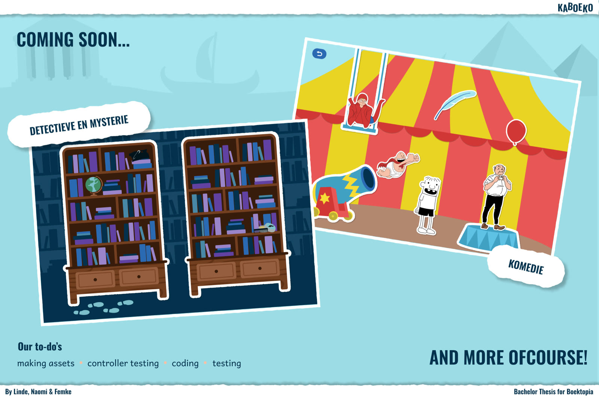

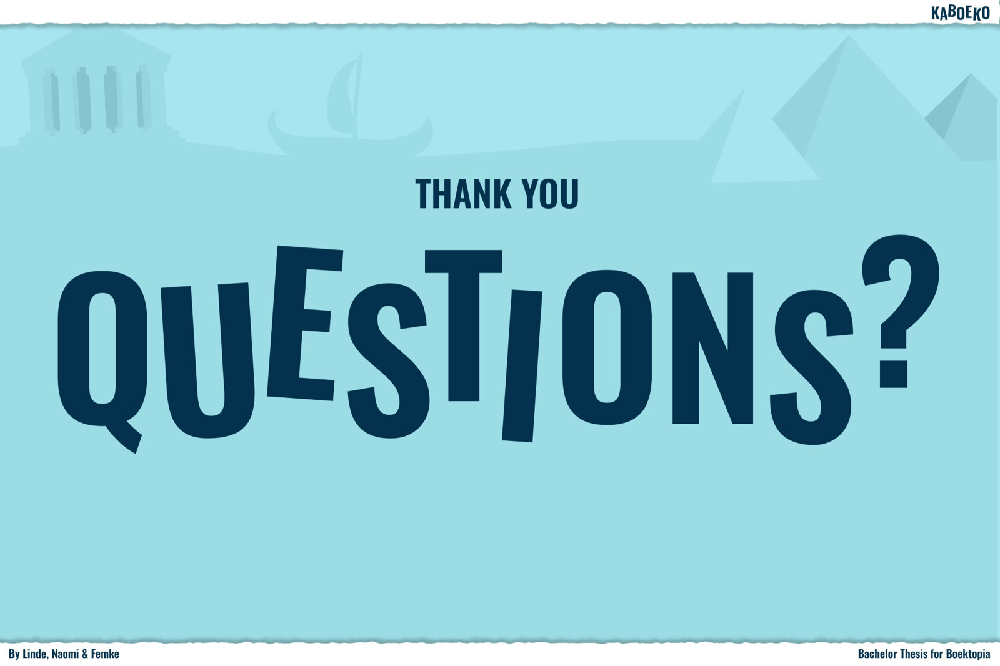

## Feedback per slide

### References

The client apparently has **mixed feelings** about using references to (classic) books from Boektopia, but our peers were fans of how we use them. Our lecturer didn't recognise where the sword and the sarcophagus came from, but called it "probably a generation problem".

### Style

Another group had started with a similar style, and the client was less of a fan of it there. When we showed our style to the client, there was no problem, so we'll **continue with it**. Our peers liked the style too.

### After experience, plan A

The others confirmed that the contest would mean **more work for Boektopia**. Their fear is that this could put the client off the whole idea.

### After experience, plan B

Everyone was a big fan of the **live counter**. The origami idea was intriguing too, but it works less well for our main goal: getting families to the books.

### Controllers

At first the controllers weren't clear, or people didn't notice them, but after we explained them a second time it was fine. They really liked the **stack-of-books** idea for the docking station.

### Coming soon

Someone asked whether the characters in the comedy game are plagiarism. They aren't: we show them for what they stand for, as a reference to their books, and we don't claim they're our own work.

### Questions

*How will we make sure the controllers don't break?* We answered that the steel cable will be **shorter than the electrical cable**, so the steel cable takes the pull and not the wires. As a tip, they suggested giving the docking station **weight at the bottom** or a **larger base**, so it can't fall over.

## Extra info

- There's **no prototype budget** from the client.
- We were able to claim a **TV** from the school's equipment list for the jury.

## What did we learn?

The live counter came out as the clear favourite for the stamp card: it keeps families moving towards the books without giving Boektopia extra work, which is exactly the risk of our contest idea. The book references and our style are worth keeping, even if not everyone recognises every object.

## Next steps

- Work out the live counter as the new approach for after the experience, and check with the client whether it fits.
- Get started with the ESP32 as soon as possible.
- Keep making assets and building the games in code.
- Test, test, test!
