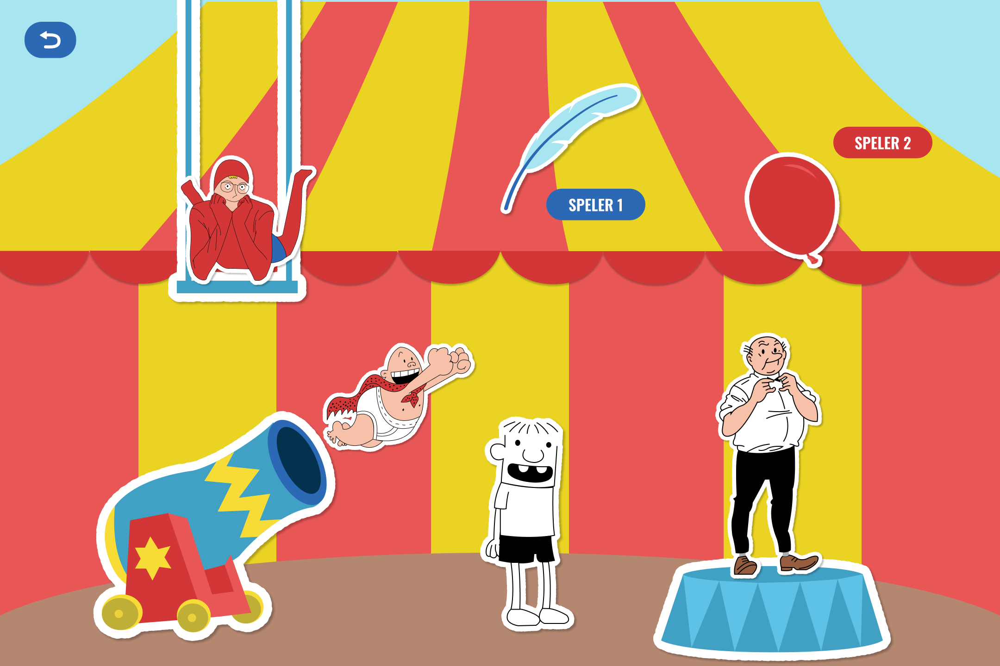
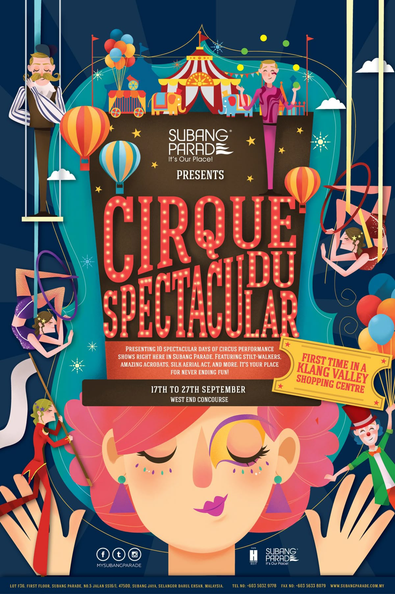
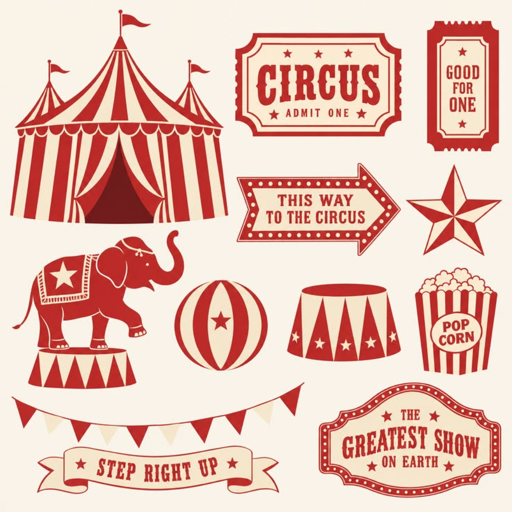
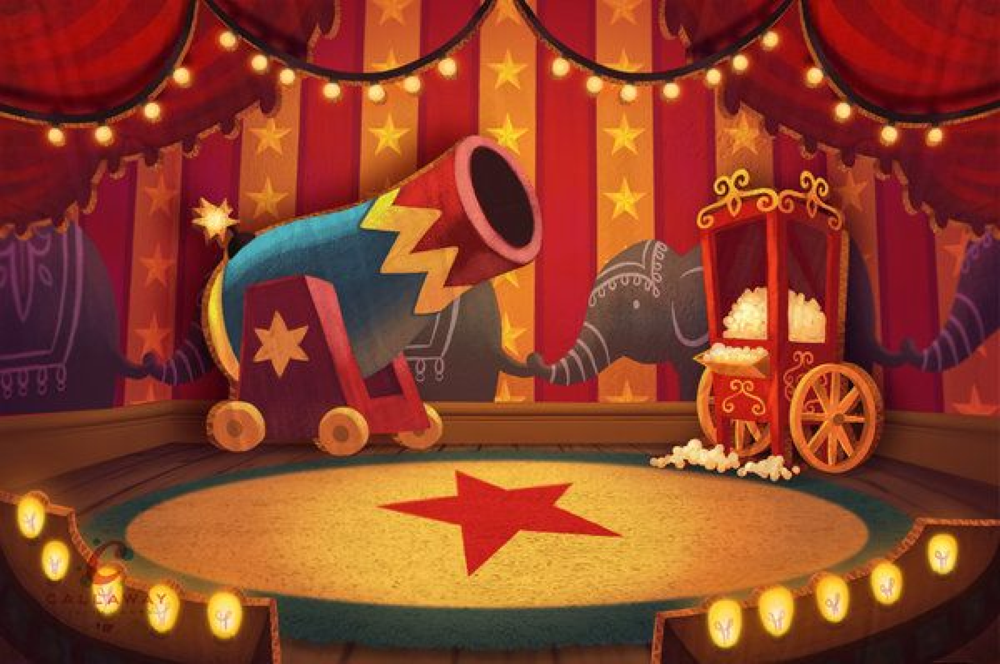
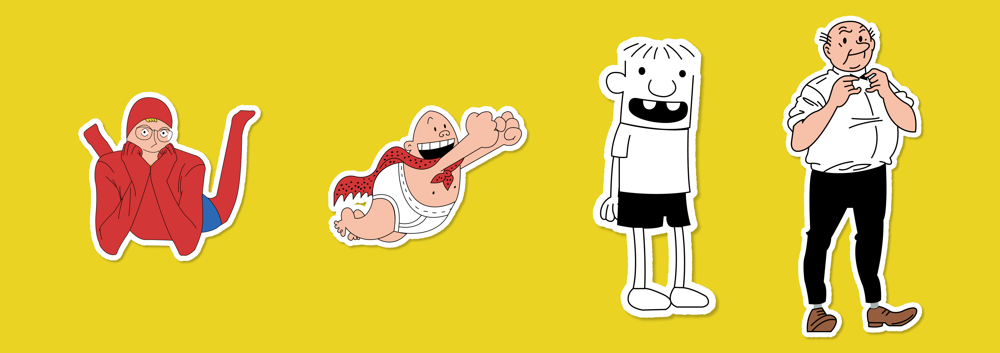
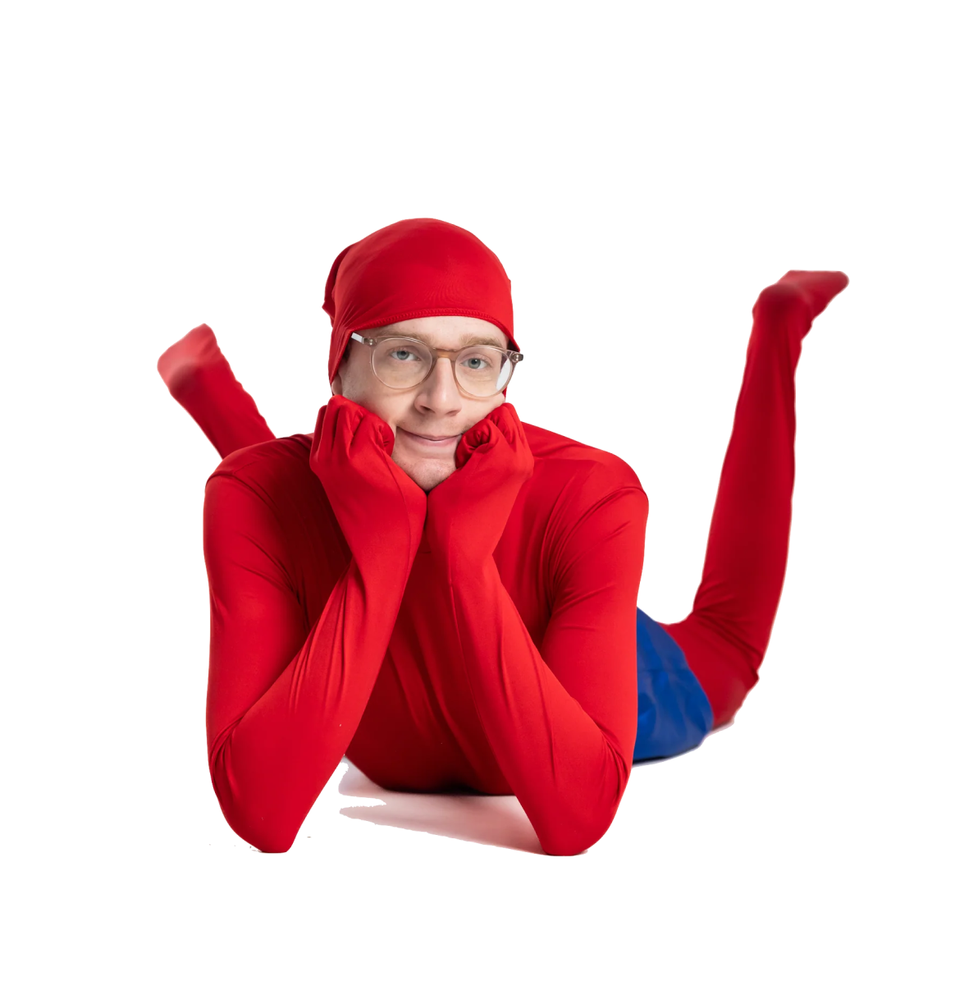
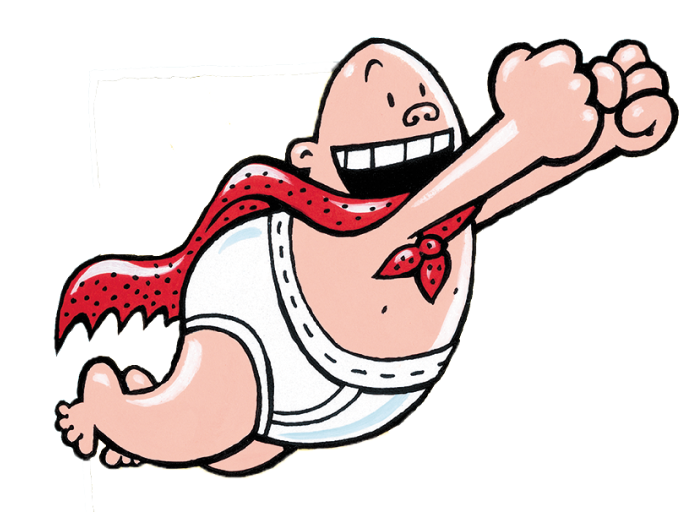
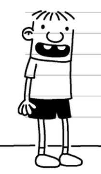
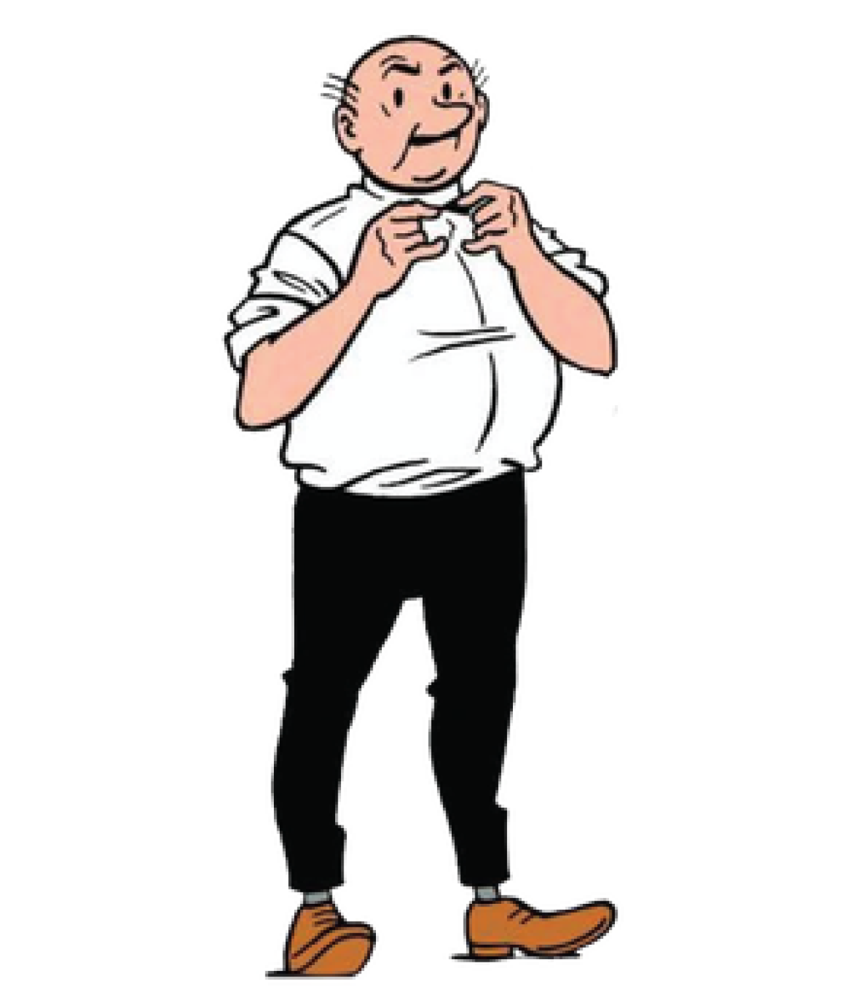

## What did we do?

In the comedy genre, the setting is a circus. Popular characters from children's books show up in the ring, and the players have to make them react: player 1 tickles them with a feather, and player 2 throws water balloons at them. We designed all the assets for this scene.

### The game screen

We chose a circus because it is a playful setting that fits the slapstick humour of the genre, and because it gives us a lot of recognisable elements to fill the scene with: a striped tent, a cannon, a podium and a trapeze. The comedy characters are placed all over the scene, each in a spot that fits the circus: on the trapeze, flying out of the cannon or standing on the podium.

We used the following references:

### The controllers

Each player gets a tool that fits their role: a feather for player 1, who tickles the characters, and a water balloon for player 2, who throws it at them.

### The characters

We picked four funny characters from well-known children's books:

- Timon Verbeek from "Timon Verbeek"
- Kapitein Onderbroek from "Kapitein Onderbroek"
- Rowley Jefferson from "Dagboek van een Muts"
- Lambik from "Suske en Wiske"

We used the following references:

## Why this direction?

Tickling and throwing water balloons are simple actions that every child understands right away, and they give the two players two clearly different roles. Using popular characters from funny books makes the scene recognisable, and the circus gives them a lively, colourful stage to appear in. The characters also react to what the players do, which is where most of the humour comes from.

## Next steps

- Design the reactions of the characters when they are tickled or hit by a water balloon.
- Build the scene and test the controls with the accelerometer controller.
- Test the comedy game with the target audience.
