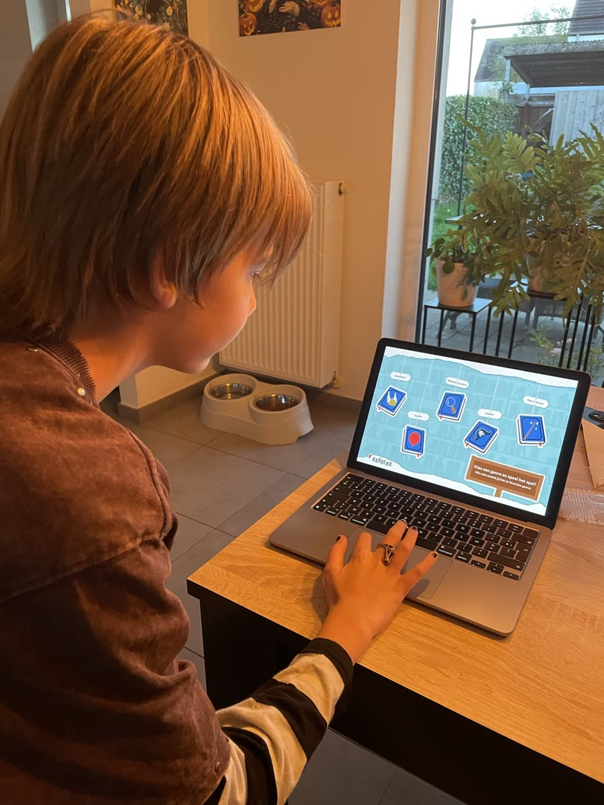
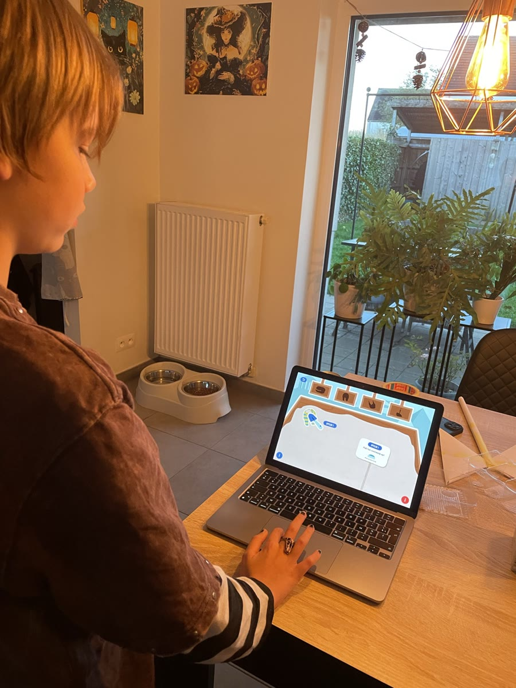
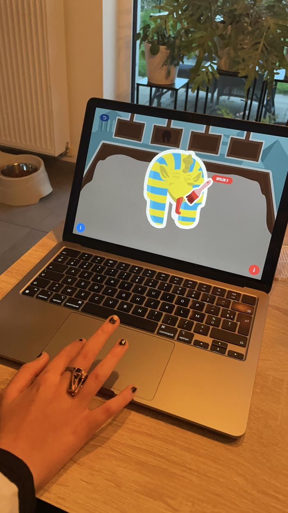
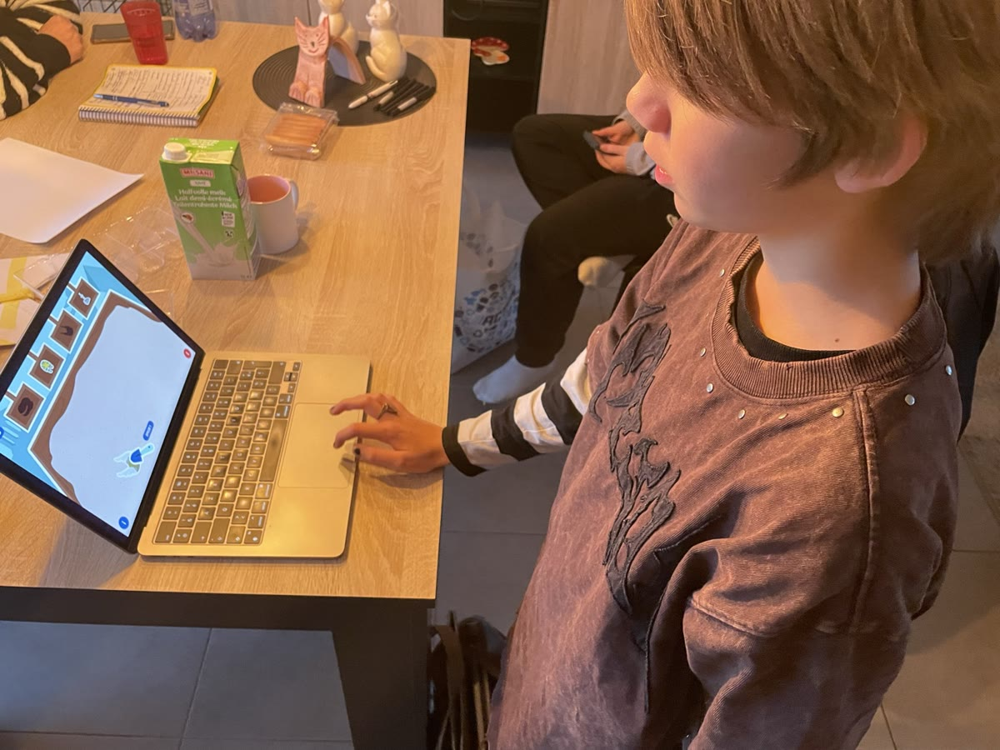

## The test

We did a first small test of our **history minigame** with Fenne, a boy of **12**, right in our target audience. The test took about **15 minutes**. He played on a laptop alone with the trackpad, because our controllers aren't connected to the game yet and because multiplayer does not work at the moment (see our [project pitch](../2026-11-20-project-pitch/)).

We asked him to:

1. Start the game.
2. Choose the history game.
3. Play both roles (player 1 and player 2): find the treasures and brush them clean.
4. Find the last object: the book.

## What we observed

- He **understood right away** what he had to do. He plays online games himself, so he's used to online games like this.
- On the choice screen, he moved the cursor around to **see the animations** first.
- He found everything **quickly**, and he also read the **instruction signs** when they appeared, quietly but out loud.

## His feedback

- He found the game **easy**.
- A tip: if you don't move for a while, the instruction sign could **pop up again**, because maybe the players forgot how it works.
- *"You know what I find strange? When you dig, there's no sand on the objects, and then suddenly the sand just spawns on them."* So the patches of sand should already be on the objects **while you're digging**.

## What did we learn?

He found the game easy, but that's probably partly because he played it on a laptop with a trackpad, just by clicking. We expect that playing with **two players, with controllers, on a big screen** will feel like a completely different level of difficulty. So this test tells us that the game is clear, but not yet how hard it is.

His comment about the sand is a good example of something we didn't notice ourselves: the order of what happens on screen has to match what you would expect in real life.

## Next steps

- Show the patches of sand on the objects while you're still digging, instead of letting them appear afterwards.
- Show the instruction sign again when a player hasn't moved for a while.
- Test again once the controllers work, with two players and on a bigger screen, to see how the difficulty changes.
