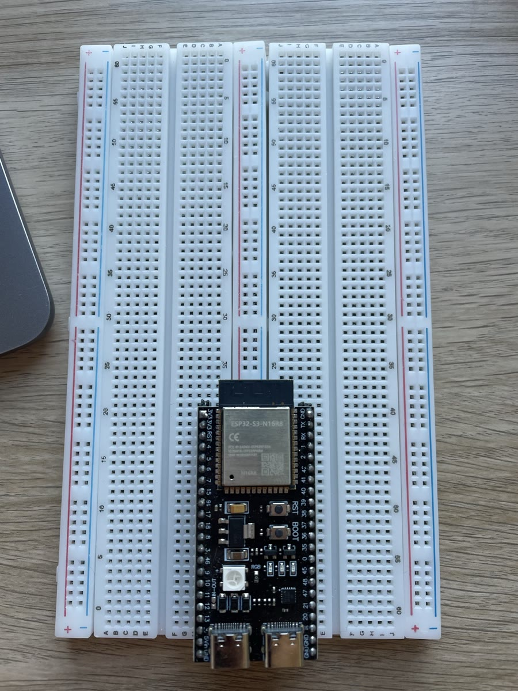
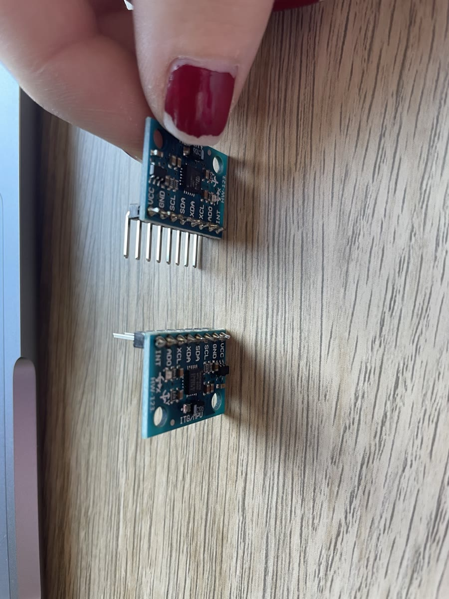
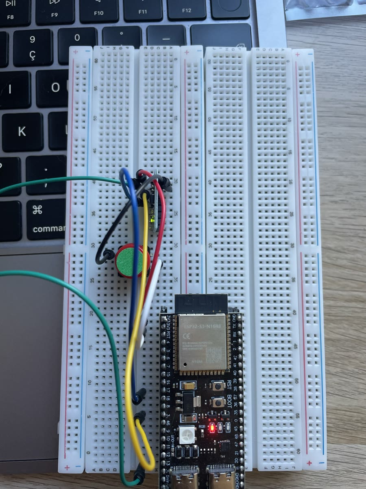
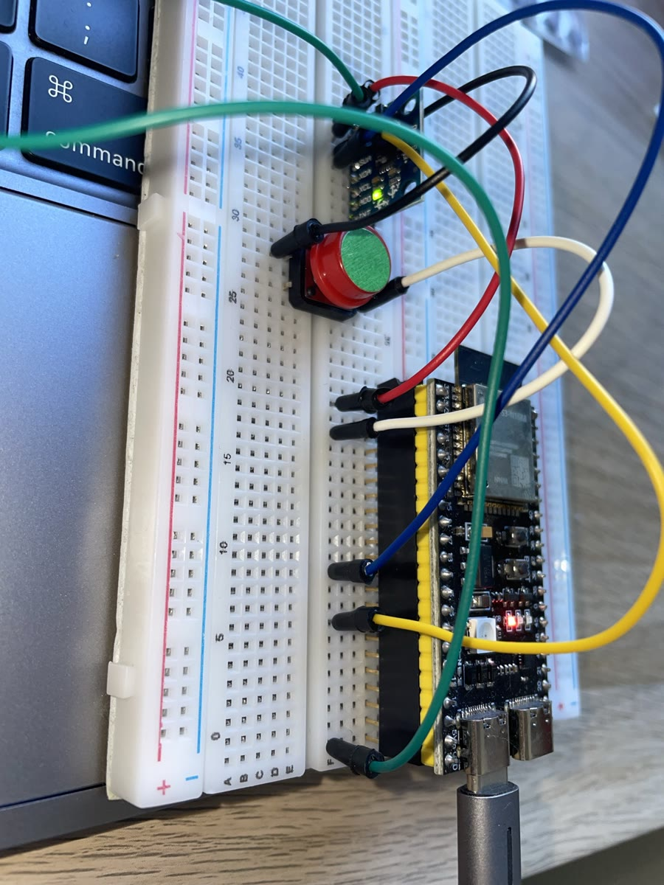
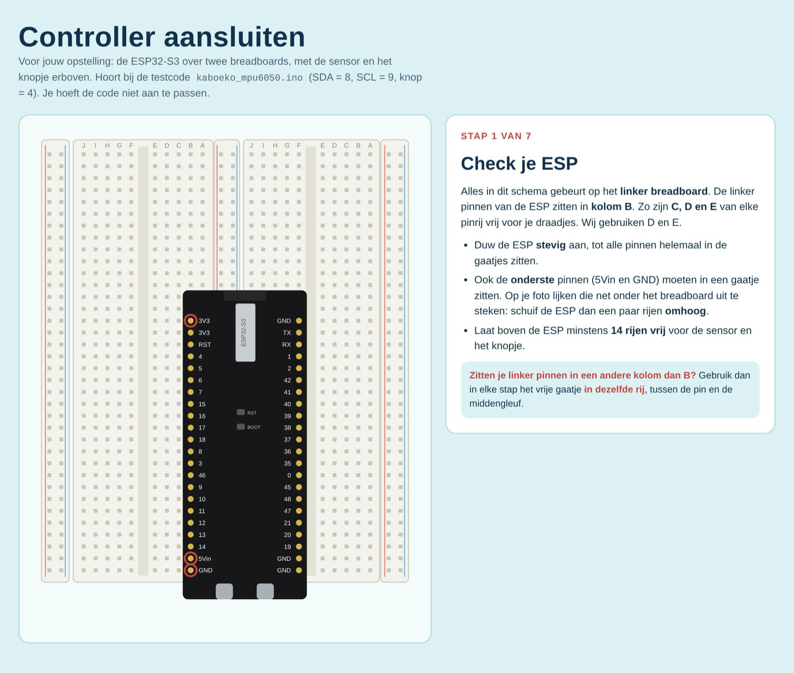
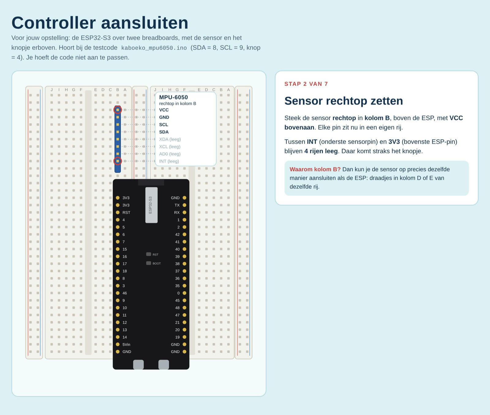
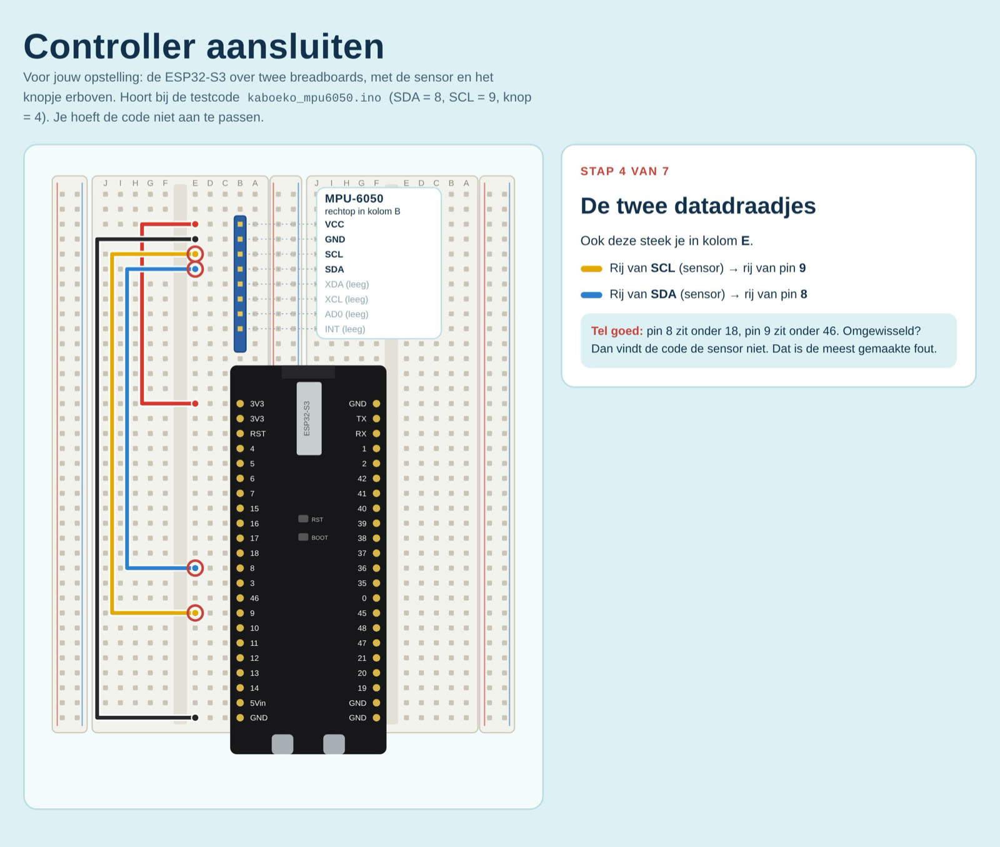
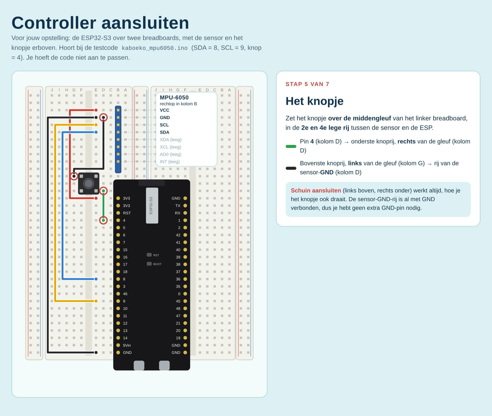
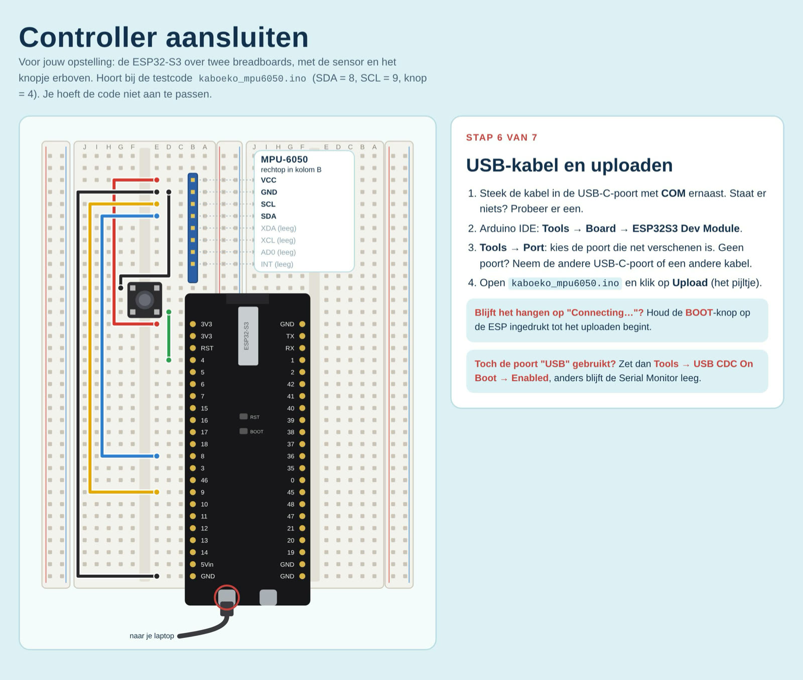
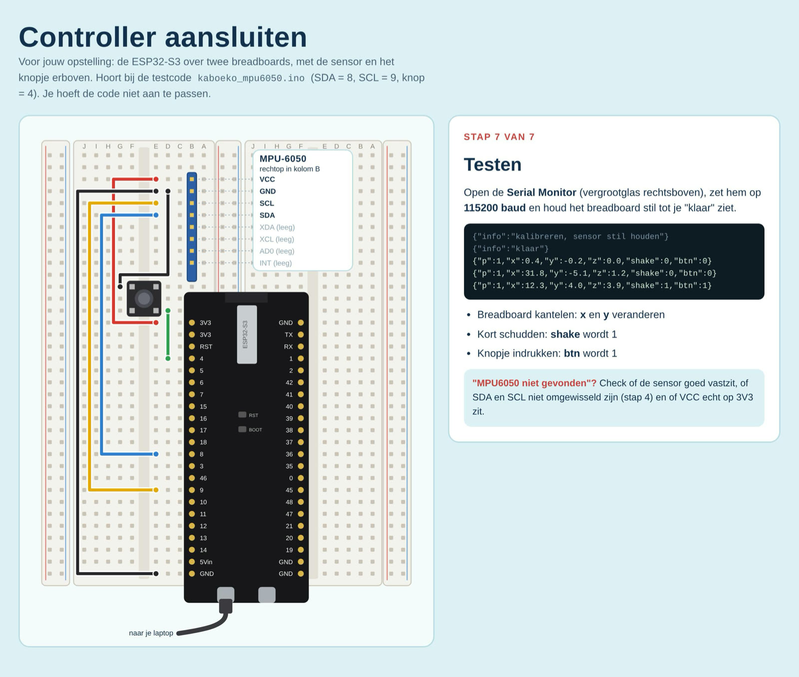

## What did we test?

Our test parts finally arrived (see our [technical research](../2026-11-15-technical-research/)). For this first test we wanted to know: can we use a motion sensor as a controller for our games?

We used:

- an **ESP32-S3** microcontroller
- a **breadboard**
- **jumper wires**
- an **MPU-6050** (GY-521), the accelerometer
- a **USB-C cable** that transfers data
- a **push button** from the starter kit
- **Arduino IDE** on a laptop

<div class="carousel" aria-label="Photos of our setup">









</div>

## A wiring plan made with AI

We asked **Claude (AI)** for help to start up the wiring. The prompt:

> Make an interactive step-by-step wiring diagram in Fritzing style for my ESP32-S3 + MPU-6050 + push button, adapted to my setup (ESP across two breadboards, left pins in column B), with the parts, wire colours and exact holes needed for each step.

Claude made a plan of seven steps for exactly our setup: check the ESP, put the sensor upright, connect the power, the two data wires, the button, the USB cable and uploading, and testing. Each step shows which wire goes into which hole, with tips for the mistakes you're most likely to make, like mixing up the two data pins. This helped us enormously: we could follow it step by step without having to figure out the wiring ourselves.

<div class="flipbook" aria-label="Claude's wiring plan, 8 pages">















</div>

## The test code

Claude also wrote the test code for the ESP32, which we uploaded with Arduino IDE. It reads the sensor 50 times per second and sends one line of data over USB, for example `{"p":1,"x":12.3,"y":-4.1,"z":87.0,"shake":0,"btn":1}`: which player it is, how far the controller is tilted and turned, whether you're shaking it and whether the button is pressed. Our Phaser game reads those lines with Web Serial.

<details>
<summary>Show the full Arduino code</summary>

```cpp
// Kaboeko – test controller with an MPU-6050 on an ESP32-S3 DevKitC
//
// Wiring (breadboard):
//   MPU-6050 VCC -> ESP32 3V3
//   MPU-6050 GND -> ESP32 GND
//   MPU-6050 SDA -> ESP32 GPIO 8
//   MPU-6050 SCL -> ESP32 GPIO 9
//   Button (from the starter kit): one leg -> GPIO 4, other leg -> GND
//
// Library: "MPU6050_light" by rfetick (Arduino IDE > Library Manager)
//
// What it does: sends one line of JSON over USB 50 times per second, e.g.
//   {"p":1,"x":12.3,"y":-4.1,"z":87.0,"shake":0,"btn":1}
// The Phaser game reads those lines via Web Serial.
#include <Wire.h>
#include <MPU6050_light.h>
const int PLAYER = 1;          // set to 2 for player 2's controller
const int SDA_PIN = 8;
const int SCL_PIN = 9;
const int BUTTON_PIN = 4;
// How hard you have to shake: 1.0 = gravity, anything above ~1.8 g counts as shaking.
const float SHAKE_THRESHOLD = 1.8;
MPU6050 mpu(Wire);
unsigned long lastSend = 0;
void setup() {
  Serial.begin(115200);
  delay(500);
  pinMode(BUTTON_PIN, INPUT_PULLUP);  // internal resistor: no extra parts needed
  Wire.begin(SDA_PIN, SCL_PIN);
  byte status = mpu.begin();
  if (status != 0) {
    // 0 = all ok. Anything else = the sensor isn't found: check the wires.
    while (true) {
      Serial.print("{\"error\":\"MPU6050 not found, status ");
      Serial.print(status);
      Serial.println("\"}");
      delay(1000);
    }
  }
  // Keep the sensor STILL and FLAT during these 2 seconds.
  Serial.println("{\"info\":\"calibrating, keep the sensor still\"}");
  delay(1000);
  mpu.calcOffsets();
  Serial.println("{\"info\":\"ready\"}");
}
void loop() {
  mpu.update();  // call as often as possible, also when we don't send
  if (millis() - lastSend < 20) return;  // 20 ms = 50 messages per second
  lastSend = millis();
  // Shaking: how many g act on the sensor in total.
  float ax = mpu.getAccX();
  float ay = mpu.getAccY();
  float az = mpu.getAccZ();
  float g = sqrt(ax * ax + ay * ay + az * az);
  int shake = g > SHAKE_THRESHOLD ? 1 : 0;
  int btn = digitalRead(BUTTON_PIN) == LOW ? 1 : 0;  // pressed = LOW because of the pull-up
  Serial.print("{\"p\":");     Serial.print(PLAYER);
  Serial.print(",\"x\":");     Serial.print(mpu.getAngleX(), 1);  // tilting forward/back
  Serial.print(",\"y\":");     Serial.print(mpu.getAngleY(), 1);  // tilting left/right
  Serial.print(",\"z\":");     Serial.print(mpu.getAngleZ(), 1);  // turning (drifts slowly)
  Serial.print(",\"shake\":"); Serial.print(shake);
  Serial.print(",\"btn\":");   Serial.print(btn);
  Serial.println("}");
}
```

</details>

This first setup records the movement, shaking and pressing the button, although the button didn't work yet.

## Test 1: it works, but it feels wrong

<video controls playsinline preload="metadata" src="../../videos/accelerometer-test-1.mp4" aria-label="Test 1: steering the cursor in the history minigame by moving the breadboard with the sensor"></video>

- The **accelerometer does its job**, though the tilting still needs some tweaking.
- The **button** on the board doesn't work yet, and we haven't found out why or how to fix it.
- You can already play the **history game with one controller** with the accelerometer, and player 2 with the normal cursor. Clicking still happens on the trackpad for both players.
- A small problem: the **direction** in which you have to hold the board doesn't feel "normal" at all. To go up you had to tilt down, and the other way around. That was strange, so it had to change.

## Test 2: the directions fixed

We asked Claude why the directions felt wrong. It turned out that only **one setting** had to change: `INVERT_YAW` from `false` to `true`. The code that uses this setting already existed.

The setting is in our game code, in `src/input/controllerConfig.ts`:

```ts
POINT: {
  PITCH_AXIS: 'x' as 'x' | 'y',
  INVERT_PITCH: false,
  INVERT_YAW: true,   // was false: left/right was mirrored
  YAW_RANGE: 45,
  PITCH_RANGE: 35,
  ...
},
```

The game first calculates how many degrees the controller is turned away from the middle, and flips the sign when `INVERT_YAW` is on (in `src/input/InputManager.ts`):

```ts
private relativeAngles(state: PlayerState) {
  const P = CFG.POINT;
  const axis = P.PITCH_AXIS;
  const pitch = state[axis] - (axis === 'x' ? state.neutralX : state.neutralY);
  const yaw = wrapDegrees(state.z - state.neutralZ);   // z = turning left/right
  return {
    pitch: P.INVERT_PITCH ? -pitch : pitch,
    yaw: P.INVERT_YAW ? -yaw : yaw,                   // this is where it's flipped
  };
}
```

Then that angle becomes a position on the screen, where a positive angle means the cursor goes right:

```ts
x: GAME_WIDTH / 2 + (yaw / P.YAW_RANGE) * (GAME_WIDTH / 2),
```

**Why it was flipped:** the MPU-6050 counts up when you turn the controller to the **left**, but our formula expects a positive value when you turn to the **right**. With `INVERT_YAW` on, the angle is made negative first, so the cursor moves the same way as your arm.

Which way the sign goes depends on how the sensor sits in the controller. That's why it's a setting: if we build the sensor in differently later, we just flip `INVERT_YAW` (or `INVERT_PITCH` for up and down) again, without changing the code.

<video controls playsinline preload="metadata" src="../../videos/accelerometer-test-2.mp4" aria-label="Test 2: steering the cursor with the sensor after fixing the directions"></video>

The directions of the physical movements are now adjusted, and it **feels much more natural**.

## What did we learn?

A motion sensor works as a controller for our games, and it can be cheap: the sensor itself costs only a few euros. But a controller only feels good when the movement on screen matches the movement of your arm. A single flipped sign was enough to make it feel strange. Because it's a setting, we can easily adjust it again once the sensor is built into the real controller.

AI made this test possible much faster than we could have managed alone: it gave us a wiring plan for our exact setup, wrote the test code, and found the cause of the flipped direction. We built and tested everything ourselves, and judged how it felt.

## Next steps

- A second test with other directional movements, to make them feel less awkward.
- Build a second controller, so we can test in the game with two players at the same time.
- Find out why the button doesn't work yet.
