## What did we test?

After our [accelerometer test](../2026-11-22-accelerometer-controller-test-1/), we tested the second option from our [technical research](../2026-11-15-technical-research/): a **Wii Nunchuk**. It has a ready-made casing, a joystick, two buttons (C and Z) and an accelerometer inside.

We already knew beforehand that the Nunchuk wouldn't work the same way as a separate accelerometer: it can tilt, but it can't measure turning. Still, we found it necessary to test it, so we could compare both options based on real experience and not only on paper.

We used:

- our full **ESP32-S3 setup** from the accelerometer test
- an **Adafruit Wii Nunchuck Breakout Adapter** (4836)
- a **Wii Nunchuk**
- a **STEMMA QT cable** with one small plug and four loose pins

The adapter slides into the Nunchuk's plug. Then the STEMMA QT cable goes into the adapter, and its four pins go into the breadboard.

<div class="carousel" aria-label="Photos of connecting the Nunchuk">

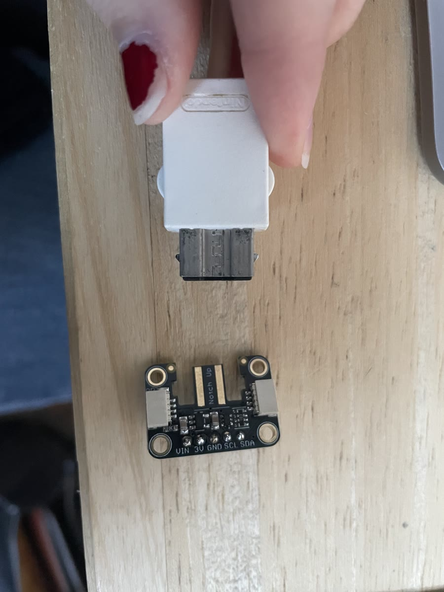

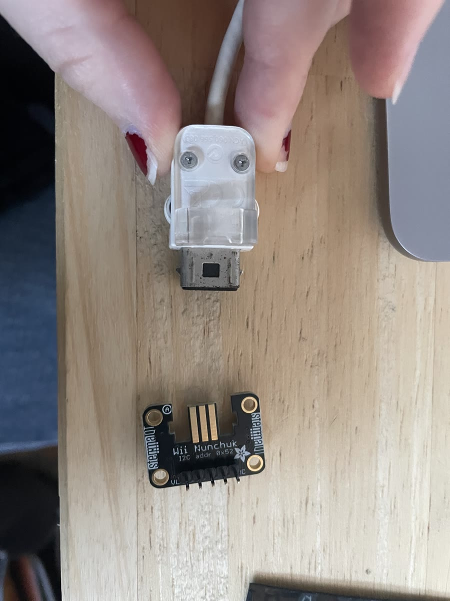

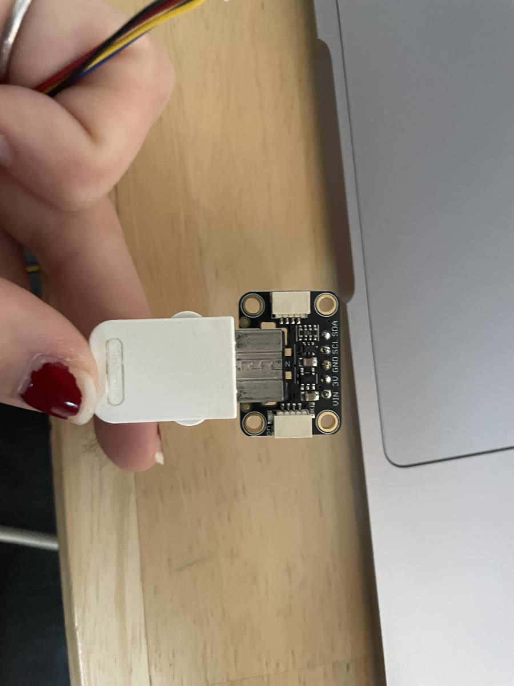

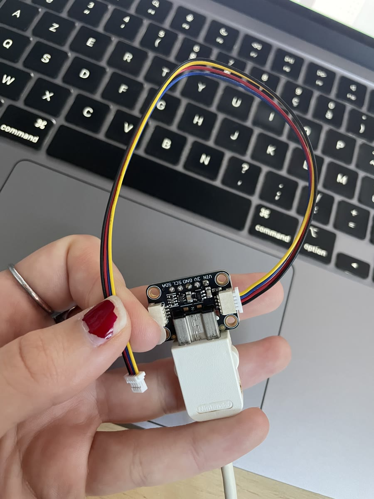

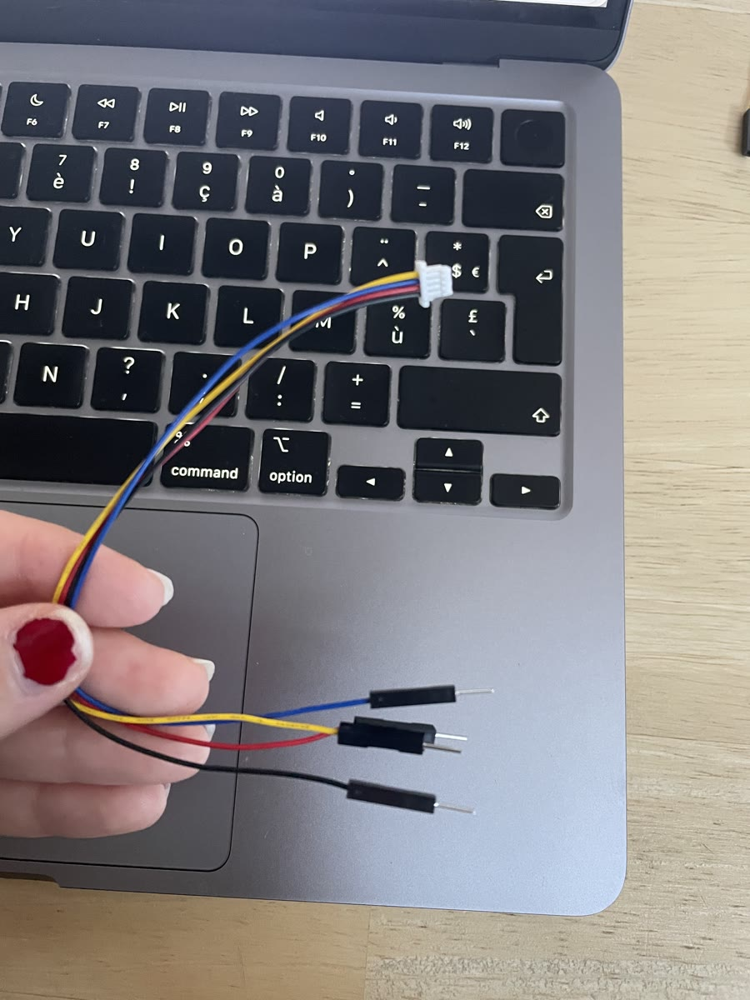

</div>

## A wiring plan made with AI

We asked **Claude (AI)** for help again, with the same prompt as for the accelerometer. This time the plan builds on the setup we already had: the MPU-6050 and the button stay where they are, and we only add four wires.

- The Nunchuk uses the **same four connections** as the MPU-6050: power, ground and the two data wires. So its pins go into the **same rows** as the sensor.
- That's allowed, because both have their **own address**, so the ESP can tell them apart.
- The colours match too: red with red, black with black, yellow with yellow and blue with blue.

<div class="flipbook" aria-label="Claude's wiring plan for the Nunchuk, 7 pages">

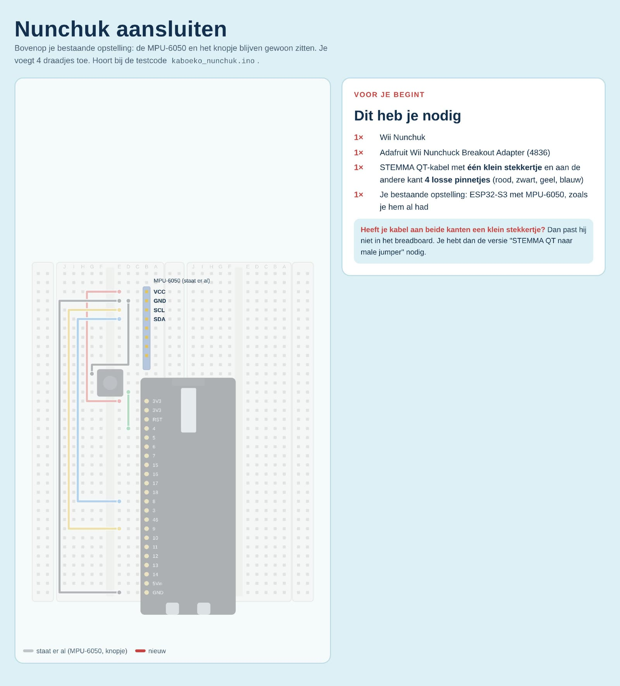

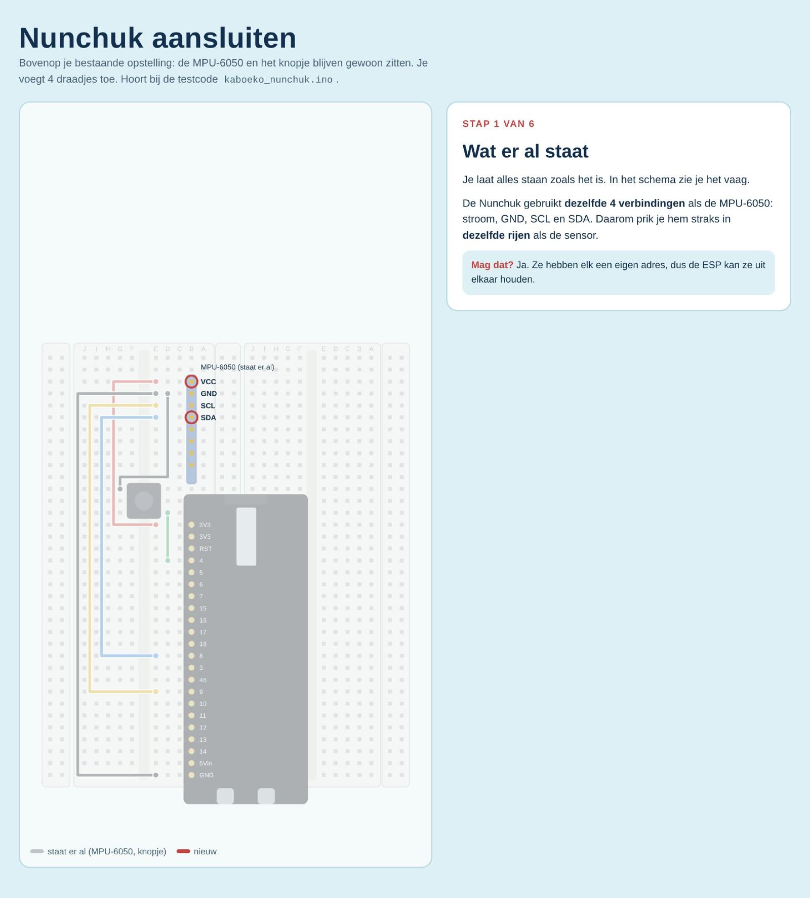

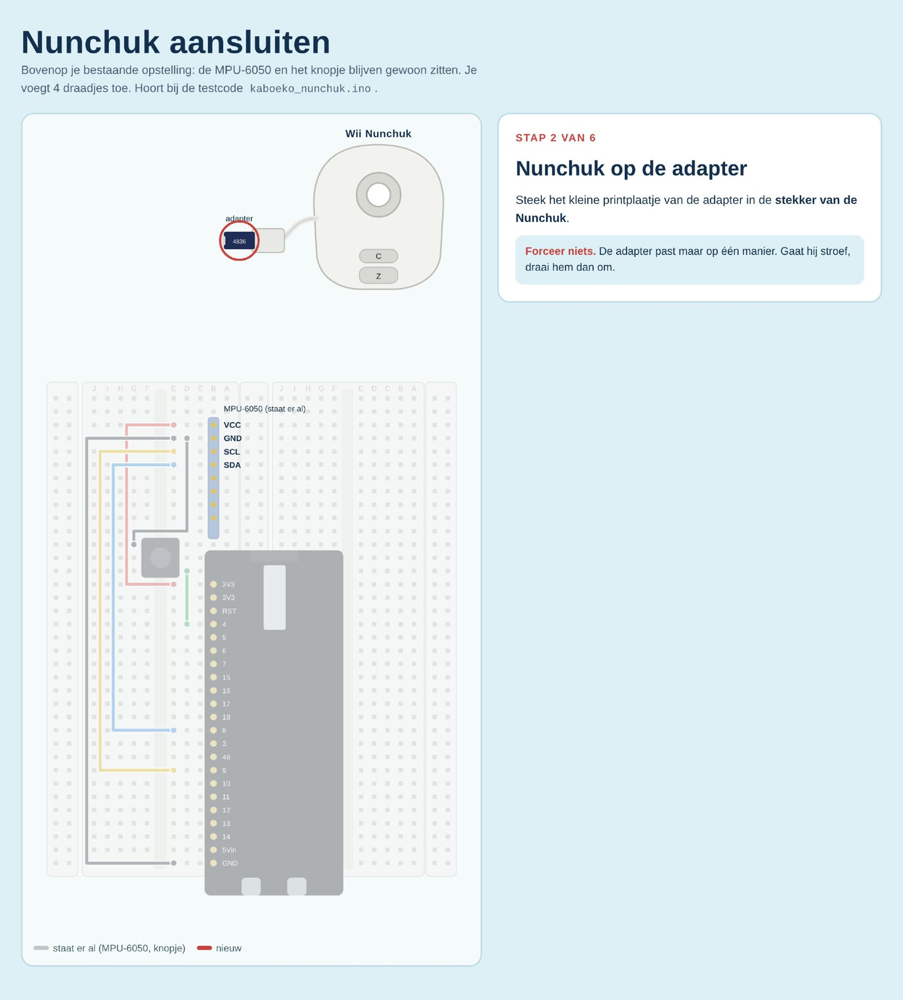

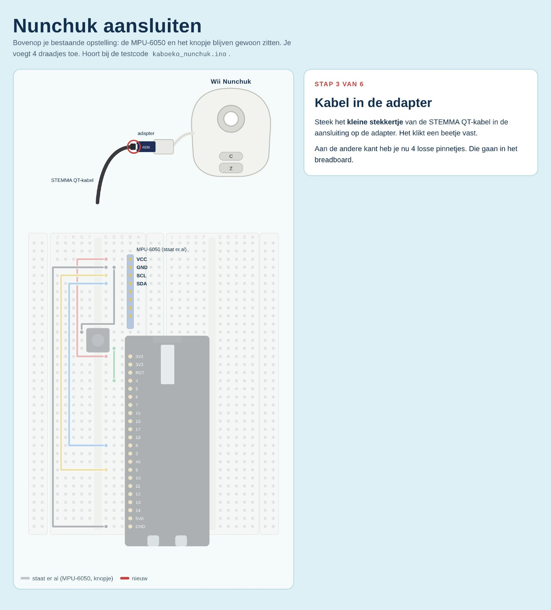


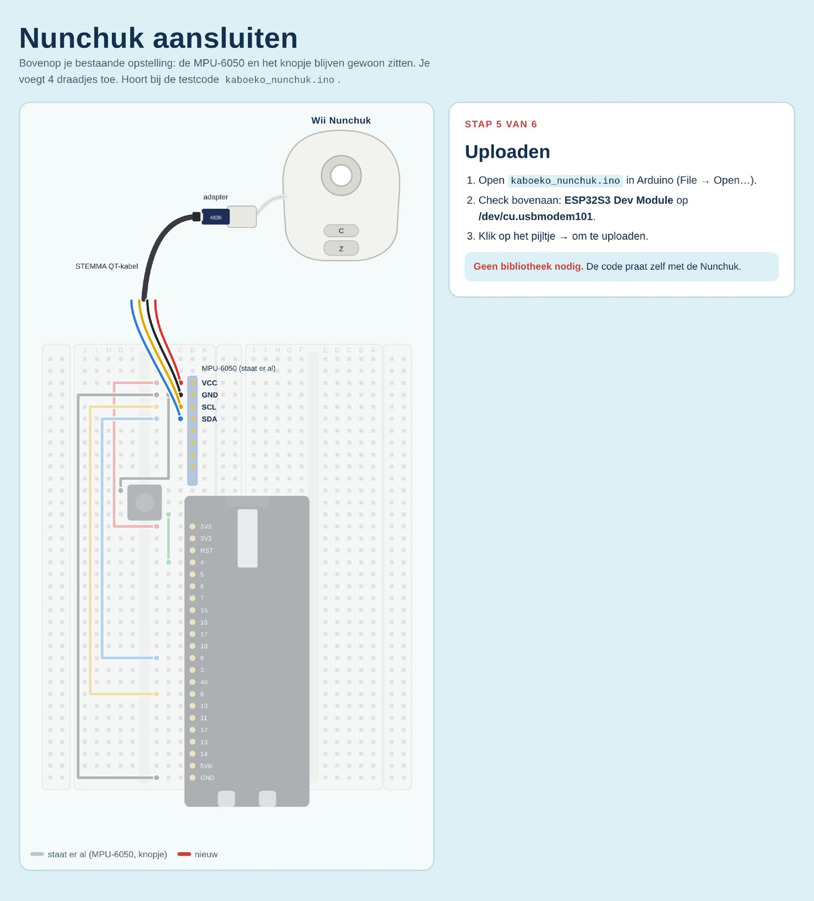

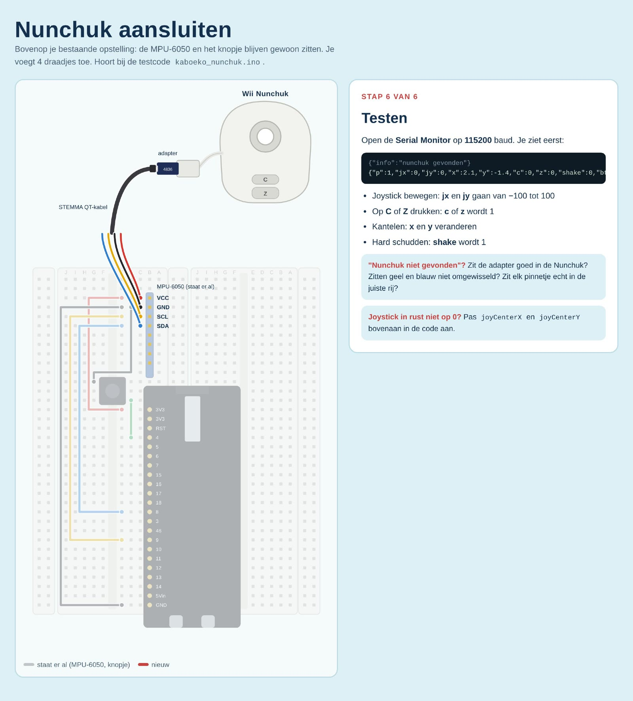

</div>

## The test code

Claude also wrote the test code. It talks to the Nunchuk directly, so we didn't need an extra library. Just like with the accelerometer, it sends one line of data over USB 50 times per second, for example `{"p":1,"jx":0,"jy":0,"x":12.3,"y":-4.1,"bc":0,"bz":0,"shake":0,"btn":0}`:

- `jx` / `jy`: the joystick, from −100 to 100
- `x` / `y`: tilting forward/back and left/right, in degrees
- `bc` / `bz`: the C and Z buttons
- `shake`: 1 when you shake hard
- `btn`: the same as the Z button, so the game code we wrote for the MPU-6050 keeps working

One important difference: the Nunchuk has **no gyroscope**, so it can't measure turning (pointing left and right). It only knows how it's tilted.

<details>
<summary>Show the full Arduino code</summary>

```cpp
// Kaboeko – test controller with a Wii Nunchuk on an ESP32-S3 DevKitC
//
// Connected via the Adafruit Wii Nunchuck Breakout Adapter (4836)
// and a STEMMA QT to jumper cable:
//   red    (V+)  -> ESP32 3V3
//   black  (GND) -> ESP32 GND
//   blue   (SDA) -> ESP32 GPIO 8
//   yellow (SCL) -> ESP32 GPIO 9
// The same pins as the MPU-6050: both may be connected at the same time.
//
// No extra library needed.
//
// What it does: sends one line of JSON over USB 50 times per second, e.g.
//   {"p":1,"jx":0,"jy":0,"x":12.3,"y":-4.1,"bc":0,"bz":0,"shake":0,"btn":0}
//   jx / jy  = joystick, from -100 (left/down) to 100 (right/up)
//   x / y    = tilting forward/back and left/right, in degrees
//   bc / bz  = the C button and the Z button (1 = pressed)
//   btn      = same as bz, so the MPU-6050 game code keeps working
//   shake    = 1 when you shake hard
// Note: the Nunchuk has no gyroscope, so it doesn't measure "turning" (pointing left/right).

#include <Wire.h>

const int PLAYER = 1;          // set to 2 for player 2's controller
const int SDA_PIN = 8;
const int SCL_PIN = 9;
const byte NUNCHUK_ADDR = 0x52;

// How hard you have to shake: 1.0 = gravity, anything above ~1.8 g counts as shaking.
const float SHAKE_THRESHOLD = 1.8;
// About 200 counts = 1 g on a Nunchuk. Adjust if tilting gives too little or too much.
const float COUNTS_PER_G = 200.0;
// Centre position of the joystick (adjust if it isn't 0 at rest).
int joyCenterX = 128;
int joyCenterY = 128;

bool connected = false;
unsigned long lastSend = 0;
unsigned long lastRetry = 0;

bool initNunchuk() {
  // "Unencrypted" start: works with original and with third-party Nunchuks.
  Wire.beginTransmission(NUNCHUK_ADDR);
  Wire.write(0xF0);
  Wire.write(0x55);
  if (Wire.endTransmission() != 0) return false;
  delay(10);
  Wire.beginTransmission(NUNCHUK_ADDR);
  Wire.write(0xFB);
  Wire.write(0x00);
  if (Wire.endTransmission() != 0) return false;
  delay(10);
  return true;
}

bool readNunchuk(byte data[6]) {
  Wire.beginTransmission(NUNCHUK_ADDR);
  Wire.write(0x00);
  if (Wire.endTransmission() != 0) return false;
  delayMicroseconds(500);
  if (Wire.requestFrom(NUNCHUK_ADDR, (uint8_t)6) != 6) return false;
  for (int i = 0; i < 6; i++) data[i] = Wire.read();
  return true;
}

void setup() {
  Serial.begin(115200);
  delay(500);
  Wire.begin(SDA_PIN, SCL_PIN);
  Wire.setClock(100000);

  connected = initNunchuk();
  if (connected) Serial.println("{\"info\":\"nunchuk found\"}");
}

void loop() {
  if (!connected) {
    // Not found: try again every second (so you can also plug it in later).
    if (millis() - lastRetry > 1000) {
      lastRetry = millis();
      connected = initNunchuk();
      if (connected) Serial.println("{\"info\":\"nunchuk found\"}");
      else Serial.println("{\"error\":\"Nunchuk not found: check the adapter and the 4 wires\"}");
    }
    return;
  }

  if (millis() - lastSend < 20) return;  // 20 ms = 50 messages per second
  lastSend = millis();

  byte d[6];
  if (!readNunchuk(d)) {
    connected = false;
    Serial.println("{\"error\":\"lost connection with the Nunchuk\"}");
    return;
  }

  // Joystick: 0..255, centre ~128 -> -100..100
  int jx = constrain((int)((d[0] - joyCenterX) * 100L / 100), -100, 100);
  int jy = constrain((int)((d[1] - joyCenterY) * 100L / 100), -100, 100);

  // Acceleration: 10 bits per axis, centre ~512
  int ax = (d[2] << 2) | ((d[5] >> 2) & 0x03);
  int ay = (d[3] << 2) | ((d[5] >> 4) & 0x03);
  int az = (d[4] << 2) | ((d[5] >> 6) & 0x03);
  float gx = (ax - 512) / COUNTS_PER_G;
  float gy = (ay - 512) / COUNTS_PER_G;
  float gz = (az - 512) / COUNTS_PER_G;

  // Tilting in degrees
  float pitch = atan2(gy, sqrt(gx * gx + gz * gz)) * 180.0 / PI;  // forward/back
  float roll  = atan2(gx, gz) * 180.0 / PI;                         // left/right

  float g = sqrt(gx * gx + gy * gy + gz * gz);
  int shake = g > SHAKE_THRESHOLD ? 1 : 0;

  // Buttons: 0 = pressed in the raw data
  int zBtn = (d[5] & 0x01) ? 0 : 1;
  int cBtn = (d[5] & 0x02) ? 0 : 1;

  Serial.print("{\"p\":");     Serial.print(PLAYER);
  Serial.print(",\"jx\":");    Serial.print(jx);
  Serial.print(",\"jy\":");    Serial.print(jy);
  Serial.print(",\"x\":");     Serial.print(pitch, 1);
  Serial.print(",\"y\":");     Serial.print(roll, 1);
  Serial.print(",\"bc\":");    Serial.print(cBtn);
  Serial.print(",\"bz\":");    Serial.print(zBtn);
  Serial.print(",\"shake\":"); Serial.print(shake);
  Serial.print(",\"btn\":");   Serial.print(zBtn);
  Serial.println("}");
}
```

</details>

In this first setup we tried out every possible movement and the buttons in Arduino IDE. Then we connected it to the history minigame.

## The test in the game

<div class="carousel" aria-label="Photos of playing the history minigame with the Nunchuk">

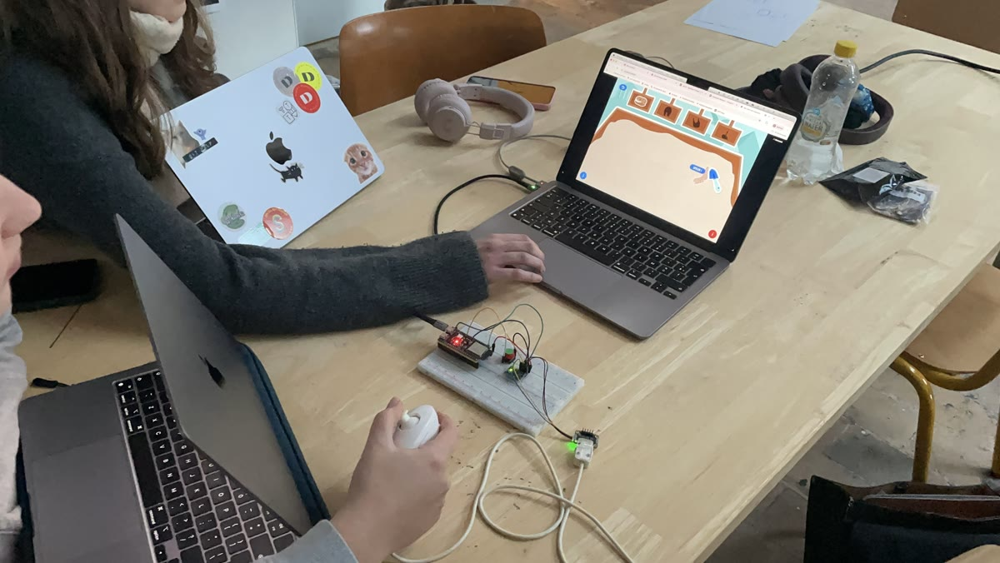

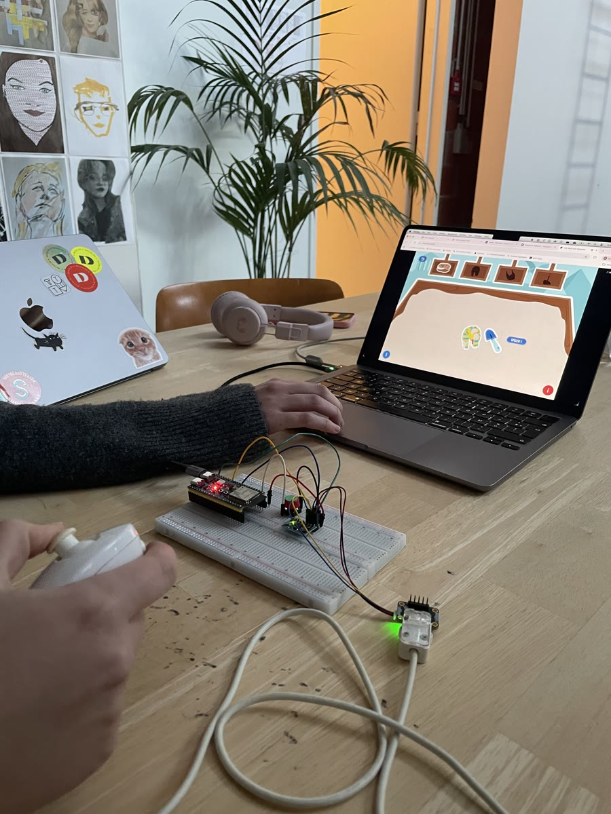

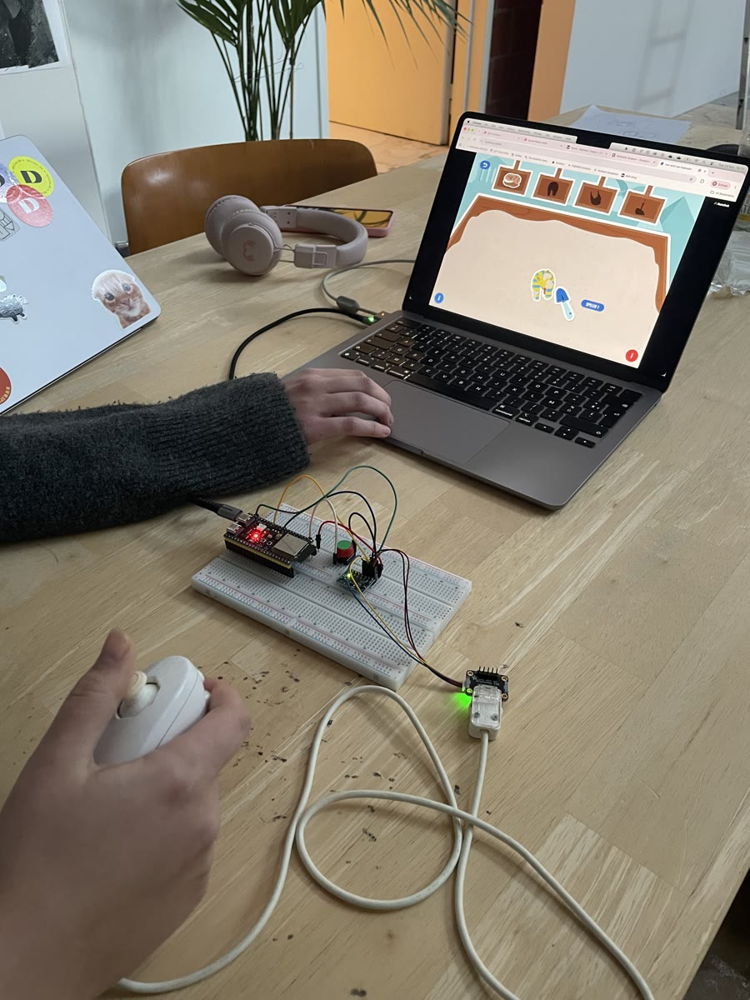

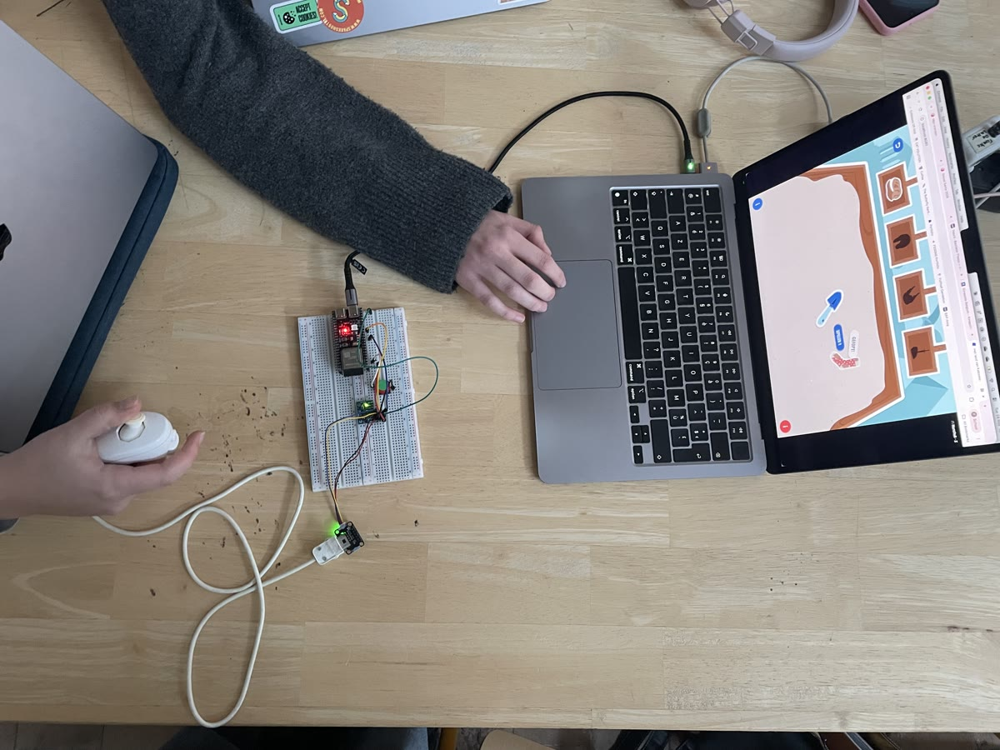

</div>

The Nunchuk steers player 1's shovel. Player 2 still plays with the trackpad.

<video controls playsinline preload="metadata" src="../../videos/nunchuck-test-1.mp4" aria-label="Steering the shovel in the history minigame with the Nunchuk"></video>

What we found so far:

- You **can steer** the Nunchuk with its accelerometer, but it's **very imprecise and awkward**.
- The **joystick works well**, but it misses the **bigger, more intense movements** we want players to make. Moving a joystick with your thumb is a lot less physical than digging or brushing with your whole arm.
- We didn't have a **second board** yet, so we couldn't properly test multiplayer.

## What did we learn?

The Nunchuk is quick to connect and comfortable to hold, thanks to its ready-made casing. But for our games it has two problems. Without a gyroscope it can't point, and steering by tilting is imprecise. And the joystick, which does work well, turns our movement games into thumb games. That's the opposite of what we want: parents and children moving together with big, physical actions.

The motion sensor from our accelerometer test measures turning too, and fits those big movements better. So this test helps us compare the two options on real experience instead of assumptions, which is exactly why we [ordered both](../2026-11-15-technical-research/).

AI made this test fast: it adapted the wiring plan to the setup we already had, and wrote the code to read the Nunchuk without a library.

## Next steps

- Test multiplayer by connecting two ESP32 boards, one for each player, so two people can play at the same time.
- Test both controllers, the Nunchuk and the accelerometer, with children, and take their feedback into account.
- Compare the two options side by side, and choose one for both players.
