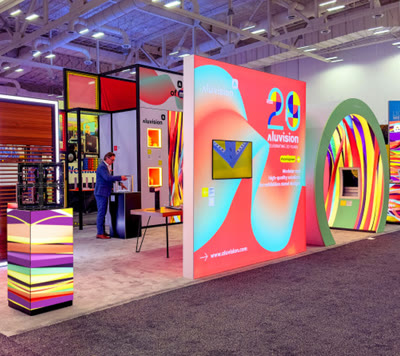
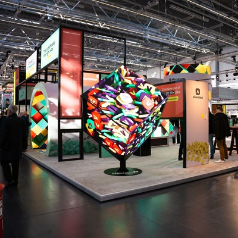
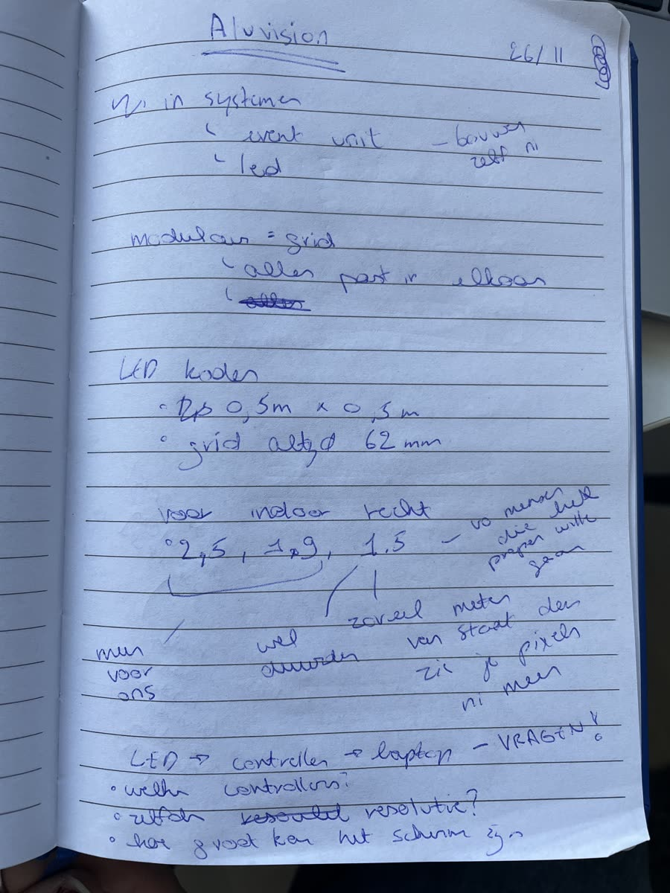
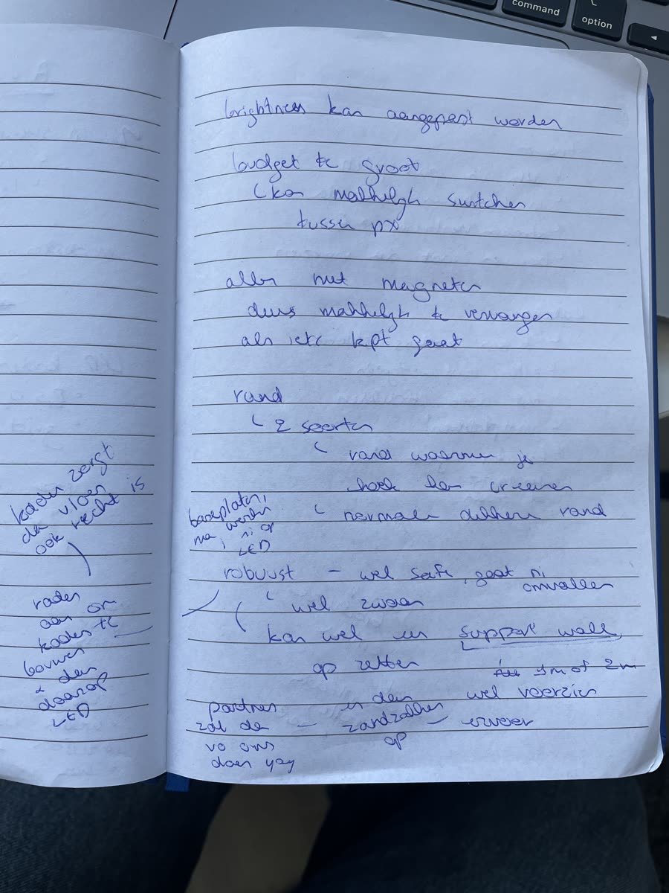
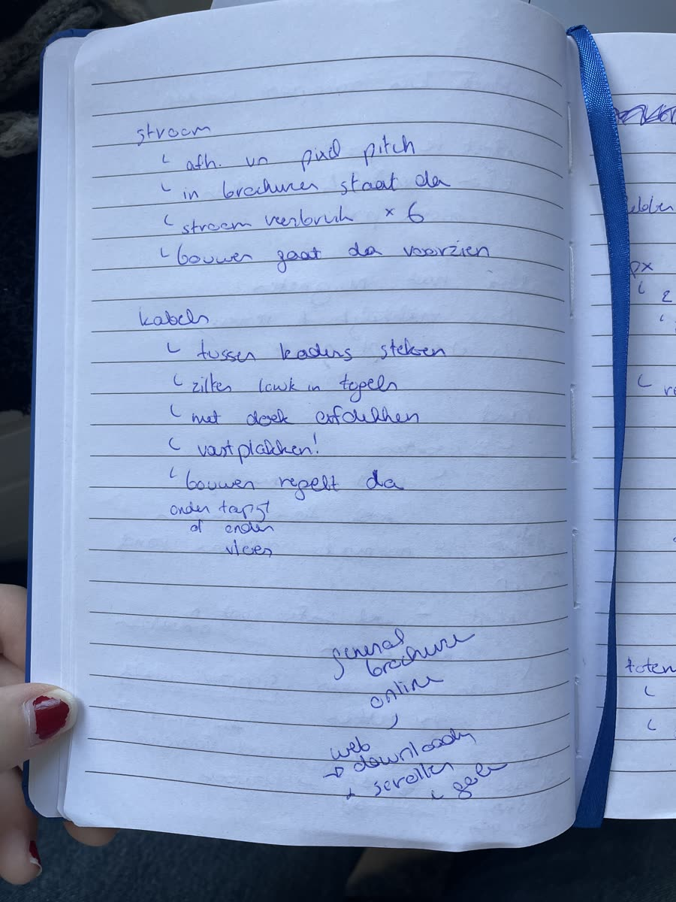
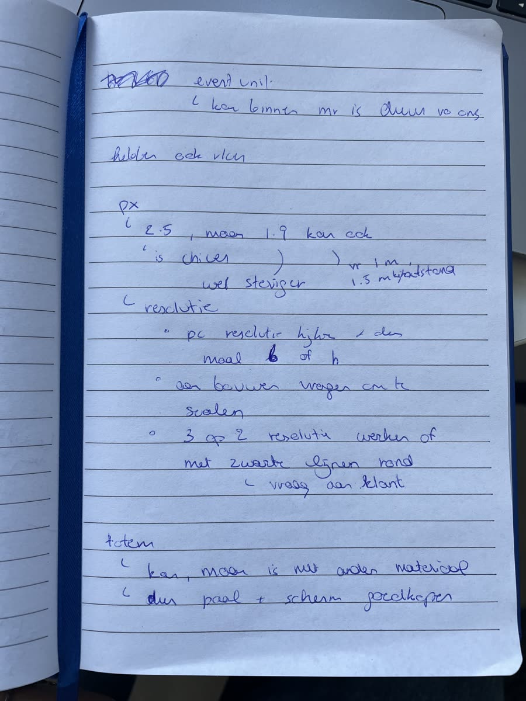

## Why we went

Our client is fairly sure to use an **LED wall** from Aluvision for our game (see our [technical research](../2026-11-15-technical-research/)). So we contacted Aluvision to visit their showroom and ask our technical questions in person.

We prepared a list of questions beforehand and wrote the answers down during the visit. We didn't take any photos ourselves: the person who guided us talked with us the whole visit, and everything we saw is also in their brochure.

## What we wanted to know, and the answers

### What sizes of screens are there?

One LED tile is (just under) **half a metre by half a metre**. How many pixels it has depends on the pixel pitch, the distance between the pixels.

### What's the difference between Aluvision's Hi-LED and Event Units?

**Event Units** are mostly meant for outside. They can be used inside, but they are too expensive for us. For our project they aren't really relevant.

### Which type of screen fits our project best?

**Hi-LED tiles with a pixel pitch of 1.9 or 2.5.** Only if the client really wants the best resolution (and so wants to pay more) should we look at a pitch of 1.5.

### Which contacts do we need for a good rental estimate?

Aluvision doesn't build the screens itself: their clients, the **builders**, do that. They pointed us to **[4U Renting](https://4u-renting.be)**, who rent out and build the walls, including the building costs.

### How should the screens be placed?

- **The ideal distance between the players and the screen:** with a pitch of 1.5, according to them you can't see the pixels anymore from about **1.5 metres**. From there on you get the best result.
- **The recommended pixel pitch for a viewing distance of 1 to 3 metres:** 2.5 or 1.9 is enough for us.

### Could small LED totems be an alternative?

**Yes, that's definitely possible**: their motto is "anything is possible". A totem is a kind of block with their screens hanging on it, like the one on the bottom left of the photo below. If we only want a screen on **one side**, it's cheaper. They also have an existing totem example in their brochure.

### Is the resolution sharp enough?

We wanted to know if a **3 × 2 ratio** is sharp enough, and how many pixels one tile and the whole wall have. That is something we have to ask the **builders**: they can tell us whether our game scales to the screen and stays sharp. Text is possible too, just not too small.

### Building up and breaking down

We asked if it's possible to build up and break down at **two different locations within three weeks**, which partners we can contact for that, and what they need for a price estimate:

- the dimensions
- the number of days
- the locations
- building up
- breaking down

### Can we test on one of their screens?

We hoped to connect a laptop to one of their screens to check the UI, the screen size, the colours, the movements and animations, the readability and the overall visual quality. **That wasn't possible** this time.

## What we told them about our setting

- **The space is an expo where lots of visitors walk around, so the cables can't be visible.** They often work with floors and carpets that hide the cables, and their profiles have holes for cables too. At fairs they recommend hiding the cables well: tape them to the floor if needed and cover them with carpet.
- **The room is quite dark.** The brightness of the screens can be adjusted, so it won't be too bright at Boektopia.
- **The distance between the screen and the controllers has a maximum length.** Linked to this is the safety of the build: our screen idea would need a few support profiles at the back. That means losing space (depth), so we have to think carefully about how much space we actually ask for.

## Everything else we learned

### A modular grid

- Everything is **modular** and works with a grid, so all parts fit together.
- The LED frames are about **0.5 m × 0.5 m**, and the grid on the side is always **62 mm**, so a tile is about **497 × 497 mm**.
- Everything is held with **magnets**, so a broken tile is easy to replace. The builders normally do that, but we'll check.

### Pixel pitch

- There are **2.5, 1.9 and 1.5**. The smaller the number, the more it looks like a TV.
- For us, **2.5 or 1.9** is the better choice. 1.5 is more expensive and only for when you want it really clean.
- If the **budget turns out too big**, you can easily switch to another pixel density.

### The signal

The flow is **LED wall → controller → laptop**. We still have to ask the builders which controllers they use, whether the resolution stays the same, and how big the screen can be.

To check the resolution, we look at our **computer's resolution** (width × height) and ask the builder to scale it. On a 3 × 2 wall, we might have to work with a **black strip** on the tiles, but that isn't the end of the world. That's a question for our client.

### Edges

There are **two kinds of edges**: one that lets you make a sharp corner (like a diamond), and a normal, thicker edge. Both come from the same tile; you just remove parts.

### Safety

- The walls themselves are **robust**: they don't fall over, because the tiles are heavy and click into each other.
- For our idea, a **support wall** of 1 or 2 metres would be used, with **sandbags** on it. The partner would do that for us.
- The builders also look at **base plates** to level the floor. You build from the support walls, not from zero with only tiles, to avoid wonkiness. They recommend building frames first, making sure the floor is straight, and then putting the LED on them.

### Power and cables

- **Power** depends on the pixel pitch and is listed in the brochure, for example the consumption times the number of tiles. The builder provides it.
- **Cables** go between the frames and sit hidden in the tiles. You cover them with cloth, tape them down, or put them under a carpet or a floor. The builders take care of that.

Their **general brochure** is online and downloadable, and our contact at Aluvision will also email it to us.

## What does this mean for us?

In short: at Aluvision we saw **what our installation could look like**, but the **technical side** is something we have to discuss with a **building partner**. Our contact at Aluvision suggested [4U Renting](https://4u-renting.be) for that.

## Our notes

One of my teammates took these notes during the visit. I typed them out on our board, and they are written out above.

## Next steps

- **Sketch out the whole installation:** what will stand where, the sizes, the location and everything that comes with it, including the space and depth for the support walls.
- With that sketch, **contact 4U Renting** for a price estimate and our technical questions: the controllers, the resolution and scaling, and how big the screen can be.
- **Be patient:** our contact at Aluvision warned us that builders are always extremely busy between September and December, so we'll probably have to wait for an answer.
